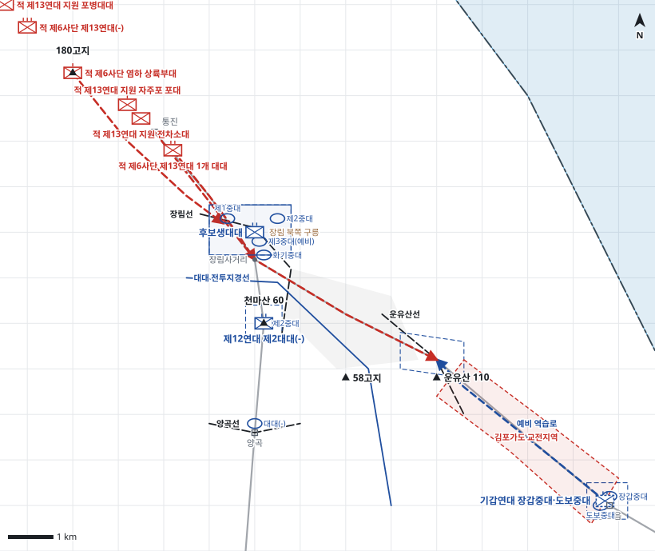

# kb1_039 · 장림-운유산 전투

| 관점 | 임무 유형 | 구간 | 실제 결과 | 좌표 | 보정용 | 사람 검토 |
|---|---|---|---|---|---|---|
| 김포지구전투사령부 | 지연 | t=11~35 (24h) | partial | text | 예 | no |

**구간**: 장림-운유산 전투 전체. 후보생대대가 장림선에서 제12연대 제2대대와 합류해 장림선을 편성한 D일 11:00부터 운유산선 지연을 거쳐 김포읍으로 철수할 때까지(D+1일).

**출처**: 국방부 군사편찬연구소, 『6·25전쟁 주요전투 1』(2017), '장림-운유산 전투' (pdf 193쪽)

| 파일 | 내용 | 생성 모델에 |
|---|---|---|
| [`situation.json`](situation.json) | 상황 (익명화) | 줌 |
| [`coa.json`](coa.json) | pseudo-GT COA (익명화) | 예시로만 |
| [`scenario.json`](scenario.json) | 적 계획·환경 (시뮬레이터 전용) | 주지 않음 |
| [`history.json`](history.json) | 실제 경과 (평가 전용) | 주지 않음 |
| [`source.json`](source.json) | 출처·결과 라벨·자동 검사 | 주지 않음 |
| [`real_names/`](real_names) | 상황·COA 실명판 | 주지 않음 |

## 약도

## pseudo-GT COA (실명판)

**전투편성** 후보생대대, 제12연대 제2대대(-), 기갑연대 장갑중대·도보중대(예비) / 지원: 없음(후보생대대 화기중대 박격포)
**1. 상황**
  **가. 지형** 장림사거리는 48번 도로와 305번 도로의 분기점으로 김포읍과 양곡 방면을 함께 통제한다. 장림 북쪽 구릉과 천마산이 두 도로를 제압하고, 김포평야 너머 운유산이 김포읍 앞 마지막 방어 요충이다. 적의 주접근로는 통진-김포가도이며 염하변 180고지 방면에서 좌측방으로 침투할 수 있다.
  **나. 적** 적 제13연대는 포병·자주포·전차 지원 아래 통진-김포가도를 따라 장림사거리로 공격해 올 것이다. 1개 대대는 48번 도로로 장림을 정면 공격하고, 염하 상륙부대는 180고지에서 장림선 좌측방으로 침투해 올 것이다. 장림을 돌파하면 연대 주력이 김포평야를 지나 운유산과 김포읍으로 공격해 올 것이다.
  **다. 가정**
    **(1)** 대대 세부 보충: 후보생대대는 2개 중대를 일선, 1개 중대를 예비로 두고 화기중대는 장림 남쪽에 둔다.
    **(2)** 제12연대 제2대대는 제2중대 외 병력을 양곡 부근에서 수습한다.
    **(3)** 적 기갑과 자주포는 48번 도로 축으로만 기동한다.
**2. 임무** 김포지구전투사령부는 D일 11:00부터 장림사거리와 운유산 일대에서 적 제13연대를 지연하여 적의 김포읍·영등포 방면 진출을 늦추고 아군의 퇴로를 확보한다.
**3. 실시**
  **가. 최종상태** 적 제13연대가 운유산선 앞에서 저지되고 사령부는 전투력을 유지한 채 김포읍을 확보한다.
  **나. 작전개념** 장림선에서 후보생대대와 제12연대 제2대대로 김포읍과 양곡 두 도로를 막아 적을 지연한다. 장림선이 압박받으면 후보생대대는 운유산선으로, 제12연대 제2대대는 양곡으로 지연한다. 기갑연대 장갑중대·도보중대는 김포읍에서 김포가도 돌파에 대비해 역습을 준비한다.
    **(1) 기동** 주력 후보생대대는 장림 북쪽 구릉에서 48번 도로를 제압하고 운유산선으로 지연하며, 제12연대 제2대대(-)는 천마산에서 장림-양곡 도로를 차단한다. 예비는 김포읍에서 김포가도로 역습한다.
    **(2) 화력** 포병 지원이 없으므로 후보생대대 화기중대 박격포를 장림 북쪽 48번 도로 접근로에 집중한다.
  **다. 예하부대 과업**
    **(1) 후보생대대** 장림 북쪽 구릉 진지를 점령한다. 장림선에서 운유산선까지 48번 도로를 따라 적을 지연한다. 운유산 북쪽 진지에서 방어한다.
    **(2) 제12연대 제2대대(-)** 천마산 진지를 점령한다. 장림-양곡 도로를 차단한다. 명에 의해 양곡까지 305번 도로를 따라 적을 지연한다.
    **(3) 기갑연대 장갑중대·도보중대** 김포읍 예비진지를 점령한다. 명에 의해 김포가도를 따라 운유산 북쪽으로 역습한다.
  **라. 협조지시**
    **(1) 시간계획** D일 12:00 장림선 진지 점령 완료 / D일 12:00 예비 김포읍 역습 준비 완료
    **(2) 통제수단** 장림선, 운유산선, 장림 북쪽 구릉 진지, 천마산 진지, 운유산 북쪽 진지, 양곡선, 김포읍 예비진지, 김포가도 교전지역, 예비 역습로, 대대 전투지경선
