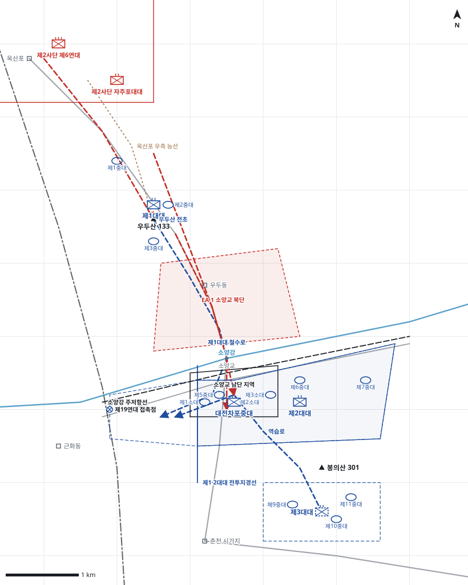

# kb1_043 · 소양교 전투

| 관점 | 임무 유형 | 구간 | 실제 결과 | 좌표 | 보정용 | 사람 검토 |
|---|---|---|---|---|---|---|
| 제6사단 제7연대 | 지역방어 | t=3~36 (33h) | partial | text | 예 | no |

**구간**: 소양교 전투 전체: 제7연대가 옥산포 역습 뒤 소양강 남안 주저항선으로 물러나 방어를 시작한 D일 03:00부터 주저항선이 돌파되어 춘천 시가지로 철수를 결심한 D+1일 정오까지

**출처**: 국방부 군사편찬연구소, 『6·25전쟁 주요전투 1』(2017), '소양교 전투' (pdf 202쪽)

| 파일 | 내용 | 생성 모델에 |
|---|---|---|
| [`situation.json`](situation.json) | 상황 (익명화) | 줌 |
| [`coa.json`](coa.json) | pseudo-GT COA (익명화) | 예시로만 |
| [`scenario.json`](scenario.json) | 적 계획·환경 (시뮬레이터 전용) | 주지 않음 |
| [`history.json`](history.json) | 실제 경과 (평가 전용) | 주지 않음 |
| [`source.json`](source.json) | 출처·결과 라벨·자동 검사 | 주지 않음 |
| [`real_names/`](real_names) | 상황·COA 실명판 | 주지 않음 |

## 약도

## pseudo-GT COA (실명판)

**전투편성** 제1대대, 제2대대, 제3대대(예비), 대전차포중대 / 지원: 제16포병대대(-) 제1·2포대
**1. 상황**
  **가. 지형** 봉의산은 소양강과 우두산을 감제하는 핵심 지형이다. 소양교는 춘천 시내로 들어가는 유일한 교량이다. 적의 주접근로는 옥산포-우두동-소양교 도로이고, 서쪽 가래모기 도섭점이 보조 접근로다.
  **나. 적** 적 제2사단은 새벽에 우두산을 공격할 것이다. 여명 뒤 포병 공격준비사격과 SU-76 자주포의 직접조준사격으로 남안 화기진지를 제압하고 소양교 정면으로 주공을 지향할 것이다. 제6연대 일부는 가래모기에서 근화동으로 조공해 오고, 자주포는 소양교를 건너 남안으로 돌입을 시도할 것이다.
  **다. 가정**
    **(1)** 제1대대는 우두산에서 적을 지연한 뒤 여명 전에 남안 진지로 철수할 수 있다.
    **(2)** 제19연대는 D일 오전 중 근화동 일대 남안을 점령해 연대 좌측을 엄호한다.
    **(3)** 대대 세부 보충: 제3대대는 봉의산 후사면에 예비로, 제2대대는 소양교 동측 남안에 둔다.
**2. 임무** 제7연대는 D일 05:00까지 소양강 남안 주저항선을 점령하고 소양교 정면에서 적 제2사단의 도하를 저지하여 춘천 시가지로의 적 진출을 거부한다.
**3. 실시**
  **가. 최종상태** 연대가 봉의산과 소양교 남단을 확보하고, 적은 소양강 북안에서 도하하지 못한다.
  **나. 작전개념** 제1대대가 우두산에서 적을 지연하는 동안 제2대대가 남안 진지에서 철수를 엄호한다. 이후 제1·2대대는 남안 주저항선에서 소양교 북단 교전지역에 화력을 집중해 도하를 저지하고, 대전차포중대는 교량 남단에서 자주포를 차단한다. 제3대대는 봉의산 후사면에서 교두보 역습을 준비한다.
    **(1) 기동** 제1대대는 우두산에서 지연한 뒤 소양교로 철수해 교량 서측 남안을 방어한다. 제2대대는 교량과 봉의산 북사면을 방어한다. 주력은 소양교 정면의 제2대대다.
    **(2) 화력** 포병은 제1대대가 철수하는 동안 우두산 전방에 집중사격하고, 이후 소양교 북단 교전지역과 우두동 접근로에 화력을 집중한다. 대전차포는 교량 남단에서 직접조준한다.
  **다. 예하부대 과업**
    **(1) 제1대대** 우두산에서 소양강까지 적의 남하를 지연한다. 철수로를 따라 소양교 서측 남안 진지로 철수한다. 소양교 서측 남안 진지를 방어한다.
    **(2) 제2대대** 제1대대의 소양교 철수를 엄호한다. 소양교 정면 남안 진지를 방어한다.
    **(3) 제3대대** 명에 의해 소양교 남단 교두보로 역습한다. 명에 의해 제1대대 진지로 역습한다.
    **(4) 대전차포중대** 적 자주포의 소양교 통과를 차단한다.
  **라. 협조지시**
    **(1) 시간계획** D일 05:00 제1대대 남안 진지 점령 완료 / D일 05:00 제3대대 예비진지 준비 완료 / D일 05:30 포병 엄호 집중사격 개시
    **(2) 통제수단** 제1대대 진지, 제2대대 진지, 예비진지, EA 1 소양교 북단, 제1·2대대 전투지경선, 제1대대 철수로, 역습로, 소양강 주저항선, 우두산 전초, 연대 방어지역, 제19연대 접촉점, 소양교 남단 지역
