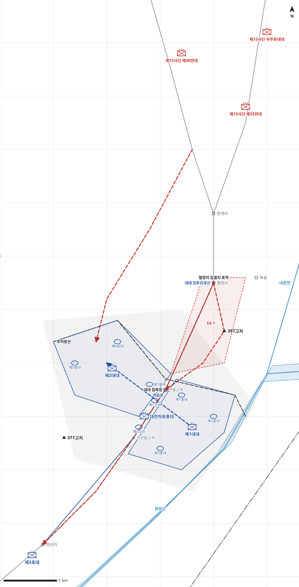

# kb1_047 · 말고개 전투

| 관점 | 임무 유형 | 구간 | 실제 결과 | 좌표 | 보정용 | 사람 검토 |
|---|---|---|---|---|---|---|
| 국군 제6사단 제2연대 | 지역방어 | t=-7~62 (69h) | success | text | 예 | no |

**구간**: 말고개 전투 전체. 1950-06-26 17:00 연대가 말고개 방어진지를 편성한 때부터 1950-06-29 14:00 사단의 홍천 철수 지시까지.

**출처**: 국방부 군사편찬연구소, 『6·25전쟁 주요전투 1』(2017), '말고개 전투' (pdf 211쪽)

| 파일 | 내용 | 생성 모델에 |
|---|---|---|
| [`situation.json`](situation.json) | 상황 (익명화) | 줌 |
| [`coa.json`](coa.json) | pseudo-GT COA (익명화) | 예시로만 |
| [`scenario.json`](scenario.json) | 적 계획·환경 (시뮬레이터 전용) | 주지 않음 |
| [`history.json`](history.json) | 실제 경과 (평가 전용) | 주지 않음 |
| [`source.json`](source.json) | 출처·결과 라벨·자동 검사 | 주지 않음 |
| [`real_names/`](real_names) | 상황·COA 실명판 | 주지 않음 |

## 약도

## pseudo-GT COA (실명판)

**전투편성** 제1대대, 제2대대, 대전차포중대 / 지원: 제6사단 포병 제3포대(직접지원)
**1. 상황**
  **가. 지형** 큰말고개와 작은말고개는 44번 도로와 철정리 저지대를 감제하는 핵심 지형이다. 작은말고개의 굽은 도로는 대전차 방어에 유리하고 화양강이 남동측방을 막는다. 주 접근로는 한계리·철정리에서 말고개로 오는 44번 도로이고, 보조 접근로는 서측 능선이다.
  **나. 적** 적 제12사단은 제32연대와 제30연대로 한계리·철정리에 집결한 뒤 자주포를 앞세워 44번 도로를 따라 공격해 올 것이다. 제32연대는 도로 축선으로 말고개를 돌파하려 하고, 제30연대는 서측 능선으로 제2대대 진지를 공격해 올 것이다. 공격 전에 포격을 집중하고 야간에도 침투를 되풀이할 것이다.
  **다. 가정**
    **(1)** 대대 세부 보충: 각 대대는 3개 소총중대를 일선에 배치하고 중대 위치는 추정한다.
    **(2)** 연대는 2개 대대만 가용하며 별도 예비가 없다.
    **(3)** 사단 포병 1개 포대가 연대를 직접지원한다.
    **(4)** 화양강 때문에 적은 남동측으로 우회하지 못한다.
**2. 임무** 제2연대는 D일 04:00까지 말고개 일대에 진지를 점령하고 방어하여 적 제12사단의 44번 도로 돌파를 저지하고 홍천을 보호한다.
**3. 실시**
  **가. 최종상태** 연대가 큰말고개와 작은말고개를 확보하고 적 자주포와 보병을 말고개 전방에서 저지한다.
  **나. 작전개념** 2개 대대를 도로 양측 감제고지에 나란히 두어 말고개를 방어한다. 대전차포는 작은말고개 굽은 도로에서 자주포를 저지하고, 포병은 철정리 집결지를 친다. 예비가 없으므로 제1대대가 제2대대 지역 역습을 대비한다.
    **(1) 기동** 제2대대는 좌일선 큰말고개 서측 능선을, 제1대대는 우일선 도로 동측에서 화양강까지를 방어한다. 적이 제2대대 진지에 돌입하면 제1대대가 역습로를 따라 역습한다.
    **(2) 화력** 제3포대는 철정리 적 집결지를 먼저 화력공격하고, 이어서 EA 1에 들어온 적을 사격해 제2대대를 지원한다.
  **다. 예하부대 과업**
    **(1) 제1대대** 도로 동측에서 화양강까지 BP1을 방어한다. 명에 의해 역습로를 따라 제2대대 지역으로 역습한다.
    **(2) 제2대대** 큰말고개 서측 능선의 BP2를 방어한다. 큰말고개를 고수한다.
    **(3) 대전차포중대** 작은말고개 굽은 도로에서 EA 1로 들어오는 적 자주포를 저지한다.
    **(4) 제3포대** 철정리 적 집결지를 화력공격한다. EA 1의 적을 사격해 제2대대를 화력지원한다.
  **라. 협조지시**
    **(1) 시간계획** 대전차포 진지 점령 완료 D-1일 22:00 / 일선 대대 진지 점령·구축 완료 D일 04:00 / 제3포대 성산리 진지 점령, 철정리 사격 준비 완료 D일 06:00
    **(2) 통제수단** 제1대대 진지, 제2대대 진지, 대대 전투지경선, 주저항선, 대대 접촉점, EA 1, 철정리 집결지 표적, 역습로
