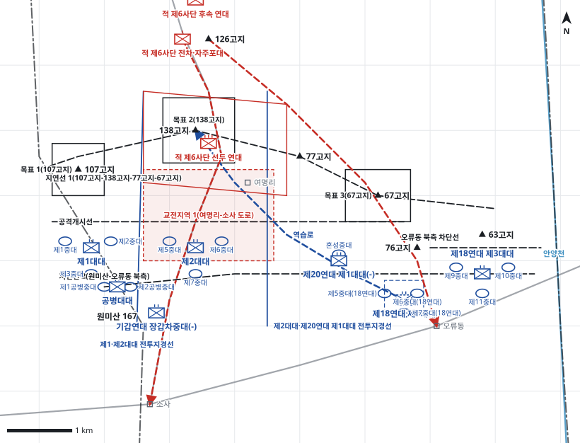

# kb1_054 · 원미산-오류동 전투

| 관점 | 임무 유형 | 구간 | 실제 결과 | 좌표 | 보정용 | 사람 검토 |
|---|---|---|---|---|---|---|
| 김포지구전투사령부 | 지연 | t=9~60 (51h) | success | text | 예 | no |

**구간**: 최영희 대령이 김포지구전투사령관으로 임명된 직후 6개 대대로 138고지-107고지선 탈취 공격을 결심한 때부터 7월 3일 오전 안양천을 따라 철수할 때까지

**출처**: 국방부 군사편찬연구소, 『6·25전쟁 주요전투 1』(2017), '원미산-오류동 전투' (pdf 227쪽)

| 파일 | 내용 | 생성 모델에 |
|---|---|---|
| [`situation.json`](situation.json) | 상황 (익명화) | 줌 |
| [`coa.json`](coa.json) | pseudo-GT COA (익명화) | 예시로만 |
| [`scenario.json`](scenario.json) | 적 계획·환경 (시뮬레이터 전용) | 주지 않음 |
| [`history.json`](history.json) | 실제 경과 (평가 전용) | 주지 않음 |
| [`source.json`](source.json) | 출처·결과 라벨·자동 검사 | 주지 않음 |
| [`real_names/`](real_names) | 상황·COA 실명판 | 주지 않음 |

## 약도

## pseudo-GT COA (실명판)

**전투편성** 제1대대, 제2대대, 제20연대 제1대대(-), 공병대대, 제18연대 제2대대, 제18연대 제3대대, 기갑연대 장갑차중대(-)
**1. 상황**
  **가. 지형** 138고지와 107고지는 비행장-소사 도로와 경인국도를 내려다보는 핵심 지형이다. 적의 주 접근로는 비행장에서 여명리를 거쳐 소사로 내려오는 도로이고, 부 접근로는 126고지에서 오류동으로 향하는 구릉이다.
  **나. 적** 적 제6사단은 138고지-여명리에서 방어하다가 전차를 앞세워 소사로 역습해 올 것이다. 1개 연대는 비행장-소사 도로로 경인국도를 차단하려 하고, 1개 연대는 126고지에서 오류동으로 공격해 올 것이다.
  **다. 가정**
    **(1)** 원미산 혼성부대는 원미산을 계속 확보한다.
    **(2)** 포병 지원은 없고 장갑차와 로켓포가 주 화력이다.
    **(3)** 대대 세부 보충: 대대별 공격대기지점, 중대 위치, 제18연대 제2대대의 예비 지정은 서술과 모순되지 않게 보충했다.
**2. 임무** 김포지구전투사령부는 D일 13:00 공격하여 138고지-107고지선을 탈취하고 이 선과 오류동 북쪽에서 적 제6사단의 경인국도 진출을 지연하여 시흥지구전투사령부의 서측방을 보호한다.
**3. 실시**
  **가. 최종상태** 138고지-107고지선과 오류동 북쪽을 확보하고 적이 경인국도에 진출하지 못한 상태다.
  **나. 작전개념** 3개 대대가 나란히 공격해 77고지-138고지-107고지선을 탈취하고 지연선 1을 편성한다. 제18연대 2개 대대는 오류동 북쪽을 막고 1개 대대는 예비로 둔다. 지연선 1이 무너지면 원미산-오류동 선에서 지연한다.
    **(1) 기동** 좌일선 제1대대가 장갑차와 공병대대 지원으로 107고지, 중앙 제2대대가 138고지, 우일선 제20연대 제1대대(-)가 67고지를 탈취한다.
    **(2) 화력** 장갑차중대는 제1대대를, 대대 박격포와 로켓포는 각 대대를 지원한다. 화력 우선은 제1대대, 이어서 제2대대다.
  **다. 예하부대 과업**
    **(1) 제1대대** D일 13:00 공격하여 107고지를 탈취한다. 지연선 1과 지연선 2에서 적의 소사 진출을 지연한다.
    **(2) 제2대대** D일 13:00 공격하여 138고지를 탈취한다. 지연선 1과 지연선 2에서 비행장-소사 도로의 적을 지연한다.
    **(3) 제20연대 제1대대(-)** D일 13:00 공격하여 67고지를 탈취한다. 지연선 1 동단에서 적을 지연한다.
    **(4) 공병대대** 제1대대를 후속지원한다. 107고지 동쪽 안부를 확보한다.
    **(5) 제18연대 제2대대** 오류동 서북쪽에서 경인국도 북측 접근로를 차단한다. 명에 의해 138고지 방향으로 역습한다.
    **(6) 제18연대 제3대대** 오류동 동북쪽에서 영등포 방향 침투로를 차단한다. 명에 의해 오류동 북쪽에서 적을 지연한다.
    **(7) 기갑연대 장갑차중대(-)** 제1대대의 107고지 공격을 화력지원한다.
  **라. 협조지시**
    **(1) 시간계획** D일 12:00 공격대기지점 점령 완료 / D일 13:00 H시 공격 개시 / D일 20:00 지연선 1 진지 편성 완료
    **(2) 통제수단** 공격개시선, 목표 1(107고지), 목표 2(138고지), 목표 3(67고지), 지연선 1(107고지-138고지-77고지-67고지), 지연선 2(원미산-오류동 북측), 오류동 북측 차단선, 교전지역 1(여명리-소사 도로), 제1·제2대대 전투지경선, 제2대대·제20연대 제1대대 전투지경선, 예비진지, 역습로
