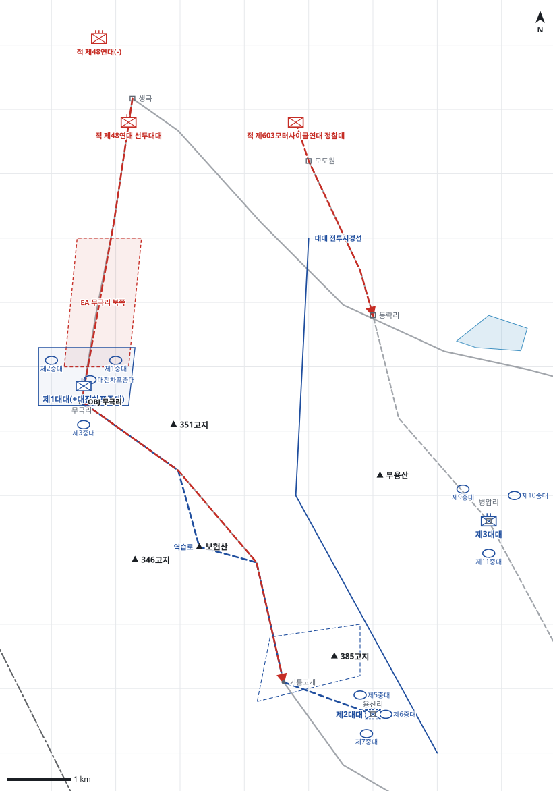

# kb1_062 · 무극리 전투

| 관점 | 임무 유형 | 구간 | 실제 결과 | 좌표 | 보정용 | 사람 검토 |
|---|---|---|---|---|---|---|
| 제7연대 | 지역방어 | t=2~32 (30h) | partial | atlas+text | 아니오 | yes |

**구간**: 무극리 전투 전체, D일 02:00부터 30시간

**출처**: 국방부 군사편찬연구소, 『6·25전쟁 주요전투 1』(2017), '무극리 전투' (pdf 244쪽)

| 파일 | 내용 | 생성 모델에 |
|---|---|---|
| [`situation.json`](situation.json) | 상황 (익명화) | 줌 |
| [`coa.json`](coa.json) | pseudo-GT COA (익명화) | 예시로만 |
| [`scenario.json`](scenario.json) | 적 계획·환경 (시뮬레이터 전용) | 주지 않음 |
| [`history.json`](history.json) | 실제 경과 (평가 전용) | 주지 않음 |
| [`source.json`](source.json) | 출처·결과 라벨·자동 검사 | 주지 않음 |
| [`real_names/`](real_names) | 상황·COA 실명판 | 주지 않음 |

## 약도

## pseudo-GT COA (실명판)

**전투편성** 제1대대(+대전차포중대), 제2대대, 제3대대 / 지원: 제16야전포병대대 제2포대(직접지원)
**1. 상황**
  **가. 지형** 무극리는 생극-무극리 도로와 무극리-음성 도로의 교차점으로 적의 음성 진출 관문이다. 기름고개와 385고지는 무극리-음성 도로를 감제하는 최후 저지선이다. 주접근로는 생극-무극리-기름고개 도로이고, 보조접근로는 모도원-동락리 통로다.
  **나. 적** 적 제48연대는 생극에서 생극-무극리 도로를 따라 무극리를 거쳐 기름고개로 공격해 올 것이다. 1개 대대가 선두로 무극리를 지나고 연대 주력이 후속할 것이다. 적 제603모터사이클연대 정찰대는 모도원-동락리 통로로 침투해 올 것이다.
  **다. 가정**
    **(1)** 적 주력은 생극-무극리 도로로 남하한다.
    **(2)** 제1사단 전개 전 상급 사단의 증원은 없다.
    **(3)** 대대 세부 보충: 대전차포중대 배속, 중대 배치와 예비진지는 추정이다.
**2. 임무** 제7연대는 D일 02:00부터 무극리-음성 도로 일대에서 적 제48연대의 남하를 저지하여 음성을 확보하고 제1사단의 음성 전개를 엄호한다.
**3. 실시**
  **가. 최종상태** 제1대대가 무극리를 점령해 적을 그 북쪽에서 저지하고 음성 도로를 아군이 통제한다.
  **나. 작전개념** 제1대대를 주력으로 무극리에 투입해 적 남하를 저지한다. 제2대대는 모도원에서 반전해 용산리에서 역습을 준비하고 제3대대는 병암리에서 동락리 방면을 경계한다.
    **(1) 기동** 제1대대는 무극리-음성 도로로 무극리를 점령한다. 적이 먼저 무극리에 이르면 기름고개-385고지에서 방어하고, 적 선두대대가 약화되면 보현산을 거쳐 무극리를 탈취한다.
    **(2) 화력** 제2포대는 제1대대를 직접지원해 생극-무극리 도로와 기름고개 전방에 화력을 집중한다.
  **다. 예하부대 과업**
    **(1) 제1대대(+대전차포중대)** 무극리-음성 도로로 기동해 무극리를 점령한다. 생극-무극리 도로에서 적 제48연대의 남하를 저지한다. 명에 의해 기름고개-385고지 진지를 방어한다. 명에 의해 보현산을 거쳐 무극리를 탈취한다.
    **(2) 제2대대** D일 05:00까지 모도원 일대를 경계한다. 모도원-음성 통로로 용산리까지 철수한다. 명에 의해 기름고개를 거쳐 보현산으로 역습한다.
    **(3) 제3대대** 병암리를 점령한다. 동락리-부용산 방면을 경계한다.
  **라. 협조지시**
    **(1) 시간계획** D일 02:00 명령 하달 / D일 05:00 제2대대 모도원에서 반전 / D일 06:00 제1대대 무극리로 출발 / D일 10:00 제3대대 병암리 점령 완료 / D일 12:00 제1대대 무극리 점령, 제2대대 예비 준비 완료
    **(2) 통제수단** EA 무극리 북쪽, 기름고개-385고지 예비진지, OBJ 무극리, 역습로, 동락리 경계지역, 대대 전투지경선
