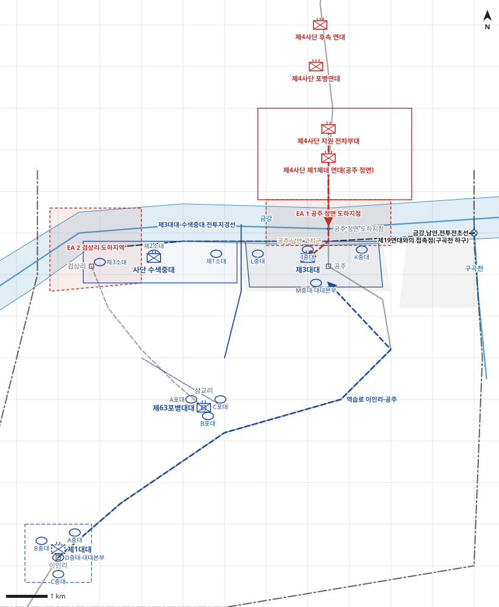

# kb1_070 · 공주 전투

| 관점 | 임무 유형 | 구간 | 실제 결과 | 좌표 | 보정용 | 사람 검토 |
|---|---|---|---|---|---|---|
| 미 제24사단 제34연대 | 지역방어 | t=-30~24 (54h) | failure | text | 예 | no |

**구간**: 공주 전투 전체: 미 제34연대의 공주 금강선 방어 배치(7.12)부터 북한군 제4사단 도하 공격과 연대 철수(7.14)까지

**출처**: 국방부 군사편찬연구소, 『6·25전쟁 주요전투 1』(2017), '공주 전투' (pdf 261쪽)

| 파일 | 내용 | 생성 모델에 |
|---|---|---|
| [`situation.json`](situation.json) | 상황 (익명화) | 줌 |
| [`coa.json`](coa.json) | pseudo-GT COA (익명화) | 예시로만 |
| [`scenario.json`](scenario.json) | 적 계획·환경 (시뮬레이터 전용) | 주지 않음 |
| [`history.json`](history.json) | 실제 경과 (평가 전용) | 주지 않음 |
| [`source.json`](source.json) | 출처·결과 라벨·자동 검사 | 주지 않음 |
| [`real_names/`](real_names) | 상황·COA 실명판 | 주지 않음 |

## 약도

## pseudo-GT COA (실명판)

**전투편성** 제3대대, 제1대대(연대 예비), 사단 수색중대(배속) / 지원: 제63포병대대(직접지원)
**1. 상황**
  **가. 지형** 금강은 도섭할 수 없는 장애물이며 공주 정면 도하지점과 23번 국도가 대전·논산으로 가는 핵심 축선이다. 공주 남안 고지군은 도하지점과 국도를 감제한다. 적 접근로는 공주 정면 도하와 병력이 얇은 검상리 서측 강안 도하다.
  **나. 적** 적 제4사단은 전차와 포병의 엄호 아래 공주 정면 23번 국도 축선으로 금강을 도하해 올 것이다. 1개 연대가 공주 정면으로 도하해 남안 고지군에 교두보를 만들고, 1개 연대가 후속해 논산 방향으로 전과를 확대할 것이다. 일부 병력이 병력이 없는 서측 강안으로 도하할 수 있다.
  **다. 가정**
    **(1)** 적 주력은 공주 정면 23번 국도 축선으로 도하한다.
    **(2)** 금강은 도섭할 수 없으므로 적은 보트·뗏목으로만 도하하며 도하 중 화력으로 제압할 수 있다.
    **(3)** 병력을 배치하지 않은 강안은 제63포병대대의 화력과 수색중대의 경계로 통제한다.
    **(4)** 대대 세부 보충: 제3대대 중대 위치(동에서 서로 K·I·L중대), 수색중대 소대 배치, 제1대대 중대 위치는 서술과 모순되지 않게 추정했다.
**2. 임무** 제34연대는 D-1일 06:00까지 공주 남안 금강선에 진지를 점령하고 공주 정면으로 도하하는 적 제4사단을 방어하여 23번 국도를 통한 대전·논산 방향 남진을 저지한다.
**3. 실시**
  **가. 최종상태** 제3대대가 공주 남안 고지군을 확보하고 적의 도하를 금강 수면과 남안에서 격퇴한 상태다. 예비와 포병은 전투력을 보존한다.
  **나. 작전개념** 연대는 공주 정면에 제3대대를 집중 배치해 적 주 도하를 저지하고, 서측 강안은 사단 수색중대의 경계와 포병 화력으로 통제한다. 제1대대는 이인리에 예비로 두어 공주 정면 역습과 후방 방호에 대비한다.
    **(1) 기동** 제3대대는 논산가도 서쪽 공주 남안 고지군에 동에서 서로 K·I·L중대를 배치해 공주 정면 도하지점을 방어한다. 수색중대는 공주 서측에서 검상리까지 강안을 경계한다. 제1대대는 이인리에서 역습을 준비한다.
    **(2) 화력** 제63포병대대는 삼교리 진지에서 제3대대를 직접지원하고 공주 정면 도하지점에 우선 화력을 집중한다. 병력이 없는 검상리 일대 강안은 계획 화력으로 제압한다.
  **다. 예하부대 과업**
    **(1) 제3대대** 공주 남안 고지군에 진지를 점령해 방어한다. 공주 정면 도하지점으로 도하하는 적을 금강 수면에서 저지한다.
    **(2) 사단 수색중대** 공주 서측 강안에서 검상리까지 경계한다. 검상리 일대 강안의 적 도하 징후를 정찰한다.
    **(3) 제1대대** 이인리 예비진지를 점령한다. 명에 의해 23번 국도로 공주 남안 고지군에 역습한다. 명에 의해 삼교리 일대에서 서측으로 침투한 적을 차단한다.
    **(4) 제63포병대대** 제3대대 정면 공주 도하지점에 화력지원한다. 검상리 일대 강안 도하지역을 화력공격한다.
  **라. 협조지시**
    **(1) 시간계획** 제3대대·수색중대 진지 점령 완료 D-1일 06:00 / 제63포병대대 삼교리 진지 점령 및 도하지점 사격 준비 완료 D-1일 06:00 / 제1대대 이인리 예비진지 점령 및 역습 준비 완료 D-1일 12:00
    **(2) 통제수단** 제3대대-수색중대 전투지경선, EA 1 공주 정면 도하지점, EA 2 검상리 도하지역, 역습로 이인리-공주, 이인리 예비진지, 제19연대와의 접촉점(구곡천 하구), 삼교리 차단진지, 수색중대 경계지역, 금강 남안 전투전초선
