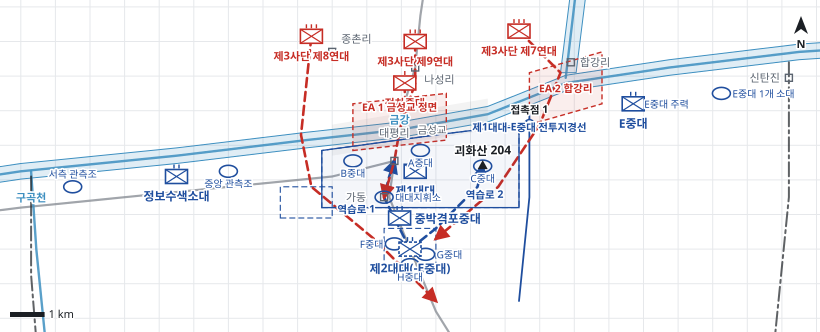

# kb1_071 · 대평리 전투

| 관점 | 임무 유형 | 구간 | 실제 결과 | 좌표 | 보정용 | 사람 검토 |
|---|---|---|---|---|---|---|
| 미 제24사단 제19연대 | 지역방어 | t=9.5~94.0 (84.5h) | failure | text | 아니오 | no |

**구간**: 제19연대가 대평리 일대 방어지역을 인수한 1950-07-13 09:30부터 북한군 제3사단의 도하 공격으로 연대가 붕괴되어 철수한 1950-07-16 야간까지의 전투 전체

**출처**: 국방부 군사편찬연구소, 『6·25전쟁 주요전투 1』(2017), '대평리 전투' (pdf 263쪽)

| 파일 | 내용 | 생성 모델에 |
|---|---|---|
| [`situation.json`](situation.json) | 상황 (익명화) | 줌 |
| [`coa.json`](coa.json) | pseudo-GT COA (익명화) | 예시로만 |
| [`scenario.json`](scenario.json) | 적 계획·환경 (시뮬레이터 전용) | 주지 않음 |
| [`history.json`](history.json) | 실제 경과 (평가 전용) | 주지 않음 |
| [`source.json`](source.json) | 출처·결과 라벨·자동 검사 | 주지 않음 |
| [`real_names/`](real_names) | 상황·COA 실명판 | 주지 않음 |

## 약도

## pseudo-GT COA (실명판)

**전투편성** 제1대대, E중대, 제2대대(-E중대), 정보수색소대, 중박격포중대 / 지원: 제52포병대대(105mm), 근접항공지원
**1. 상황**
  **가. 지형** 금강은 도섭이 불가능하고 교량이 모두 파괴되어 대평리 정면 금성교 일대와 합강리 부근이 유력한 도하지점이다. 괴화산은 대평리 동측 강안과 합강리를 감제하고, 가동과 대평리-대전 도로는 연대의 지휘와 보급을 지탱한다. 적 접근로는 나성리에서 금성교를 거쳐 대평리로, 합강리에서 괴화산 동측으로, 종촌리에서 서측 강안으로 이어진다.
  **나. 적** 적 제3사단은 나성리·종촌리 일대 북안에서 도하를 준비하다가 야간에 포병 준비사격과 전차포 엄호 아래 3개 연대로 공격해 올 것이다. 1개 연대는 금성교 정면에서 대평리로, 1개 연대는 합강리 부근에서 괴화산 동측으로 도하해 올 것이다. 1개 연대는 서측 강안으로 도하해 연대 후방 주보급로로 침투해 올 것이다.
  **다. 가정**
    **(1)** 금강은 도섭이 불가능하고 교량이 모두 파괴되어 적은 제한된 지점에서만 도하할 수 있다.
    **(2)** 서측 제34연대가 공주 일대를 유지하여 연대 서측방을 보호한다.
    **(3)** 근접항공지원은 주간에만 가용하다.
    **(4)** 대대 세부 보충: 제1대대는 B중대 서측·A중대 중앙·C중대 괴화산, 제2대대 E중대는 동측 강안, 정보수색소대는 서측 강안을 경계한다.
**2. 임무** 제19연대는 D일 09:30부터 구곡천~신탄진 금강선에서 대평리 정면을 중점으로 방어하여 적 제3사단의 도하를 저지하고 사단의 대전 방어 준비 시간을 확보한다.
**3. 실시**
  **가. 최종상태** 연대는 대평리 정면 금강 남안 진지와 주보급로를 유지하고, 도하한 적은 강안에서 격멸된다.
  **나. 작전개념** 연대는 대평리 정면에 제1대대를 집중 배치하고 나머지 강안은 경계부대로 감시한다. 포병과 박격포, 조명으로 도하하는 적을 강 위에서 타격하고, 남안에 교두보가 생기면 제2대대(-E중대)로 역습한다.
    **(1) 기동** 제1대대는 B·A·C중대로 대평리 서측에서 괴화산까지 강안 진지를 방어하고, E중대는 합강리 동측 강안을, 정보수색소대는 서측 강안을 경계한다. 제2대대(-E중대)는 대평리 남쪽 도로변에 예비로 위치해 제1대대 지역 역습, 주보급로 확보, 서측방 차단을 준비한다.
    **(2) 화력** 제52포병대대와 중박격포중대는 금성교 정면과 합강리 도하지점에 화력을 집중하고, 야간에는 조명탄으로 수면을 계속 밝힌다. 주간에는 근접항공지원으로 북안의 적 전차와 포병을 공격한다.
  **다. 예하부대 과업**
    **(1) 제1대대** 대평리 서측에서 괴화산까지 금강 남안 진지를 방어한다. 금성교 정면 교전지역에서 적의 도하를 저지한다. C중대로 괴화산을 고수한다.
    **(2) E중대** 합강리 동측에서 신탄진까지 강안을 경계한다. 합강리 교전지역에서 적의 도하를 저지한다.
    **(3) 정보수색소대** 구곡천에서 대평리 서측까지 강안을 경계한다.
    **(4) 제2대대(-E중대)** 명에 의해 역습로 1로 제1대대 지역에 역습한다. 명에 의해 대평리-대전 도로에 침투한 적을 격퇴한다. 명에 의해 서측 차단진지에서 서측방으로 접근하는 적을 차단한다.
    **(5) 중박격포중대** 금성교 정면 교전지역에서 제1대대를 화력지원한다.
  **라. 협조지시**
    **(1) 시간계획** D일 09:30 제21연대로부터 방어지역 인수를 완료한다. / D일 12:00 경계부대의 전초 점령을 완료한다. / D일 18:00 진지 보강과 예비의 역습 준비를 완료한다.
    **(2) 통제수단** 제1대대 방어지역, EA 1 금성교 정면, EA 2 합강리, 제1대대-E중대 전투지경선, 접촉점 1, 예비 집결지, 역습로 1, 역습로 2, 서측 경계지역, 동측 경계지역, 서측 차단진지
