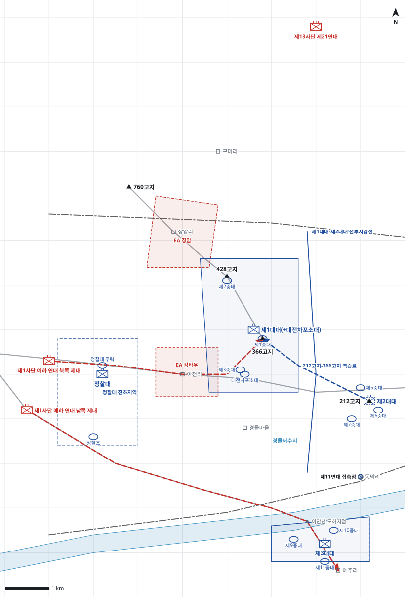

# kb1_080 · 함창 전투

| 관점 | 임무 유형 | 구간 | 실제 결과 | 좌표 | 보정용 | 사람 검토 |
|---|---|---|---|---|---|---|
| 국군 제1사단 제13연대 | 지역방어 | t=-2~33 (35h) | success | text | 예 | no |

**구간**: 제13연대가 함창 서쪽 992번 도로 축선에서 적의 공격을 저지한 전투 전체(7.27 22:00 정찰 보고부터 7.29 여명 공격 격퇴까지)

**출처**: 국방부 군사편찬연구소, 『6·25전쟁 주요전투 1』(2017), '함창 전투' (pdf 287쪽)

| 파일 | 내용 | 생성 모델에 |
|---|---|---|
| [`situation.json`](situation.json) | 상황 (익명화) | 줌 |
| [`coa.json`](coa.json) | pseudo-GT COA (익명화) | 예시로만 |
| [`scenario.json`](scenario.json) | 적 계획·환경 (시뮬레이터 전용) | 주지 않음 |
| [`history.json`](history.json) | 실제 경과 (평가 전용) | 주지 않음 |
| [`source.json`](source.json) | 출처·결과 라벨·자동 검사 | 주지 않음 |
| [`real_names/`](real_names) | 상황·COA 실명판 | 주지 않음 |

## 약도

## pseudo-GT COA (실명판)

**전투편성** 제1대대(+대전차포소대), 제2대대, 제3대대, 정찰대 / 지원: 제6사단 포병대대(요청 시 화력지원)
**1. 상황**
  **가. 지형** 366고지는 992번 도로를 감제하여 함창으로의 접근을 막는 핵심지형이고 428고지는 760고지 능선에서 내려오는 북서 접근로를 감제한다. 접근로는 992번 도로, 무명 도로와 이안천 도하지점, 760고지-428고지 능선의 셋이다.
  **나. 적** 적 제1사단 예하 연대는 D일 새벽 2개 제대로 공격해 올 것이다. 1개 제대는 장갑차를 앞세우고 992번 도로를 따라 아천리를 거쳐 366고지로, 1개 제대는 무명 도로를 따라 동진해 이안천을 도하하여 예주리로 침투해 올 것이다. 분산된 적은 경들마을 일대 산지로 침투할 것이다.
  **다. 가정**
    **(1)** 적 장갑차는 992번 도로 밖으로 기동이 제한된다.
    **(2)** 제6사단 포병대대는 요청 시 연대 정면에 화력을 지원한다.
    **(3)** 대대 세부 보충: 중대 배치와 428고지 1개 중대 배치, 대전차포 배속은 서술에 없어 보충했다.
    **(4)** 이안천변 새벽 안개로 D일 여명 관측이 제한된다.
**2. 임무** 제13연대는 D일 06:00부 992번 도로 축선 366고지-212고지 일대에서 방어하여 적의 함창 진출을 저지하고 군단 서측방을 방호한다.
**3. 실시**
  **가. 최종상태** 적 제1사단 예하 연대의 공격이 366고지 전방에서 격퇴되고 연대는 366고지, 428고지, 212고지를 확보한다. 경들마을 일대 침투 적은 소탕된다.
  **나. 작전개념** 연대는 제1대대를 주력으로 366고지와 428고지에서 감바우 정면의 적을 격멸하고, 제2대대는 212고지에서 종심을 형성하며 예비 임무를 겸한다. 제3대대는 이안천 남안에서 예주리 방향 침투를 차단하고 정찰대는 아천리 서쪽에서 조기경보한다.
    **(1) 기동** 제1대대는 992번 도로와 760고지 능선 접근로를 동시에 감제한다. 제2대대는 366고지 역습과 경들마을 소탕을 준비한다. 제3대대는 D일 06:00부 제11연대 작전통제로 전환한다.
    **(2) 화력** 대전차포 2문은 992번 도로상 장갑차를 사격한다. 제6사단 포병대대 화력은 EA 감바우에 우선 요청하고 이어 EA 장암에 둔다.
  **다. 예하부대 과업**
    **(1) 제1대대(+대전차포소대)** 366고지와 428고지 일대 진지를 점령한다. 감바우 정면에서 992번 도로를 차단한다. 명에 의해 760고지 능선으로 접근하는 적을 428고지 전방에서 격퇴한다.
    **(2) 제2대대** 212고지 일대 진지를 점령한다. 명에 의해 경들마을 일대로 침투한 적을 소탕한다. 명에 의해 역습로를 따라 366고지로 역습한다.
    **(3) 제3대대** 이안천 남안 예주리 북쪽 일대를 방어한다. 이안천 도하지점에서 적의 예주리 침투를 차단한다.
    **(4) 정찰대** 아천리 서쪽 992번 도로와 무명 도로 일대를 경계한다. 명에 의해 적 접촉 시 366고지로 철수한다.
  **라. 협조지시**
    **(1) 시간계획** 진지 보강을 D일 03:00까지 완료한다. / 제2대대는 D일 04:00까지 역습 준비를 완료한다. / D일 06:00부 사단 방어 책임을 개시하고 제3대대는 제11연대 작전통제로 전환한다.
    **(2) 통제수단** EA 감바우, EA 장암, 제1대대-제2대대 전투지경선, 제11연대 접촉점, 212고지-366고지 역습로, 정찰대 전초지역, 제3대대 방어진지
