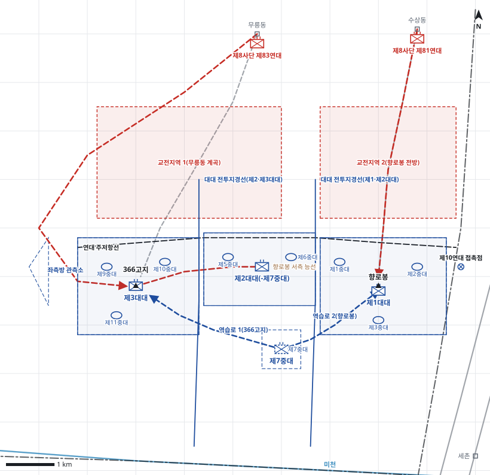

# kb1_086 · 의성 전투

| 관점 | 임무 유형 | 구간 | 실제 결과 | 좌표 | 보정용 | 사람 검토 |
|---|---|---|---|---|---|---|
| 국군 제8사단 제21연대 | 지역방어 | t=4~48 (44h) | failure | text | 예 | no |

**구간**: 의성 전투 중 8월 4~5일: 제21연대의 향로봉-366고지 주저항선 방어와 붕괴, 제10연대 제1대대의 261고지 후퇴와 세촌-262고지 재편성

**출처**: 국방부 군사편찬연구소, 『6·25전쟁 주요전투 1』(2017), '의성 전투' (pdf 300쪽)

| 파일 | 내용 | 생성 모델에 |
|---|---|---|
| [`situation.json`](situation.json) | 상황 (익명화) | 줌 |
| [`coa.json`](coa.json) | pseudo-GT COA (익명화) | 예시로만 |
| [`scenario.json`](scenario.json) | 적 계획·환경 (시뮬레이터 전용) | 주지 않음 |
| [`history.json`](history.json) | 실제 경과 (평가 전용) | 주지 않음 |
| [`source.json`](source.json) | 출처·결과 라벨·자동 검사 | 주지 않음 |
| [`real_names/`](real_names) | 상황·COA 실명판 | 주지 않음 |

## 약도

## pseudo-GT COA (실명판)

**전투편성** 제1대대, 제2대대(-제7중대), 제3대대, 연대 예비: 제7중대 / 지원: 제8사단 포병대대(일반지원)
**1. 상황**
  **가. 지형** 향로봉은 의성 방어의 핵심 지형이다. 남동쪽 261고지와 5번 도로를 감제하고, 366고지는 연대 좌익의 지탱점이다. 적의 접근로는 무릉동에서 366고지로 이어지는 계곡, 수상동에서 향로봉으로 이어지는 능선, 그리고 개방된 좌측방의 우회로다.
  **나. 적** 적 제8사단은 무릉동·수상동 교두보에서 D일 새벽 2개 연대로 공격해 올 것이다. 1개 연대는 무릉동에서 366고지와 향로봉 서측 능선으로, 1개 연대는 수상동에서 향로봉으로 공격해 올 것이다. 적은 개방된 좌측방으로 366고지를 우회해 올 수 있다.
  **다. 가정**
    **(1)** 대대 세부 보충: 중대 배치와 제2대대 제7중대의 연대 예비 운용은 서술에 없어 보충했다.
    **(2)** 좌측 국군 제6사단과는 연결되지 않으며 좌측방은 제3대대가 자체 경계한다.
    **(3)** 진지는 급편 진지 수준이다.
    **(4)** 제16연대는 제2선 예비진지에서 사단 역습을 준비한다.
**2. 임무** 제21연대는 D일 04:00부터 향로봉-366고지 선에서 방어하여 적 제8사단의 의성 방향 남진을 저지한다.
**3. 실시**
  **가. 최종상태** 연대가 향로봉과 366고지를 확보하고 적 선두 연대의 공격력이 주저항선 전방에서 소모된다.
  **나. 작전개념** 3개 대대를 주저항선에 나란히 배치하고 향로봉의 제1대대를 주력으로 한다. 좌측 개방 측방은 제3대대가 경계하고, 연대 예비 제7중대는 중앙 후방에서 366고지와 향로봉으로 역습을 준비한다. 사단 포병 화력은 무릉동 계곡 접근로에 우선 집중한다.
    **(1) 기동** 제3대대는 366고지를 방어하고 좌측방을 경계한다. 제2대대(-)는 향로봉 서측 능선을 방어한다. 제1대대는 향로봉을 고수하고 제10연대와 접촉을 유지한다. 제7중대는 예비진지에서 돌파된 지역으로 역습한다.
    **(2) 화력** 사단 포병대대는 교전지역 1(무릉동 계곡)과 교전지역 2(향로봉 전방)에 사전 화력을 계획하고 제3대대 정면을 우선 지원한다.
  **다. 예하부대 과업**
    **(1) 제1대대** 향로봉을 고수한다. 우측 접촉점에서 제10연대 제1대대와 접촉하며 연대 우측방을 경계한다.
    **(2) 제2대대(-제7중대)** 향로봉 서측 능선을 방어한다.
    **(3) 제3대대** 366고지를 방어한다. 좌측방 관측소를 운용해 개방된 좌측방을 경계한다.
    **(4) 제7중대** 연대 예비진지를 점령한다. 명에 의해 역습로 1을 따라 366고지로 역습한다. 명에 의해 역습로 2를 따라 향로봉으로 역습한다.
  **라. 협조지시**
    **(1) 시간계획** D일 04:00까지 각 대대는 진지 점령과 보강을 끝낸다. / D일 04:00까지 제7중대는 예비진지 점령과 역습 준비를 끝낸다.
    **(2) 통제수단** 연대 주저항선, 제1대대 전투진지(향로봉), 제2대대 전투진지(향로봉 서측 능선), 제3대대 전투진지(366고지), 교전지역 1(무릉동 계곡), 교전지역 2(향로봉 전방), 대대 전투지경선(제1·제2대대), 대대 전투지경선(제2·제3대대), 연대 예비진지, 제10연대 접촉점, 좌측방 관측소, 역습로 1(366고지), 역습로 2(향로봉)
