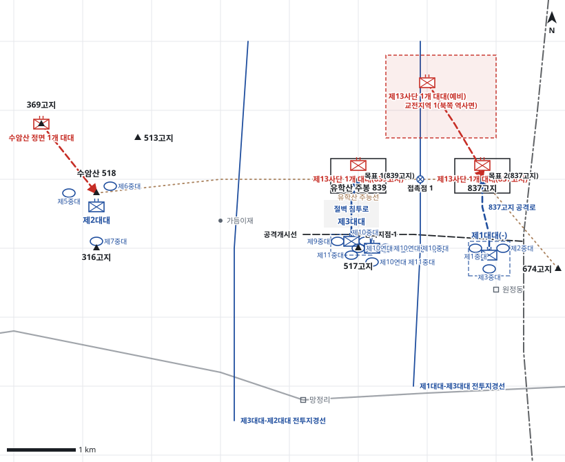

# kb1_093 · 수암산-유학산 전투

| 관점 | 임무 유형 | 구간 | 실제 결과 | 좌표 | 보정용 | 사람 검토 |
|---|---|---|---|---|---|---|
| 국군 제1사단 제12연대 | 공격 | t=5~72 (67h) | success | text | 예 | no |

**구간**: 구간 ③: 북한군 제15사단이 제13사단과 교대한 뒤 제12연대가 제3대대와 배속된 제10연대 제3대대를 투입해 839고지와 837고지를 다시 공격한 구간(8.20~23).

**출처**: 국방부 군사편찬연구소, 『6·25전쟁 주요전투 1』(2017), '수암산-유학산 전투' (pdf 317쪽)

| 파일 | 내용 | 생성 모델에 |
|---|---|---|
| [`situation.json`](situation.json) | 상황 (익명화) | 줌 |
| [`coa.json`](coa.json) | pseudo-GT COA (익명화) | 예시로만 |
| [`scenario.json`](scenario.json) | 적 계획·환경 (시뮬레이터 전용) | 주지 않음 |
| [`history.json`](history.json) | 실제 경과 (평가 전용) | 주지 않음 |
| [`source.json`](source.json) | 출처·결과 라벨·자동 검사 | 주지 않음 |
| [`real_names/`](real_names) | 상황·COA 실명판 | 주지 않음 |

## 약도

## pseudo-GT COA (실명판)

**전투편성** 제1대대(-), 제3대대, 제10연대 제3대대(배속), 제2대대 / 지원: 사단 포병(직접지원), 근접항공지원(전방항공통제관)
**1. 상황**
  **가. 지형** 839고지와 837고지는 5번 국도와 다부동 접근로를 감제하는 핵심 지형이다. 주봉 남쪽 절벽지대는 급하지만 적 경계가 약한 침투로이고, 원정동에서 837고지로 오르는 능선은 반복 공격으로 적 화력이 집중된 접근로다.
  **나. 적** 적 제13사단은 839고지와 837고지에서 2개 대대로 방어하다가 북쪽 역사면의 1개 대대로 837고지와 주봉으로 야간 역습해 올 것이다. 수암산 정면의 적 1개 대대는 369고지에서 제2대대를 고착할 것이다.
  **다. 가정**
    **(1)** 교대 직후의 적 제13사단은 진지와 지형에 익숙하지 않다.
    **(2)** 근접항공지원은 전방항공통제관 통제하에 가용하다.
    **(3)** 수암산 정면의 적은 대규모 공세 여력이 없다.
    **(4)** 대대 세부 보충: 중대 배치와 공격대기지점은 서술과 모순되지 않게 추정했다.
**2. 임무** 제12연대는 D일 06:00 유학산 839고지와 837고지를 탈취하여 사단 주저항선을 회복한다.
**3. 실시**
  **가. 최종상태** 제3대대와 제1대대가 839고지와 837고지를 확보하고 연결된 방어진지를 구축한다. 제2대대는 수암산 일대를 계속 확보한다.
  **나. 작전개념** 제10연대 제3대대가 517고지에서 주봉 정면을 엄호하는 동안 제3대대가 주봉 남쪽 절벽지대로 침투해 839고지를 탈취한다. 제1대대는 원정동에서 837고지를 동시에 공격해 적을 분산시킨다. 제2대대는 수암산 일대를 방어해 좌측방을 보호한다.
    **(1) 기동** 주력 제3대대는 절벽 침투로로 주봉을 기습 탈취하고, 제1대대는 837고지를 공격해 적 예비를 동쪽에 묶는다. 주봉 탈취 뒤 두 대대는 주능선에서 연결한다.
    **(2) 화력** 사단 포병과 박격포는 H-30분부터 주봉 북쪽 사면과 837고지 정상에 공격준비사격을 하고 우선은 제3대대다. 근접항공지원은 전방항공통제관 통제하에 북쪽 역사면 적 예비를 공격한다.
  **다. 예하부대 과업**
    **(1) 제3대대** 주봉 남쪽 절벽지대로 침투하여 839고지를 탈취한다. 839고지에서 837고지 방향 주능선을 확보한다.
    **(2) 제1대대(-)** 원정동에서 능선을 따라 837고지를 탈취한다. 837고지를 확보하고 주능선에서 제3대대와 연결한다.
    **(3) 제10연대 제3대대** 517고지에서 주봉 정면 적을 사격하여 제3대대의 침투를 엄호한다. 명에 의해 517고지에서 제3대대를 초월한다. 이어서 839고지를 탈취한다.
    **(4) 제2대대** 수암산 일대를 방어한다. 369고지의 적을 고착한다.
  **라. 협조지시**
    **(1) 시간계획** D일 04:00까지 공격대기지점과 엄호진지를 점령한다. / D일 05:30 공격준비사격을 시작한다. / D일 06:00 H시, 제3대대와 제1대대가 공격을 개시한다.
    **(2) 통제수단** 목표 1(839고지), 목표 2(837고지), 공격개시선, 제3대대 공격대기지점, 제1대대 공격대기지점, 절벽 침투로, 837고지 공격로, 통과지점 1, 제1대대-제3대대 전투지경선, 제3대대-제2대대 전투지경선, 접촉점 1, 교전지역 1(북쪽 역사면)
