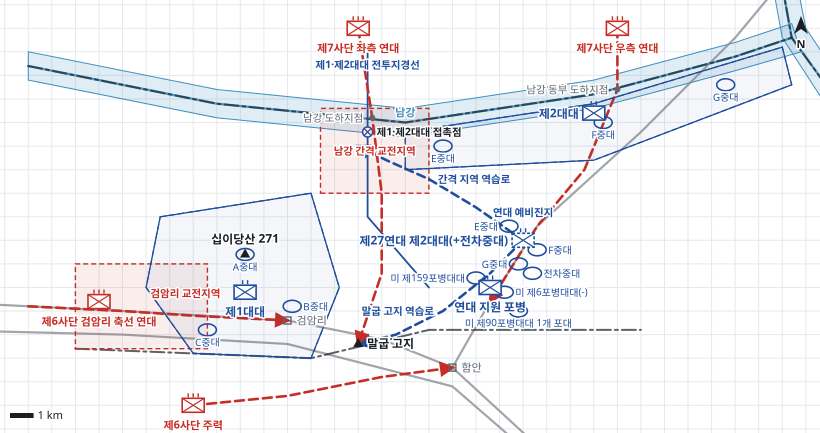

# kb1_102 · 마산 서북방 전투

| 관점 | 임무 유형 | 구간 | 실제 결과 | 좌표 | 보정용 | 사람 검토 |
|---|---|---|---|---|---|---|
| 미 제35연대 | 지역방어 | t=18~168 (150h) | success | text | 아니오 | no |

**구간**: 북한군 제6·제7사단의 8월 31일 야간 총공격 직전 미 제35연대의 방어 명령에서 시작해 9월 6일 북한군의 수세 전환까지의 전투 전 기간.

**출처**: 국방부 군사편찬연구소, 『6·25전쟁 주요전투 1』(2017), '마산 서북방 전투' (pdf 338쪽)

| 파일 | 내용 | 생성 모델에 |
|---|---|---|
| [`situation.json`](situation.json) | 상황 (익명화) | 줌 |
| [`coa.json`](coa.json) | pseudo-GT COA (익명화) | 예시로만 |
| [`scenario.json`](scenario.json) | 적 계획·환경 (시뮬레이터 전용) | 주지 않음 |
| [`history.json`](history.json) | 실제 경과 (평가 전용) | 주지 않음 |
| [`source.json`](source.json) | 출처·결과 라벨·자동 검사 | 주지 않음 |
| [`real_names/`](real_names) | 상황·COA 실명판 | 주지 않음 |

## 약도

## pseudo-GT COA (실명판)

**전투편성** 제1대대, 제2대대, 제27연대 제2대대(+전차중대) / 지원: 미 제159포병대대(직접지원), 미 제6포병대대(-)·미 제90포병대대 1개 포대(일반지원), 미 제5공군 근접항공지원
**1. 상황**
  **가. 지형** 십이당산과 검암리 일대 고지는 진주-마산 도로를 통제하는 핵심 지형이고, 말굽 고지는 연대와 미 제24연대의 후방을 내려다본다. 남강은 장애물이나 도섭 지점이 있고 제1·제2대대 간격 정면이 가장 취약하다. 접근로는 진주-검암리 도로, 남강 도하 후 함안-남지 도로로 남하하는 축선이다.
  **나. 적** 적 제7사단은 D일 야간에 2개 연대로 남강을 도하해 공격해 올 것이다. 1개 연대는 제1·제2대대 간격으로 도하해 말굽 고지와 연대 후방으로, 1개 연대는 제2대대 강변진지를 돌파해 함안-남지 도로로 공격해 올 것이다. 적 제6사단 1개 연대는 진주-검암리 도로를 따라 제1대대를 공격하고 주력은 함안으로 공격해 올 것이다.
  **다. 가정**
    **(1)** 대대 세부 보충: 대대 진지와 중대 위치는 서술에 없어 지형에 맞게 보충한다.
    **(2)** 미 제27연대 제2대대와 전차중대는 명령 시점에 연대에 배속되어 있다.
    **(3)** 주간에는 미 제5공군의 근접항공지원을 받을 수 있다.
    **(4)** 적은 항공을 피해 야간에 도하·공격한다.
**2. 임무** 미 제35연대는 D일 야간부터 남지교에서 검암리에 이르는 남강·진주 도로 정면에서 방어하여 북한군 제7사단의 남강 도하와 북한군 제6사단의 검암리 돌파를 저지하고 마산 접근을 거부한다.
**3. 실시**
  **가. 최종상태** 연대는 남강변과 검암리 정면 진지를 유지하고, 도하한 적은 포병·항공 화력과 역습으로 격멸된다.
  **나. 작전개념** 연대는 2개 대대를 전방에 배치해 남강 도하와 검암리 도로를 저지하고, 대대 간격과 후방은 포병 화력과 배속 대대의 역습으로 막는다. 결정적 작전은 대대 간격으로 도하한 적을 화력으로 약화시킨 뒤 예비로 역습해 격멸하는 것이다.
    **(1) 기동** 제1대대는 십이당산과 검암리 정면을 방어하고, 제2대대는 남강 남안 강변진지를 방어한다. 제27연대 제2대대(+전차중대)는 함안-남지 도로 부근 예비진지를 점령하고 간격 지역 또는 말굽 고지로 역습을 준비한다.
    **(2) 화력** 지원 포병은 도하지점과 남강 간격 교전지역에 우선 화력을 집중하고, 다음으로 검암리 정면 도로에 화력을 준비한다. 주간에는 근접항공지원으로 도하한 적과 집결지를 타격한다.
  **다. 예하부대 과업**
    **(1) 제1대대** 십이당산과 검암리 정면 진지를 방어한다. 진주-검암리 도로로 공격하는 적을 검암리 교전지역에서 저지한다.
    **(2) 제2대대** 남강 남안 강변진지를 방어한다. 남강을 도하하는 적을 남강선에서 저지한다.
    **(3) 제27연대 제2대대(+전차중대)** 함안-남지 도로 부근 예비진지를 점령한다. 명에 의해 대대 간격으로 도하한 적에 대해 남강 간격 교전지역으로 역습한다. 명에 의해 말굽 고지를 점령한 적에 대해 말굽 고지로 역습한다. 명에 의해 제2대대 강변진지가 돌파되면 강변진지로 역습한다.
    **(4) 연대 지원 포병** 제2대대를 위해 남강 도하지점과 간격 교전지역에 화력지원한다. 제1대대를 위해 검암리 교전지역에 화력지원한다.
  **라. 협조지시**
    **(1) 시간계획** D일 20:00 전방 대대 진지 점령 완료 / D일 22:00 예비 예비진지 점령 및 역습 준비 완료 / D일 22:00 도하지점·교전지역 사격 준비 완료
    **(2) 통제수단** 제1·제2대대 전투지경선, 제1·제2대대 접촉점, 남강 간격 교전지역, 검암리 교전지역, 간격 지역 역습로, 말굽 고지 역습로, 연대 예비진지, 제1대대 진지, 제2대대 강변진지
