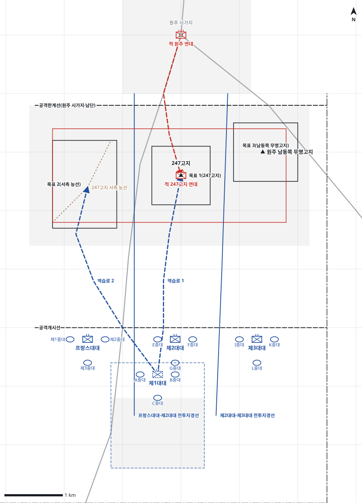

# kb1_149 · 원주 전투

| 관점 | 임무 유형 | 구간 | 실제 결과 | 좌표 | 보정용 | 사람 검토 |
|---|---|---|---|---|---|---|
| 제23연대 | 공격 | t=8~110 (102h) | success | text | 아니오 | no |

**구간**: 원주 남쪽으로 철수한 직후 연대가 군단·사단 명령을 받아 247고지를 비롯한 원주 남쪽 고지군 공격을 결심한 시점부터, 247고지 점령(1/11 오후)과 원주 탈환 공격(1/12 미명)까지.

**출처**: 국방부 군사편찬연구소, 『6·25전쟁 주요전투 1』(2017), '원주 전투' (pdf 442쪽)

| 파일 | 내용 | 생성 모델에 |
|---|---|---|
| [`situation.json`](situation.json) | 상황 (익명화) | 줌 |
| [`coa.json`](coa.json) | pseudo-GT COA (익명화) | 예시로만 |
| [`scenario.json`](scenario.json) | 적 계획·환경 (시뮬레이터 전용) | 주지 않음 |
| [`history.json`](history.json) | 실제 경과 (평가 전용) | 주지 않음 |
| [`source.json`](source.json) | 출처·결과 라벨·자동 검사 | 주지 않음 |
| [`real_names/`](real_names) | 상황·COA 실명판 | 주지 않음 |

## 약도

## pseudo-GT COA (실명판)

**전투편성** 제1대대, 제2대대, 제3대대, 프랑스대대 / 지원: 제37야전포병대대(직접지원), 근접항공지원
**1. 상황**
  **가. 지형** 247고지는 원주 시가지를 감제하고 원주-충주 도로를 통제하는 핵심 지형이다. 서측 능선과 남동쪽 무명고지가 247고지 양 측방을 엄호한다. 아군 접근로는 원주-충주 도로를 따라 북진하는 축선이고, 적의 역습은 시가지에서 같은 도로를 따라 남하한다.
  **나. 적** 적 247고지 연대는 247고지와 원주 남쪽 고지군에서 방어할 것이다. 적 원주 연대는 시가지에 머물다가, 아군이 247고지를 탈취하면 야간에 원주-충주 도로를 따라 247고지로 역습해 올 것이다.
  **다. 가정**
    **(1)** 대대 세부 보충: 대대별 목표와 중대 배치는 서술에 없어 연대 과업에 맞게 보충했다.
    **(2)** 근접항공지원은 주간에 기상이 허락할 때만 가능하다.
    **(3)** 제38연대는 미천 부근을 고수해 연대 후방을 엄호한다.
**2. 임무** 제23연대는 D일 10:00 원주 남쪽에서 247고지를 비롯한 원주 남쪽 고지군을 탈취하여 원주 시가지와 원주-충주 도로를 감제하고 사단이 원주를 탈환할 발판을 마련한다.
**3. 실시**
  **가. 최종상태** 연대는 247고지와 원주 남쪽 고지군을 확보하고 원주 시가지를 감제한다. 적의 역습을 격퇴하고 원주 공격을 준비한다.
  **나. 작전개념** 연대는 3개 대대를 나란히 세워 원주-충주 도로 축선으로 공격하고 원주 남쪽 고지군을 동시에 탈취한다. 제2대대가 주력으로 247고지를 탈취하고, 프랑스대대와 제3대대가 양 측방 고지를 탈취한다. 제1대대는 예비로서 247고지 역습을 준비한다.
    **(1) 기동** 프랑스대대는 도로 서쪽으로 서측 능선을, 제2대대는 도로 동쪽으로 247고지를, 제3대대는 동쪽으로 남동쪽 무명고지를 공격한다. 목표를 탈취한 뒤 원주 시가지 남단을 공격한계선으로 하여 고지를 고수한다.
    **(2) 화력** 제37야전포병대대는 제2대대의 247고지 공격을 우선 지원한다. 주간에 기상이 허락하면 근접항공지원으로 247고지와 시가지 남단의 적을 타격한다.
  **다. 예하부대 과업**
    **(1) 제2대대** D일 10:00 원주-충주 도로 동쪽으로 공격하여 247고지를 탈취한다. 247고지를 고수한다.
    **(2) 프랑스대대** D일 10:00 원주-충주 도로 서쪽으로 공격하여 247고지 서측 능선을 탈취한다. 서측 능선에서 원주-충주 도로를 차단한다.
    **(3) 제3대대** D일 10:00 동쪽으로 공격하여 원주 남동쪽 무명고지를 탈취한다. 원주 남동쪽 무명고지를 고수한다.
    **(4) 제1대대** 명에 의해 역습로 1을 따라 247고지로 역습한다. 명에 의해 역습로 2를 따라 247고지 서측 능선으로 역습한다.
  **라. 협조지시**
    **(1) 시간계획** D일 10:00 H시, 3개 대대가 공격개시선을 통과한다. / D일 10:00까지 제1대대는 예비진지를 점령하고 역습 준비를 마친다. / D일 17:00 일몰 전까지 탈취한 목표에서 야간 방어 준비를 마친다.
    **(2) 통제수단** 연대 집결지, 공격개시선, 목표 1(247고지), 목표 2(서측 능선), 목표 3(남동쪽 무명고지), 프랑스대대-제2대대 전투지경선, 제2대대-제3대대 전투지경선, 역습로 1, 역습로 2, 공격한계선(원주 시가지 남단)
