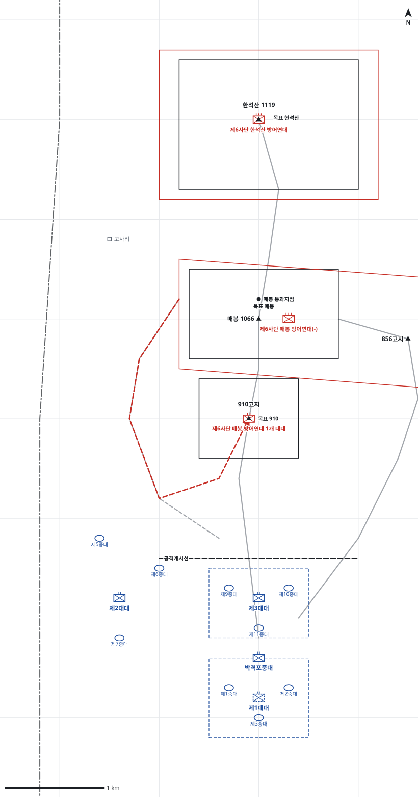

# kb1_175 · 매봉-한석산 전투

| 관점 | 임무 유형 | 구간 | 실제 결과 | 좌표 | 보정용 | 사람 검토 |
|---|---|---|---|---|---|---|
| 국군 제9사단 제30연대 | 공격 | t=7~91 (84h) | success | text | 예 | no |

**구간**: 제30연대가 D일 07:00 공격을 시작해 910고지·매봉을 거쳐 D+3일 저녁 한석산을 점령하기까지의 전투 전체

**출처**: 국방부 군사편찬연구소, 『6·25전쟁 주요전투 1』(2017), '매봉-한석산 전투' (pdf 518쪽)

| 파일 | 내용 | 생성 모델에 |
|---|---|---|
| [`situation.json`](situation.json) | 상황 (익명화) | 줌 |
| [`coa.json`](coa.json) | pseudo-GT COA (익명화) | 예시로만 |
| [`scenario.json`](scenario.json) | 적 계획·환경 (시뮬레이터 전용) | 주지 않음 |
| [`history.json`](history.json) | 실제 경과 (평가 전용) | 주지 않음 |
| [`source.json`](source.json) | 출처·결과 라벨·자동 검사 | 주지 않음 |
| [`real_names/`](real_names) | 상황·COA 실명판 | 주지 않음 |

## 약도

## pseudo-GT COA (실명판)

**전투편성** 제3대대, 제1대대(예비), 제2대대, 박격포중대 / 지원: 사단 포병대대(직접지원), 근접항공지원, 탄약 지원소대(노무자)
**1. 상황**
  **가. 지형** 매봉과 한석산은 인제와 현리를 감제하는 핵심 지형이며 910고지는 매봉 공격의 발판이다. 주접근로는 910고지-매봉 능선이고 856고지 능선이 매봉 동측방으로 이어진다. 910고지 좌측 계곡은 적이 아군 측후방으로 침투할 수 있는 접근로다.
  **나. 적** 적 제6사단은 2개 연대로 910고지-매봉-한석산 거점진지에서 소양강을 등지고 고수 방어할 것이다. 1개 연대는 910고지와 매봉-856고지를, 1개 연대는 한석산을 지킬 것이다. 910고지를 잃으면 매봉의 연대가 1개 대대로 910고지 좌측 계곡을 따라 아군 측후방으로 역습해 올 것이다.
  **다. 가정**
    **(1)** 대대 세부 보충: 제2대대는 현 진지에서 연대 좌측방을 경계하고, 각 대대의 중대 배치는 서술과 모순되지 않게 추정했다.
    **(2)** 주간에는 근접항공지원이 가능하다.
    **(3)** 탄약은 노무자 지원소대가 910고지까지 인력으로 운반한다.
    **(4)** 적은 소양강 배수진으로 철수보다 고수를 택한다.
**2. 임무** 제30연대는 D일 07:00 공격하여 910고지와 매봉을 거쳐 한석산을 탈취하여 사단이 인제를 통제하도록 한다.
**3. 실시**
  **가. 최종상태** 연대가 매봉과 한석산을 확보하고 적 제6사단의 2개 연대를 격퇴하여 소양강 남안을 통제한다.
  **나. 작전개념** 제3대대를 주공으로 910고지-매봉 능선을 따라 축차 공격한다. 제3대대가 매봉을 점령하면 예비 제1대대가 초월하여 한석산을 탈취한다. 제2대대는 910고지 좌측 계곡을 경계하여 주공의 측후방을 엄호한다.
    **(1) 기동** 제3대대는 D일 07:00 공격하여 910고지를 탈취하고 이어서 매봉을 탈취한다. 제1대대는 예비로서 매봉에서 제3대대를 초월하여 한석산을 탈취하고, 적이 910고지를 역습하면 역습한다.
    **(2) 화력** 사단 포병과 박격포중대는 910고지와 매봉에 공격준비사격 후 제3대대를 지원하고, 근접항공지원은 매봉에 집중한다.
  **다. 예하부대 과업**
    **(1) 제3대대** D일 07:00 공격하여 910고지를 탈취한다. 이어서 910고지-매봉 능선을 따라 공격하여 매봉을 탈취한다.
    **(2) 제1대대** 명에 의해 910고지 지역으로 역습한다. 명에 의해 매봉에서 제3대대를 초월한다. 이어서 매봉-한석산 능선을 따라 공격하여 한석산을 탈취한다.
    **(3) 제2대대** 910고지 좌측 계곡 일대를 경계한다. 제3대대의 좌측방을 엄호한다.
    **(4) 박격포중대** 910고지와 매봉에 대한 제3대대의 공격을 화력지원한다.
  **라. 협조지시**
    **(1) 시간계획** D일 06:30 공격준비사격 개시 / D일 07:00 공격 개시(H시), 예비 준비 완료
    **(2) 통제수단** 공격개시선, 제3대대 공격대기지점, 제1대대 예비진지, 목표 910, 목표 매봉, 목표 한석산, 매봉 통과지점, 좌측 계곡 경계지역
