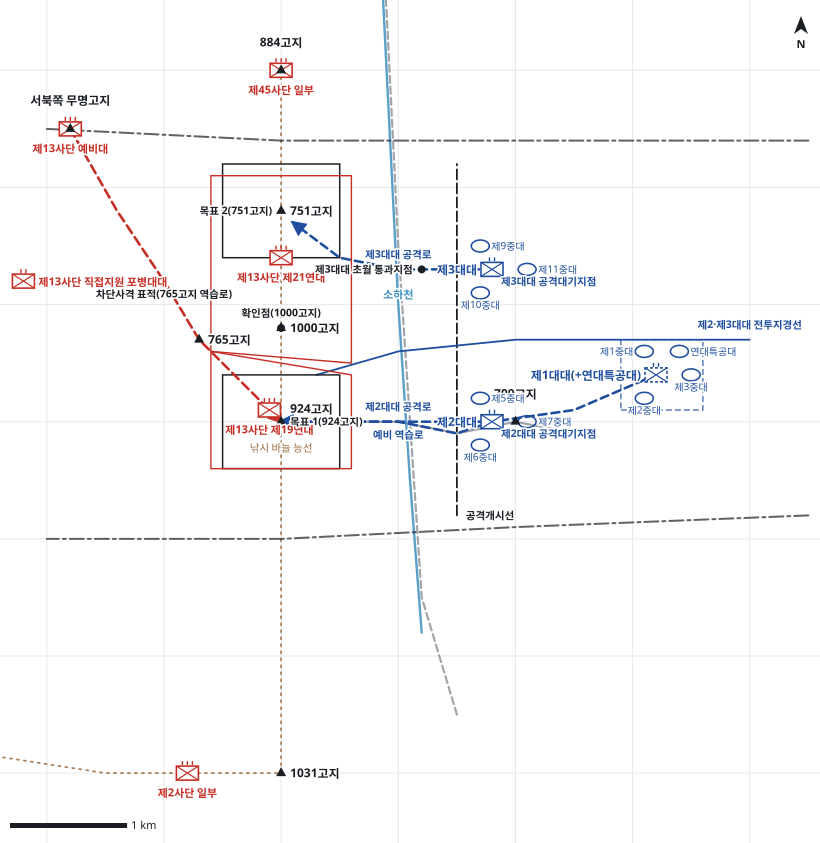

# kb1_185 · 924고지 전투

| 관점 | 임무 유형 | 구간 | 실제 결과 | 좌표 | 보정용 | 사람 검토 |
|---|---|---|---|---|---|---|
| 국군 수도사단 제26연대 | 공격 | t=5~133 (128h) | success | text | 예 | no |

**구간**: 924고지 전투 전체(크리퍼 작전 중 수도사단 924-1000-751고지 공격). 명령 시점은 제26연대가 D일 06:00 924고지·751고지 동시 공격을 결심한 첫 명령.

**출처**: 국방부 군사편찬연구소, 『6·25전쟁 주요전투 1』(2017), '924고지 전투' (pdf 553쪽)

| 파일 | 내용 | 생성 모델에 |
|---|---|---|
| [`situation.json`](situation.json) | 상황 (익명화) | 줌 |
| [`coa.json`](coa.json) | pseudo-GT COA (익명화) | 예시로만 |
| [`scenario.json`](scenario.json) | 적 계획·환경 (시뮬레이터 전용) | 주지 않음 |
| [`history.json`](history.json) | 실제 경과 (평가 전용) | 주지 않음 |
| [`source.json`](source.json) | 출처·결과 라벨·자동 검사 | 주지 않음 |
| [`real_names/`](real_names) | 상황·COA 실명판 | 주지 않음 |

## 약도

## pseudo-GT COA (실명판)

**전투편성** 제2대대, 제3대대, 제1대대(+연대특공대) / 지원: 수도사단 포병
**1. 상황**
  **가. 지형** 924고지는 낚시 바늘 능선의 허리로 1000고지와 751고지를 내려다보는 핵심 지형이다. 709고지에서 서쪽으로 뻗은 능선과 소하천 계곡이 동쪽 접근로이고, 적 예비대는 서북쪽 무명고지에서 765고지를 거쳐 924고지로 증원할 수 있다.
  **나. 적** 적 제13사단은 제19연대로 924고지를, 제21연대로 1000고지-751고지를 진지 방어할 것이다. 아군이 924고지에 돌입하면 서북쪽 무명고지의 예비대가 765고지를 거쳐 924고지로 역습해 올 것이고, 직접지원 포병대대가 924고지와 751고지 접근로에 집중 포격할 것이다.
  **다. 가정**
    **(1)** 인접 제11사단과 제8사단이 D일 동시에 공격하여 884고지와 1031고지의 적을 고착한다.
    **(2)** 사단 포병이 D일 05:30부터 공격준비사격과 근접 지원을 제공한다.
    **(3)** 대대 세부 보충: 대대 공격대기지점, 중대 배치, 연대특공대의 예비 편조는 서술과 모순되지 않게 보충했다.
**2. 임무** 제26연대는 D일 06:00 동쪽에서 924고지와 751고지를 동시에 공격하여 탈취함으로써 낚시 바늘 능선의 허리를 확보하고 서화계곡 기동로 확보를 보장한다.
**3. 실시**
  **가. 최종상태** 연대가 924고지-1000고지-751고지를 확보하고 적 제13사단의 역습을 격퇴할 태세를 갖춘다.
  **나. 작전개념** 연대는 2개 대대를 병진시켜 동쪽에서 924고지와 751고지를 동시에 공격한다. 제2대대가 주공으로 924고지를 탈취하고, 제3대대는 751고지를 공격해 적 제21연대를 고착한다. 제1대대(+연대특공대)는 709고지 동쪽에서 예비로 924고지 역습과 초월공격에 대비한다.
    **(1) 기동** 제2대대는 709고지-924고지 능선을 따라 정면 공격하고, 제3대대는 소하천을 건너 751고지 동남쪽에서 좌우로 포위 공격한다.
    **(2) 화력** 사단 포병은 D일 05:30부터 924고지와 751고지에 공격준비사격을 하고, 이후 제2대대를 우선 지원하며 765고지와 무명고지 방향 적 역습로를 차단사격한다.
  **다. 예하부대 과업**
    **(1) 제2대대** D일 06:00 709고지-924고지 능선을 따라 공격하여 924고지를 탈취한다. 이어서 765고지 방향으로 진지를 편성하여 924고지를 확보한다.
    **(2) 제3대대** D일 06:00 소하천을 건너 751고지 동남쪽에서 좌우로 포위 공격하여 751고지를 탈취한다. 이어서 751고지에서 884고지 방향 적의 증원을 차단한다.
    **(3) 제1대대(+연대특공대)** D일 05:00까지 709고지 동쪽 예비진지를 점령한다. 명에 의해 709고지-924고지 능선을 따라 924고지로 역습한다. 명에 의해 소하천 동쪽 통과지점에서 제3대대를 초월한다. 이어서 751고지를 탈취한다.
  **라. 협조지시**
    **(1) 시간계획** D일 05:00 공격대기지점과 예비진지 점령 완료 / D일 05:30 공격준비사격 개시 / D일 06:00 H시, 924고지·751고지 동시 공격 개시 / D일 06:00 예비 역습 준비 완료
    **(2) 통제수단** 공격개시선, 제2·제3대대 전투지경선, 목표 1(924고지), 목표 2(751고지), 확인점(1000고지), 제2대대 공격대기지점, 제3대대 공격대기지점, 예비진지, 제2대대 공격로, 제3대대 공격로, 예비 역습로, 제3대대 초월 통과지점, 차단사격 표적(765고지 역습로)
