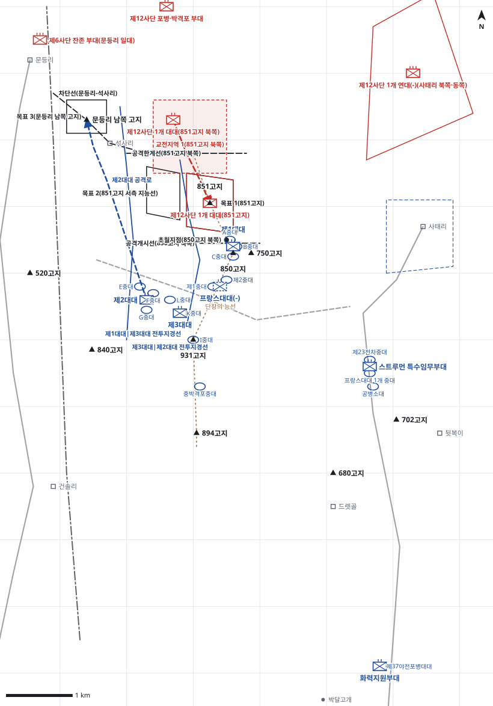

# kb1_189 · 단장의 능선 전투

| 관점 | 임무 유형 | 구간 | 실제 결과 | 좌표 | 보정용 | 사람 검토 |
|---|---|---|---|---|---|---|
| 미 제2사단 제23연대 | 공격 | t=6~78 (72h) | success | atlas+text | 아니오 | yes |

**구간**: 단장의 능선 전투 구간 4: 894·931·850고지를 확보한 미 제2사단 제23연대(프랑스대대 배속)가 능선 북단 851고지를 공격한다. H시부터 72시간.

**출처**: 국방부 군사편찬연구소, 『6·25전쟁 주요전투 1』(2017), '단장의 능선 전투' (pdf 566쪽)

| 파일 | 내용 | 생성 모델에 |
|---|---|---|
| [`situation.json`](situation.json) | 상황 (익명화) | 줌 |
| [`coa.json`](coa.json) | pseudo-GT COA (익명화) | 예시로만 |
| [`scenario.json`](scenario.json) | 적 계획·환경 (시뮬레이터 전용) | 주지 않음 |
| [`history.json`](history.json) | 실제 경과 (평가 전용) | 주지 않음 |
| [`source.json`](source.json) | 출처·결과 라벨·자동 검사 | 주지 않음 |
| [`real_names/`](real_names) | 상황·COA 실명판 | 주지 않음 |

## 약도

## pseudo-GT COA (실명판)

**전투편성** 제1대대, 프랑스대대(-), 제3대대, 제2대대, 스트루먼 특수임무부대(제23전차중대, 프랑스대대 1개 중대, 공병 1개 소대) / 지원: 제37야전포병대대(직접지원), 중박격포중대, 사단·군단 포병, 근접항공지원
**1. 상황**
  **가. 지형** 851고지는 단장의 능선 북단으로 이를 확보해야 능선 전체와 문등리·사태리 계곡을 통제한다. 850고지에서 851고지까지 능선은 좁아 1개 대대 정면만 허용한다. 적 증원은 문등리 계곡에서 석사리를 거쳐, 역습은 961고지 방면에서 북쪽으로 접근한다.
  **나. 적** 적 제12사단은 2개 대대로 851고지와 그 북쪽 종심의 벙커 진지에서 박격포 화력으로 방어하다가 851고지 북쪽 진지의 대대로 851고지로 역습해 올 것이다. 적 제6사단 잔존 부대는 문등리 계곡에서 석사리를 거쳐 851고지 서측으로 증원해 올 것이다.
  **다. 가정**
    **(1)** H시는 D일 06:00으로 한다.
    **(2)** 프랑스대대 1개 중대를 스트루먼 특수임무부대에 배속한다.
    **(3)** 대대 세부 보충: 각 대대의 중대 배치와 공격대기지점은 서술과 모순되지 않게 추정했다.
    **(4)** 사단·군단 포병과 근접항공지원을 연대 정면에 우선 할당받는다.
**2. 임무** 제23연대는 D일 06:00 850고지에서 능선을 따라 공격하여 851고지를 탈취해 단장의 능선 전체를 확보하고 사단의 전선 추진을 가능하게 한다.
**3. 실시**
  **가. 최종상태** 연대가 851고지를 확보하고 문등리 남쪽 고지와 사태리에서 적 증원을 차단한 상태다.
  **나. 작전개념** 제1대대가 능선을 따라 851고지를 공격하고 제3대대가 그 서측에서 851고지 서측 지능선을 공격해 적을 분산시킨다. 제2대대는 문등리 남쪽 고지를, 특수임무부대는 사태리를 차단해 851고지를 고립시킨다. 선도 대대가 소모되면 프랑스대대가 초월해 851고지를 탈취한다.
    **(1) 기동** 제1대대가 주력으로 850고지에서 능선을 따라 851고지를 공격한다. 프랑스대대(-)는 후속지원하다가 명에 의해 제1대대를 초월한다. 제3대대는 서측 지능선으로, 제2대대는 석사리 방면으로, 특수임무부대는 사태리 계곡으로 공격한다.
    **(2) 화력** H-30분 공격준비사격을 851고지에 집중한다. 이후 우선은 제1대대, 초월 후 프랑스대대다. 적 박격포를 대포병 사격으로 제압하고 851고지 북쪽 역습로를 차단사격한다.
  **다. 예하부대 과업**
    **(1) 제1대대** 850고지에서 능선을 따라 851고지를 공격한다. 명에 의해 프랑스대대 초월 후 850고지를 확보한다.
    **(2) 프랑스대대(-)** 제1대대를 후속지원한다. 명에 의해 850고지 북쪽 초월지점에서 제1대대를 초월한다. 이어서 851고지를 탈취한다.
    **(3) 제3대대** 1개 중대로 931고지를 확보한다. 제1대대 서측에서 851고지 서측 지능선을 공격한다.
    **(4) 제2대대** 공격로를 따라 문등리 남쪽 고지를 탈취한다. 이어서 문등리-석사리 선에서 적의 증원을 차단한다.
    **(5) 스트루먼 특수임무부대** 사태리 계곡 도로로 사태리에 진입해 851고지 동측방을 차단한다. 이어서 851고지 동사면에 직사화력을 지원한다.
    **(6) 화력지원부대** 851고지에 공격준비사격을 실시하고 제1대대를 화력지원한다. 명에 의해 851고지 북쪽 역습로에 화력공격한다.
  **라. 협조지시**
    **(1) 시간계획** D일 05:00 공격대기지점 점령 완료 / D일 05:30 공격준비사격 개시 / D일 06:00 H시. 전 부대 공격 개시 / 프랑스대대 초월 준비 완료
    **(2) 통제수단** 공격개시선(850고지 북쪽), 목표 1(851고지), 목표 2(851고지 서측 지능선), 목표 3(문등리 남쪽 고지), 초월지점(850고지 북쪽), 차단선(문등리-석사리), 차단지역(사태리), 교전지역 1(851고지 북쪽), 제1대대|제3대대 전투지경선, 제3대대|제2대대 전투지경선, 제2대대 공격로, 공격한계선(851고지 북쪽)
