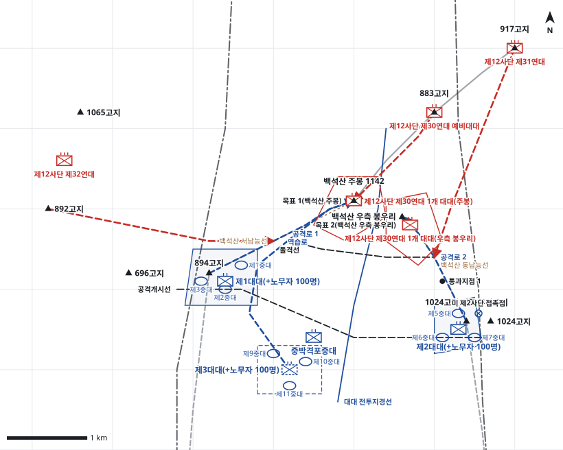

# kb1_190 · 백석산 전투

| 관점 | 임무 유형 | 구간 | 실제 결과 | 좌표 | 보정용 | 사람 검토 |
|---|---|---|---|---|---|---|
| 국군 제8사단 제10연대 | 공격 | t=6~38 (32h) | success | text | 예 | no |

**구간**: 국군 제8사단이 제7사단과 임무를 교대한 뒤 9월 29일 공격준비를 마치고, 9월 30일 07:00 제10연대를 주공으로 백석산 주봉과 우측 봉우리를 공격해 10월 1일 11:55 주봉을, 이어 우측 봉우리를 점령한 구간.

**출처**: 국방부 군사편찬연구소, 『6·25전쟁 주요전투 1』(2017), '백석산 전투' (pdf 570쪽)

| 파일 | 내용 | 생성 모델에 |
|---|---|---|
| [`situation.json`](situation.json) | 상황 (익명화) | 줌 |
| [`coa.json`](coa.json) | pseudo-GT COA (익명화) | 예시로만 |
| [`scenario.json`](scenario.json) | 적 계획·환경 (시뮬레이터 전용) | 주지 않음 |
| [`history.json`](history.json) | 실제 경과 (평가 전용) | 주지 않음 |
| [`source.json`](source.json) | 출처·결과 라벨·자동 검사 | 주지 않음 |
| [`real_names/`](real_names) | 상황·COA 실명판 | 주지 않음 |

## 약도

## pseudo-GT COA (실명판)

**전투편성** 제1대대(+노무자 100명), 제2대대(+노무자 100명), 제3대대(+노무자 100명), 중박격포중대 / 지원: 제8사단 포병 1개 대대(직접지원), 근접항공지원
**1. 상황**
  **가. 지형** 백석산 주봉은 단장의 능선과 문등리 계곡을 감제하는 핵심 지형이고 우측 봉우리는 주봉의 동측방을 지배한다. 접근로는 894고지에서 오르는 서남능선과 무명고지에서 오르는 동남능선 2개뿐이며 급경사로 협소하다. 적의 역습로는 883고지에서 주봉으로 이어지는 능선이다.
  **나. 적** 적 제30연대는 2개 대대로 백석산 주봉과 우측 봉우리의 기존 진지에서 방어하다가 883고지의 예비대대로 주봉에 역습해 올 것이다. 좌우측의 적 제32연대와 제31연대는 892고지와 917고지 일대에서 측방 화력으로 방어를 지원할 것이다.
  **다. 가정**
    **(1)** 대대 세부 보충: 제1대대는 894고지, 제2대대는 무명고지를 공격대기지점으로 쓰고 중대 배치는 추정한다.
    **(2)** 미 제2사단은 1024고지를 계속 확보해 연대 우측방이 안전하다.
    **(3)** 대대별 노무자 100명으로 급경사 능선에서 탄약·식량 보급을 유지할 수 있다.
    **(4)** 주간에 근접항공지원을 받을 수 있다.
**2. 임무** 제10연대는 D일 07:00 백석산 서남능선과 동남능선을 따라 공격하여 백석산 주봉과 우측 봉우리를 탈취함으로써 단장의 능선과 문등리 계곡을 감제한다.
**3. 실시**
  **가. 최종상태** 아군 연대가 백석산 주봉과 우측 봉우리를 확보하고 883고지 방향의 적 역습을 격퇴할 태세를 갖춘다.
  **나. 작전개념** 2개 대대가 서남·동남 두 능선으로 동시에 공격해 주봉과 우측 봉우리를 협공한다. 주공 제1대대는 주봉을, 제2대대는 우측 봉우리를 탈취해 주봉의 동측방을 차단한다. 제3대대는 예비로 주봉에 대한 적 역습에 대비한다.
    **(1) 기동** 제1대대는 894고지에서 서남능선으로 주봉을 공격하고, 제2대대는 무명고지에서 동남능선으로 우측 봉우리를 공격한다. 두 대대는 돌격선에서 포병 사격 연신과 근접항공지원에 맞춰 돌격한다.
    **(2) 화력** 공격준비사격은 주봉과 우측 봉우리에 집중한다. 돌격 시 화력을 883고지 역습로로 연신해 적 예비를 차단한다. 근접항공지원은 돌격선 도달 시 정상 진지에 요청한다.
  **다. 예하부대 과업**
    **(1) 제1대대(+노무자 100명)** D일 07:00 공격로 1을 따라 서남능선으로 백석산 주봉을 공격한다. 돌격선에서 화력 연신과 근접항공지원에 맞춰 돌격해 백석산 주봉을 탈취한다. 883고지 방향의 역습에 대비해 백석산 주봉을 확보한다.
    **(2) 제2대대(+노무자 100명)** D일 07:00 공격로 2를 따라 동남능선으로 백석산 우측 봉우리를 공격한다. 백석산 우측 봉우리를 탈취한다. 주봉 동측방을 보호하도록 백석산 우측 봉우리를 확보한다.
    **(3) 제3대대(+노무자 100명)** 명에 의해 역습로를 따라 백석산 주봉으로 역습한다. 명에 의해 통과지점 1에서 제2대대를 초월한다.
    **(4) 중박격포중대** 제1대대의 주봉 공격을 화력지원한다.
  **라. 협조지시**
    **(1) 시간계획** D일 00:00까지 공격대기지점 점령과 공격준비를 완료한다. / D일 06:30 공격준비사격을 개시한다. / H시는 D일 07:00이다.
    **(2) 통제수단** 공격개시선, 목표 1(백석산 주봉), 목표 2(백석산 우측 봉우리), 공격로 1, 공격로 2, 대대 전투지경선, 돌격선, 예비 집결지, 역습로, 통과지점 1, 미 제2사단 접촉점
