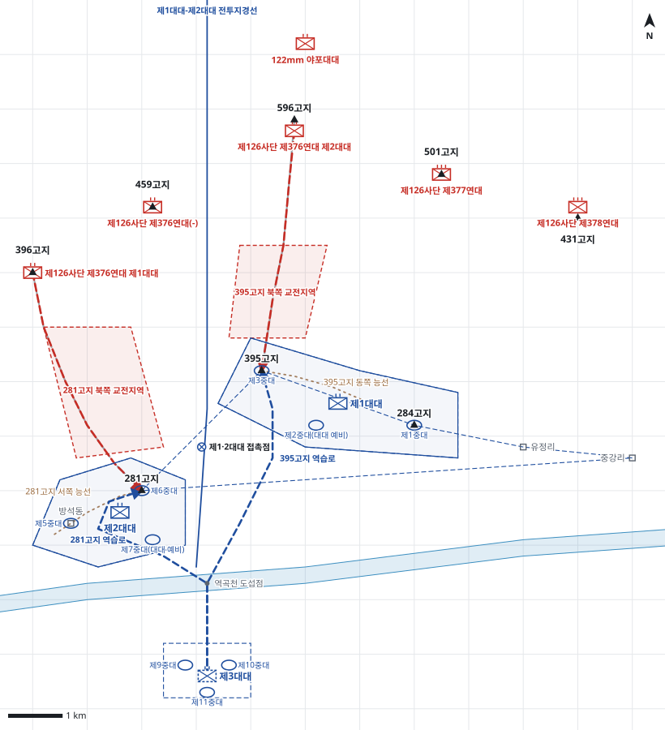

# kb2_008 · 281고지 및 395고지 전투

| 관점 | 임무 유형 | 구간 | 실제 결과 | 좌표 | 보정용 | 사람 검토 |
|---|---|---|---|---|---|---|
| 제29연대 | 지역방어 | t=22.5~83.5 (61h) | partial | text | 아니오 | no |

**구간**: 281고지 및 395고지 전투 전체(중공군의 281고지 공격 개시부터 제28연대의 395고지 탈환까지)

**출처**: 국방부 군사편찬연구소, 『6·25전쟁 주요전투 2』(2017), '281고지 및 395고지 전투' (pdf 41쪽)

| 파일 | 내용 | 생성 모델에 |
|---|---|---|
| [`situation.json`](situation.json) | 상황 (익명화) | 줌 |
| [`coa.json`](coa.json) | pseudo-GT COA (익명화) | 예시로만 |
| [`scenario.json`](scenario.json) | 적 계획·환경 (시뮬레이터 전용) | 주지 않음 |
| [`history.json`](history.json) | 실제 경과 (평가 전용) | 주지 않음 |
| [`source.json`](source.json) | 출처·결과 라벨·자동 검사 | 주지 않음 |
| [`real_names/`](real_names) | 상황·COA 실명판 | 주지 않음 |

## 약도

## pseudo-GT COA (실명판)

**전투편성** 제1대대, 제2대대, 제3대대(연대 예비) / 지원: 사단 포병대대(직접지원)
**1. 상황**
  **가. 지형** 281고지와 395고지는 철원 일대와 3번·43번 도로를 감제하는 핵심 지형이다. 적 접근로는 396고지에서 계곡을 따라 281고지로, 596고지에서 능선을 따라 395고지로 이어진다. 연대 예비는 역곡천을 건너 전초로 나가야 한다.
  **나. 적** 적 제126사단은 포격 후 연대 전초를 공격해 올 것이다. 1개 대대는 396고지에서 계곡을 따라 281고지를 3면에서 공격해 오고, 1개 대대는 596고지에서 능선을 따라 395고지로 공격해 올 것이다. 공격은 야간에 포격과 파상공격으로 반복될 것이다.
  **다. 가정**
    **(1)** 대대 세부 보충: 제2대대는 제6중대를 281고지, 제5중대를 방석동, 제7중대를 대대 예비로, 제1대대는 제3중대를 395고지, 제1중대를 284고지, 제2중대를 대대 예비로 둔다.
    **(2)** 사단 포병대대는 연대 정면에 직접지원 화력을 제공한다.
    **(3)** 역곡천 도섭점은 야간에도 대대 통과가 가능하다.
    **(4)** 395고지 상실 시 사단 예비 제28연대가 역습한다.
**2. 임무** 제29연대는 D일 22:30부터 중강리-유정리-284고지-395고지-281고지 선을 방어하여 281고지와 395고지를 고수하고 적의 철원 일대 접근을 저지한다.
**3. 실시**
  **가. 최종상태** 281고지와 395고지를 아군이 보유하고 적 공격 대대는 전초 전방에서 격퇴된다.
  **나. 작전개념** 2개 대대를 전방에 두어 281고지와 395고지를 고수하고 제3대대를 역곡천 남쪽에 예비로 둔다. 주력은 적 주 접근로상의 281고지를 맡은 제2대대다. 적이 전초에 돌입하면 예비가 역습해 회복한다.
    **(1) 기동** 제2대대는 방석동-281고지를, 제1대대는 284고지-395고지를 방어한다. 각 대대는 주봉 중대에 화력을 집중하고 대대 예비로 진내 역습한다. 제3대대는 281고지 방향을 우선으로 역습을 준비한다.
    **(2) 화력** 사단 포병은 281고지 북쪽 교전지역에 우선 화력을 두고, 다음으로 395고지 북쪽 교전지역에 둔다. 전초 돌입 시 진내 인접 사격으로 적 후속제대를 차단한다.
  **다. 예하부대 과업**
    **(1) 제2대대** 281고지를 고수한다. 방석동 일대를 방어한다.
    **(2) 제1대대** 395고지를 고수한다. 284고지 일대를 방어한다.
    **(3) 제3대대** 역곡천 남쪽 예비진지를 점령한다. 명에 의해 281고지로 역습한다. 명에 의해 395고지로 역습한다.
  **라. 협조지시**
    **(1) 시간계획** D일 22:30 전 부대 전투태세 돌입 / D일 23:30 제3대대 역습 준비 완료
    **(2) 통제수단** 연대 방어선(중강리-유정리-284고지-395고지-281고지), 제2대대 진지(방석동-281고지), 제1대대 진지(284고지-395고지), 제1대대-제2대대 전투지경선, 제1·2대대 접촉점, 281고지 북쪽 교전지역, 395고지 북쪽 교전지역, 연대 예비진지, 281고지 역습로, 395고지 역습로
