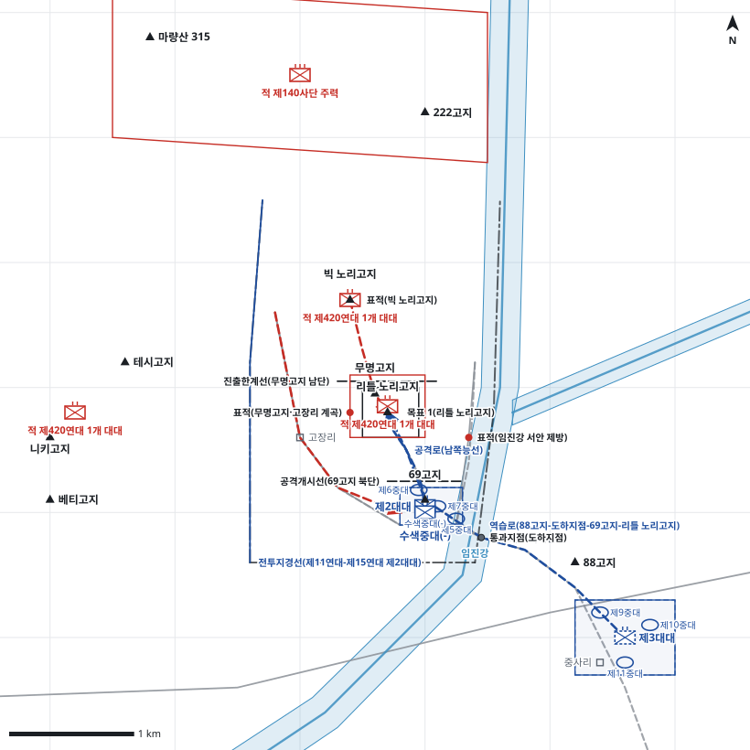

# kb2_011 · 임진강 부근 전투

| 관점 | 임무 유형 | 구간 | 실제 결과 | 좌표 | 보정용 | 사람 검토 |
|---|---|---|---|---|---|---|
| 제11연대 | 역습 | t=13~65 (52h) | partial | text | 아니오 | no |

**구간**: 전투 전체(12.11 01:30 중공군 기습~12.13 일몰 전 철수 명령). 명령 시점은 사단의 리틀 노리고지 탈취 명령을 받은 제11연대의 첫 결심(12.11 13:00).

**출처**: 국방부 군사편찬연구소, 『6·25전쟁 주요전투 2』(2017), '임진강 부근 전투' (pdf 54쪽)

| 파일 | 내용 | 생성 모델에 |
|---|---|---|
| [`situation.json`](situation.json) | 상황 (익명화) | 줌 |
| [`coa.json`](coa.json) | pseudo-GT COA (익명화) | 예시로만 |
| [`scenario.json`](scenario.json) | 적 계획·환경 (시뮬레이터 전용) | 주지 않음 |
| [`history.json`](history.json) | 실제 경과 (평가 전용) | 주지 않음 |
| [`source.json`](source.json) | 출처·결과 라벨·자동 검사 | 주지 않음 |
| [`real_names/`](real_names) | 상황·COA 실명판 | 주지 않음 |

## 약도

## pseudo-GT COA (실명판)

**전투편성** 제2대대, 제3대대(연대 예비), 수색중대(-) / 지원: 제5포병단, 군단포병, 사단 전차중대, 근접항공지원
**1. 상황**
  **가. 지형** 리틀 노리고지는 임진강 동안 주저항선 후방을 감제하는 핵심 지형이다. 빅 노리고지와 무명고지가 이를 측방에서 내려다본다. 아군 접근로는 69고지에서 남쪽능선으로 가는 좁은 1개 축뿐이다. 적의 접근로는 빅 노리고지 정면, 고장리 계곡, 임진강 서안 제방의 세 방향이다.
  **나. 적** 적 제420연대는 1개 대대(-)로 리틀 노리고지와 무명고지에서 방어하다가, 일몰 후 빅 노리고지의 1개 대대로 역습해 올 것이다. 역습 부대는 병력을 나누어 빅 노리고지 정면, 고장리 계곡, 임진강 서안 제방의 삼면에서 동시에 공격하고, 지원포병의 집중사격을 받을 것이다.
  **다. 가정**
    **(1)** 대대 세부 보충: 제2대대는 제6중대를 선두로 제7중대, 제5중대 순으로 종대 공격하고, 제5중대를 대대 예비로 둔다.
    **(2)** 공중폭격과 사단·군단 포병은 H시 전 리틀 노리고지에 화력을 집중할 수 있다.
    **(3)** 제15연대 제3대대 혼성소대는 69고지와 도하지점을 계속 확보한다.
    **(4)** 제1대대는 사단 통제 아래 남는다.
**2. 임무** 제11연대는 D일 13:30 리틀 노리고지를 탈취하여 주저항선 후방에 대한 적의 감제를 차단하고 베티고지 동측을 보호한다.
**3. 실시**
  **가. 최종상태** 리틀 노리고지를 아군이 확보하고 일몰 전 삼면 방어를 편성해 적의 야간 역습을 격퇴할 태세를 갖춘다.
  **나. 작전개념** 공중폭격과 포병 집중사격으로 리틀 노리고지를 제압한 뒤 제2대대가 남쪽능선을 따라 종대로 돌격해 고지를 탈취한다. 탈취 후 일몰 전에 삼면 방어를 편성하고, 측방은 화력으로 차단한다. 제3대대는 임진강 동안에서 역습을 준비한다.
    **(1) 기동** 제2대대는 69고지에서 출발해 제6중대를 선두로 남쪽능선을 따라 리틀 노리고지를 탈취한다. 수색중대(-)는 69고지를 확보하고 공격을 화력으로 지원한다. 제3대대는 88고지 후방 예비진지에서 도하지점을 거쳐 역습을 준비한다.
    **(2) 화력** H-30분부터 공중폭격과 제5포병단·군단포병의 집중사격을 리틀 노리고지에 실시한다. 돌격 중에는 빅 노리고지와 무명고지를 제압해 측방 사격을 막는다. 탈취 후에는 빅 노리고지 정면, 고장리 계곡, 서안 제방에 방어사격을 계획한다.
  **다. 예하부대 과업**
    **(1) 제2대대** H시에 제6중대를 선두로 종대대형으로 남쪽능선을 따라 리틀 노리고지를 탈취한다. 일몰 전 빅 노리고지 정면, 고장리 계곡, 서안 제방을 향해 삼면 방어를 편성하고 리틀 노리고지를 확보한다. 명에 의해 적이 고지에 다시 들어오면 대대 예비로 리틀 노리고지에 역습한다.
    **(2) 제3대대** 88고지 후방 예비진지를 점령한다. 명에 의해 도하지점과 69고지를 거쳐 리틀 노리고지로 역습한다.
    **(3) 수색중대(-)** 제15연대 혼성소대와 함께 69고지를 확보한다. 69고지에서 무명고지와 고장리 계곡을 사격해 제2대대 공격을 화력지원한다.
  **라. 협조지시**
    **(1) 시간계획** D일 13:00 명령 하달, 공중폭격과 포격 개시 / D일 13:30 H시, 제2대대 공격개시선 통과 / D일 15:00 제3대대 예비진지 점령 완료 / D일 17:00 리틀 노리고지 삼면 방어 편성과 방어사격 계획 완료
    **(2) 통제수단** 공격개시선(69고지 북단), 공격대기지점(69고지), 목표 1(리틀 노리고지), 진출한계선(무명고지 남단), 공격로(남쪽능선), 역습로(88고지-도하지점-69고지-리틀 노리고지), 통과지점(도하지점), 제3대대 예비진지, 표적(무명고지·고장리 계곡), 표적(빅 노리고지), 표적(임진강 서안 제방), 전투지경선(제11연대-제15연대 제2대대)
