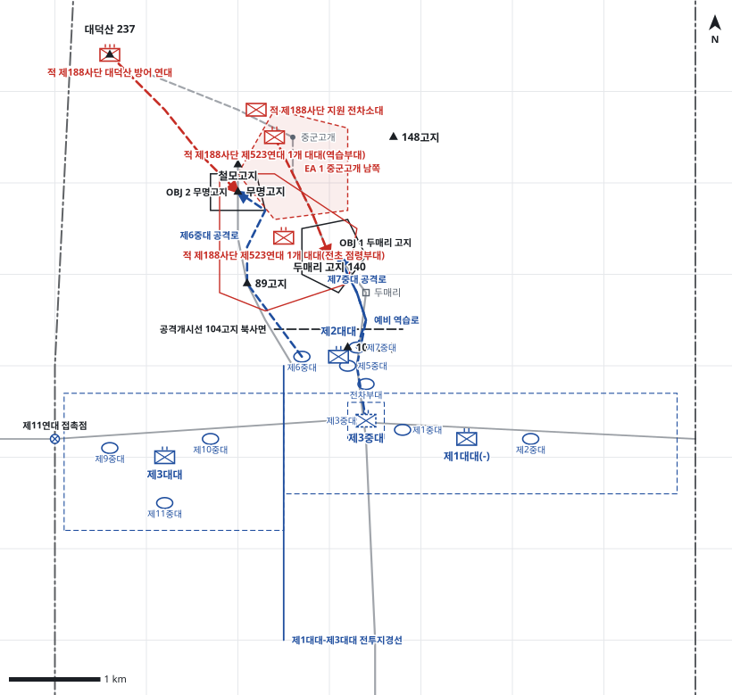

# kb2_013 · 두매리 전투

| 관점 | 임무 유형 | 구간 | 실제 결과 | 좌표 | 보정용 | 사람 검토 |
|---|---|---|---|---|---|---|
| 국군 제1사단 제12연대 | 공격 | t=7~42 (35h) | failure | text | 예 | no |

**구간**: 제1차전: 중공군이 제5중대 전초를 탈취한 뒤 제12연대가 제2대대로 두매리 고지와 무명고지 탈환을 시도한 2일간

**출처**: 국방부 군사편찬연구소, 『6·25전쟁 주요전투 2』(2017), '두매리 전투' (pdf 61쪽)

| 파일 | 내용 | 생성 모델에 |
|---|---|---|
| [`situation.json`](situation.json) | 상황 (익명화) | 줌 |
| [`coa.json`](coa.json) | pseudo-GT COA (익명화) | 예시로만 |
| [`scenario.json`](scenario.json) | 적 계획·환경 (시뮬레이터 전용) | 주지 않음 |
| [`history.json`](history.json) | 실제 경과 (평가 전용) | 주지 않음 |
| [`source.json`](source.json) | 출처·결과 라벨·자동 검사 | 주지 않음 |
| [`real_names/`](real_names) | 상황·COA 실명판 | 주지 않음 |

## 약도

## pseudo-GT COA (실명판)

**전투편성** 제2대대, 제1대대(-), 제3대대 / 연대 예비: 제3중대 / 지원: 사단 포병대대(직접지원), 전차부대, 근접항공지원
**1. 상황**
  **가. 지형** 두매리 고지는 평탄지의 유일한 고지로 대덕산 동측방을 위협하고 사단 정면을 감제하는 핵심 지형이다. 무명고지와 철모고지는 두매리 고지 서북측을 감제하여 두매리 고지 유지의 전제가 된다. 접근로는 104고지에서 두매리 고지로 이르는 도로와 89고지 능선이다.
  **나. 적** 적 제523연대는 두매리 고지와 무명고지에서 급편방어하다가 철모고지·중군고개의 예비 대대로 역습해 올 것이다. 1개 대대는 중군고개에서 두매리 고지로, 대덕산 방어 연대 일부는 대덕산에서 무명고지로 역습하며 전차포와 박격포를 집중할 것이다.
  **다. 가정**
    **(1)** 적은 점령한 전초에 급편진지만 구축했고 지뢰와 철조망은 설치하지 못했다.
    **(2)** 주간에 미 공군 전폭기와 사단 포병의 집중 지원을 받을 수 있다.
    **(3)** 대대 세부 보충: 제1대대 제3중대를 연대 예비로, 제1대대(-)와 제3대대는 주저항선을 유지한다.
**2. 임무** 제12연대는 D일 07:30 두매리 고지와 무명고지를 탈취하여 사단 전진거점을 회복하고 적의 사단 정면 수색을 제한한다.
**3. 실시**
  **가. 최종상태** 제2대대가 두매리 고지와 무명고지를 확보하고 적 역습을 격퇴하며, 주저항선은 온전하다.
  **나. 작전개념** 공격준비사격에 이어 제2대대가 두 중대로 두매리 고지와 무명고지를 동시에 탈취하고, 제1대대(-)가 전차포와 직사화력으로 철모고지와 중군고개를 제압한다. 탈취 즉시 진지를 재편하고 포병 방어사격으로 적 역습을 격퇴하며, 제3중대로 역습에 대비한다.
    **(1) 기동** 제7중대는 104고지에서 두매리 고지로 정면 공격하고, 제6중대는 89고지 능선을 따라 무명고지를 일부 우회 공격한다. 제5중대는 104고지를 지키며 후속한다.
    **(2) 화력** 사단 포병은 공격준비사격 후 철모고지·중군고개·대덕산에 차단사격을 하고, 목표 탈취 후 역습로에 방어사격을 계획한다. 전차는 104고지에서 적 화기를 직접 제압한다. 항공은 대덕산 방면 적 포병과 전차를 공격한다.
  **다. 예하부대 과업**
    **(1) 제2대대** 제7중대로 104고지에서 두매리 고지를 탈취한다. 제6중대로 89고지 능선을 따라 일부를 우회시켜 무명고지를 탈취한다. 두매리 고지와 무명고지를 확보한다.
    **(2) 제1대대(-)** 주저항선 우측 지역을 방어한다. 전차포와 기관총으로 제2대대의 공격을 화력지원한다.
    **(3) 제3대대** 주저항선 좌측 지역을 방어한다. 89고지 방면 적을 화력으로 견제한다.
    **(4) 제3중대** 명에 의해 두매리 고지로 역습한다. 명에 의해 104고지로 역습한다.
  **라. 협조지시**
    **(1) 시간계획** 공격준비사격 개시 D일 07:00 / H시 D일 07:30 제2대대 공격 개시 / 예비 제3중대 예비진지 점령 완료 D일 07:00
    **(2) 통제수단** OBJ 1 두매리 고지, OBJ 2 무명고지, 공격개시선 104고지 북사면, 제7중대 공격로, 제6중대 공격로, EA 1 중군고개 남쪽, 예비 역습로, 연대 예비진지, 제1대대 방어지역, 제3대대 방어지역, 제1대대-제3대대 전투지경선, 제11연대 접촉점
