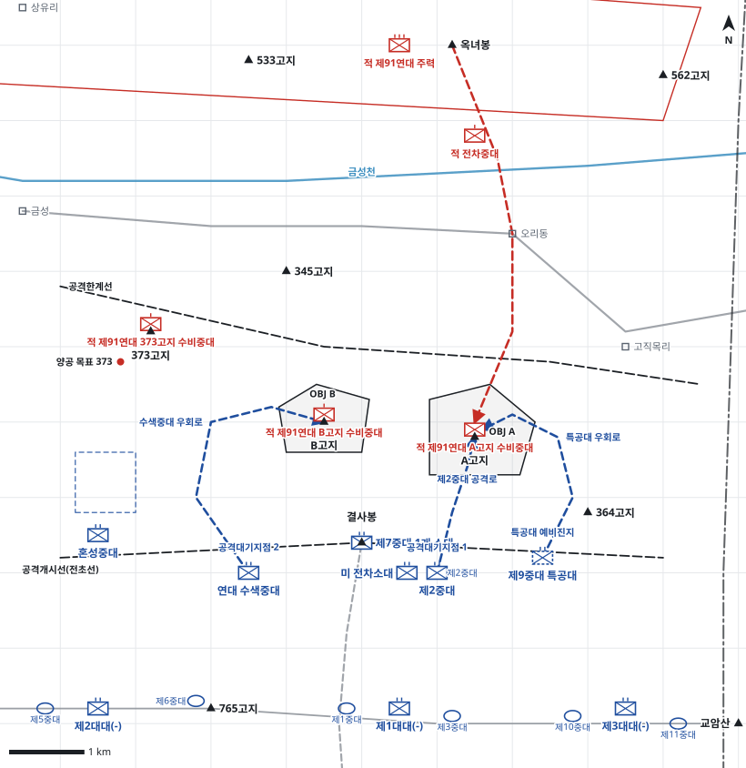

# kb2_017 · A고지 및 B고지 전투

| 관점 | 임무 유형 | 구간 | 실제 결과 | 좌표 | 보정용 | 사람 검토 |
|---|---|---|---|---|---|---|
| 제2연대 | 공격 | t=3.5~24.0 (20.5h) | success | text | 아니오 | no |

**구간**: 1952년 6월 12일 03:30~24:00, 국군 제6사단 제2연대의 A고지·B고지 제한공격(373고지 양공 포함). 두 고지를 점령하고 전초진지를 설치하는 시점까지.

**출처**: 국방부 군사편찬연구소, 『6·25전쟁 주요전투 2』(2017), 'A고지 및 B고지 전투' (pdf 76쪽)

| 파일 | 내용 | 생성 모델에 |
|---|---|---|
| [`situation.json`](situation.json) | 상황 (익명화) | 줌 |
| [`coa.json`](coa.json) | pseudo-GT COA (익명화) | 예시로만 |
| [`scenario.json`](scenario.json) | 적 계획·환경 (시뮬레이터 전용) | 주지 않음 |
| [`history.json`](history.json) | 실제 경과 (평가 전용) | 주지 않음 |
| [`source.json`](source.json) | 출처·결과 라벨·자동 검사 | 주지 않음 |
| [`real_names/`](real_names) | 상황·COA 실명판 | 주지 않음 |

## 약도

## pseudo-GT COA (실명판)

**전투편성** 제2중대(제1대대), 연대 수색중대, 제7중대 1개 소대, 혼성중대(제2대대 2개 소대), 제9중대 특공대(2개 분대), 제1대대(-), 제2대대(-), 제3대대(-) / 지원: 국군 포병대대(직접지원), 미 전차소대(직접지원), 미 자주포병대대(일반지원), 근접항공지원
**1. 상황**
  **가. 지형** A고지는 금성 동남쪽 개활지와 고직목리-오리동 일대를 감제하는 핵심 지형이며 암벽 화력거점이 있다. B고지는 결사봉 북쪽에서 A고지 서측방을 엄호한다. 접근로는 결사봉에서 A고지 남쪽 능선, 금성 동남쪽을 돌아 B고지 서남쪽에 이르는 우회로, A고지 동북쪽 측방 능선이다.
  **나. 적** 적 제91연대는 A고지·B고지·373고지 전초진지를 각 1개 중대로 방어할 것이다. 아군 공격이 시작되면 적 포병은 화력을 공격받는 거점에 집중하고, 전초를 잃으면 주저항선의 1개 대대(-)가 오리동을 거쳐 A고지로 역습해 올 것이다.
  **다. 가정**
    **(1)** 대대 세부 보충: 주저항선 대대 배치(좌 제2대대, 중앙 제1대대, 우 제3대대)와 공격대기지점 위치는 서술에 없어 보충했다.
    **(2)** 적 포병은 373고지 공격준비사격과 양공에 반응해 처음에는 화력을 373고지로 집중할 것이다.
    **(3)** 근접항공지원과 포병 추가사격은 주간 요청 시 A고지에 집중할 수 있다.
**2. 임무** 제2연대는 D일 04:00 373고지에 양공하면서 A고지와 B고지를 탈취하여 적 제91연대의 공격 거점을 제거하고 금성 동남쪽 일대를 감제하는 전초진지를 확보한다.
**3. 실시**
  **가. 최종상태** A고지와 B고지에 전초진지를 설치하고 주저항선을 온전히 유지한다.
  **나. 작전개념** 373고지에 공격준비사격과 양공을 먼저 가해 적 포병을 서쪽으로 끌어낸다. 주공 제2중대는 결사봉에서 A고지를 정면 공격하고, 수색중대는 금성 동남쪽으로 우회해 B고지를 서측방에서 공격하며 제7중대 1개 소대가 정면에서 협공한다. 제9중대 특공대는 A고지 공격이 막히면 동북쪽으로 우회해 측방에서 돌입한다.
    **(1) 기동** 양공(373고지)으로 기만하고, 주공은 A고지 정면, 조공은 B고지 측방 우회와 정면 협공으로 실시한다.
    **(2) 화력** 03:30~04:00 373고지에 공격준비사격 30분을 집중한다. 04:00 이후 포병대대는 A고지, 이어 B고지를 지원하고 미 전차소대는 결사봉 일대에서 제2중대를 직접 사격 지원한다. A고지 저항이 강하면 근접항공지원과 포병 집중사격을 요청한다.
  **다. 예하부대 과업**
    **(1) 제2중대** H시에 결사봉에서 A고지 남쪽 능선을 따라 A고지를 탈취한다. 이어서 A고지에 전초진지를 설치하고 A고지를 확보한다.
    **(2) 연대 수색중대** H시에 금성 동남쪽으로 B고지 수비 중대를 우회한다. 이어서 B고지 서남쪽에서 측방 공격해 B고지를 탈취한다.
    **(3) 제7중대 1개 소대** H시에 결사봉에서 B고지 수비 중대를 정면에서 고착한다. 이어서 수색중대와 협공해 B고지를 확보한다.
    **(4) 혼성중대** H시에 남쪽과 서남쪽 능선으로 373고지의 적을 공격해 견제한다. 명에 의해 373고지 남쪽 계곡으로 철수한다.
    **(5) 제9중대 특공대** 명에 의해 A고지 동북쪽으로 우회해 A고지를 측방에서 공격한다.
    **(6) 제1대대(-)** 미주리선 중앙 주저항선을 방어한다.
    **(7) 제2대대(-)** 765고지 일대 좌측 주저항선을 방어한다.
    **(8) 제3대대(-)** 교암산 서쪽 우측 주저항선을 방어한다. 364고지 방면 A고지 동측방을 경계한다.
    **(9) 미 전차소대** A고지 화력거점을 직접 사격해 제2중대를 화력지원한다.
  **라. 협조지시**
    **(1) 시간계획** D일 03:30 373고지 공격준비사격 개시 / D일 04:00 H시, 전 공격부대 공격 개시
    **(2) 통제수단** 공격개시선(전초선), OBJ A, OBJ B, 양공 목표 373, 공격대기지점 1, 특공대 예비진지, 공격대기지점 2, 제2중대 공격로, 수색중대 우회로, 373고지 남쪽 계곡, 특공대 우회로, 공격한계선
