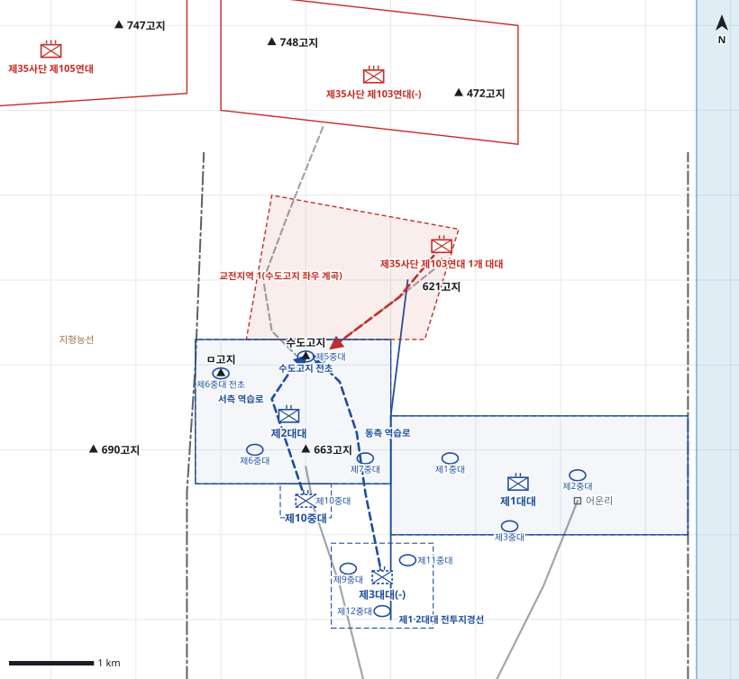

# kb2_018 · 수도고지 및 지형능선 전투

| 관점 | 임무 유형 | 구간 | 실제 결과 | 좌표 | 보정용 | 사람 검토 |
|---|---|---|---|---|---|---|
| 수도사단 제26연대 | 지역방어 | t=12~98 (86h) | partial | text | 예 | no |

**구간**: 수도고지 및 지형능선 전투 제3차전 중 제26연대의 수도고지 방어, 상실, 역습과 탈환(9. 6. 18:50 적 공격부터 9. 9. 23:20 탈환과 반격 격퇴까지)

**출처**: 국방부 군사편찬연구소, 『6·25전쟁 주요전투 2』(2017), '수도고지 및 지형능선 전투' (pdf 80쪽)

| 파일 | 내용 | 생성 모델에 |
|---|---|---|
| [`situation.json`](situation.json) | 상황 (익명화) | 줌 |
| [`coa.json`](coa.json) | pseudo-GT COA (익명화) | 예시로만 |
| [`scenario.json`](scenario.json) | 적 계획·환경 (시뮬레이터 전용) | 주지 않음 |
| [`history.json`](history.json) | 실제 경과 (평가 전용) | 주지 않음 |
| [`source.json`](source.json) | 출처·결과 라벨·자동 검사 | 주지 않음 |
| [`real_names/`](real_names) | 상황·COA 실명판 | 주지 않음 |

## 약도

## pseudo-GT COA (실명판)

**전투편성** 제1대대, 제2대대, 제10중대, 제3대대(-제10중대) / 지원: 사단 포병 105mm 대대(직접지원), 근접항공지원
**1. 상황**
  **가. 지형** 수도고지는 적 접근로와 계곡을 관측하는 핵심 전초이며 663고지 주저항선의 눈이다. 적 접근로는 621고지에서 수도고지 좌우 계곡으로 이어진다. 663고지는 주저항선과 역습의 발판이다.
  **나. 적** 적 제103연대는 대규모 공격준비사격 후 야간에 1개 대대로 수도고지 좌우 계곡에서 공격해 올 것이다. 일부는 ㅁ고지를 공격해 고착하고, 수도고지 탈취 후 주방어선 병력으로 고지를 강화할 것이다.
  **다. 가정**
    **(1)** 대대 세부 보충: 제2대대는 제5중대를 수도고지, 제6중대를 663고지와 ㅁ고지에 둔다.
    **(2)** 제10중대는 연대장 직접 통제 역습부대로 663고지 후사면에 둔다.
    **(3)** 정면의 적은 제35사단 제103연대로 본다.
    **(4)** 연대 역습이 실패하면 사단 예비 제1연대 대대가 배속된다.
**2. 임무** 제26연대는 D일부터 663고지-어운리 주저항선과 수도고지 전초를 방어하여 중공군 접근로에 대한 관측·통제를 유지한다.
**3. 실시**
  **가. 최종상태** 수도고지와 663고지-어운리 주저항선을 확보하고 적 공격 대대를 진지 전방에서 격퇴한다.
  **나. 작전개념** 제2대대가 수도고지 전초와 663고지를 고수하고 제1대대가 어운리까지 주저항선을 방어한다. 적이 수도고지에 들어오면 제10중대가 즉시 역습하고, 실패하면 제3대대(-)가 역습한다.
    **(1) 기동** 제2대대 주력, 제1대대 우측 방어, 제10중대 즉각 역습, 제3대대(-) 2차 역습.
    **(2) 화력** 포병 우선은 제2대대에 둔다. 수도고지 좌우 계곡을 교전지역으로 하여 탄막사격을 준비하고, 역습 시 수도고지 정상과 621고지에 화력을 집중한다.
  **다. 예하부대 과업**
    **(1) 제2대대** 제5중대로 수도고지 전초를 고수한다. 663고지와 ㅁ고지를 방어한다.
    **(2) 제1대대** 663고지 동측에서 어운리까지 주저항선을 방어한다.
    **(3) 제10중대** 663고지 후사면 예비진지를 점령한다. 명에 의해 서측 역습로로 수도고지를 역습한다.
    **(4) 제3대대(-)** 연대 후방 예비진지를 점령한다. 명에 의해 동측 역습로로 수도고지를 역습한다.
  **라. 협조지시**
    **(1) 시간계획** 전 진지 점령과 탄막 계획 완료 / 예비 역습 준비 완료
    **(2) 통제수단** 제2대대 방어지역, 제1대대 방어지역, 제1·2대대 전투지경선, 수도고지 전초, 교전지역 1(수도고지 좌우 계곡), 제10중대 예비진지, 제3대대 예비진지, 서측 역습로, 동측 역습로
