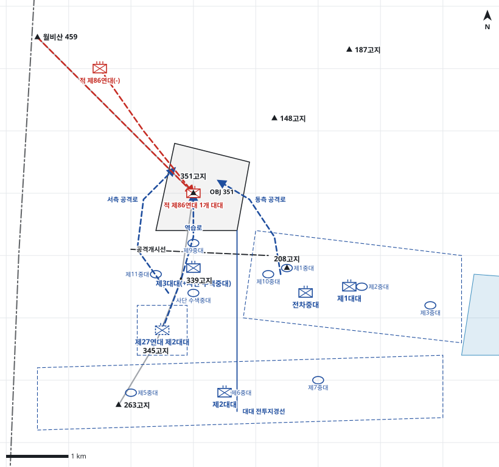

# kb2_019 · 351고지 전투

| 관점 | 임무 유형 | 구간 | 실제 결과 | 좌표 | 보정용 | 사람 검토 |
|---|---|---|---|---|---|---|
| 제35연대 | 역습 | t=8~84 (76h) | success | text | 예 | no |

**구간**: 1차전. D-1일 22:00 적 공격으로 351고지 피탈(D일 01:00), D일 08:00 사단 탈환 명령, 이후 제35연대 5차 역습과 제27연대 8차 공격 실패, D+2일 20:30 제2대대 양공으로 자정 무렵 탈환, D+3일 11:45 적 철수.

**출처**: 국방부 군사편찬연구소, 『6·25전쟁 주요전투 2』(2017), '351고지 전투' (pdf 85쪽)

| 파일 | 내용 | 생성 모델에 |
|---|---|---|
| [`situation.json`](situation.json) | 상황 (익명화) | 줌 |
| [`coa.json`](coa.json) | pseudo-GT COA (익명화) | 예시로만 |
| [`scenario.json`](scenario.json) | 적 계획·환경 (시뮬레이터 전용) | 주지 않음 |
| [`history.json`](history.json) | 실제 경과 (평가 전용) | 주지 않음 |
| [`source.json`](source.json) | 출처·결과 라벨·자동 검사 | 주지 않음 |
| [`real_names/`](real_names) | 상황·COA 실명판 | 주지 않음 |

## 약도

## pseudo-GT COA (실명판)

**전투편성** 제3대대(+사단 수색중대), 제1대대, 제2대대, 제27연대 제2대대 / 지원: 사단·군단 포병대대, 박격포 1개 소대, 전차중대, 함포, 근접항공지원
**1. 상황**
  **가. 지형** 351고지는 동해안 저지대를 감제하고 월비산 접근로를 통제하는 핵심 지형이다. 아군 접근로는 339고지 능선과 208고지 쪽 동서 능선이며, 적은 월비산 능선과 148고지 쪽에서 측방화력과 증원이 가능하다.
  **나. 적** 적 제86연대는 351고지를 1개 대대로 방어하면서 월비산과 148고지 방향에서 측방화력으로 지원할 것이다. 아군이 주봉에 이르면 월비산 능선을 따라 1개 대대로 야간 역습해 올 것이다.
  **다. 가정**
    **(1)** 적은 351고지 진지를 급편 상태로만 정비했다.
    **(2)** 함포와 사단 포병은 H시 전 공격준비사격이 가능하다.
    **(3)** 대대 세부 보충: 제3대대 중대 배치와 동서 우회 경로는 추정이다.
**2. 임무** 제35연대는 D일 14:15 351고지를 역습으로 탈취하여 동해안 저지대 감제와 월비산 접근로 통제를 회복한다.
**3. 실시**
  **가. 최종상태** 제3대대가 351고지를 확보하고 적 역습을 격퇴할 태세다.
  **나. 작전개념** 제3대대(+)가 동서 능선으로 우회해 351고지를 탈취한다. 제1대대와 전차중대는 동측에서 화력지원하고 제2대대는 주저항선을 방어한다. 제27연대 제2대대는 339고지 일대에서 역습을 준비한다.
    **(1) 기동** 제3대대는 동서 양 능선으로 동시에 접근해 주봉을 협공한다.
    **(2) 화력** H-30분 함포와 포병 공격준비사격, 공격 중 월비산·148고지 측방화력 제압.
  **다. 예하부대 과업**
    **(1) 제3대대(+사단 수색중대)** 동서 능선으로 우회하여 351고지를 탈취한다. 351고지를 확보한다.
    **(2) 제1대대** 208고지-감호 전초지역을 방어한다. 351고지 동측 공격을 화력지원한다.
    **(3) 제2대대** 주저항선을 방어한다.
    **(4) 제27연대 제2대대** 345고지 일대 예비진지를 점령한다. 명에 의해 351고지로 역습한다.
    **(5) 전차중대** 351고지 공격을 화력지원한다.
  **라. 협조지시**
    **(1) 시간계획** 예비 예비진지 점령 완료 D일 12:00 / 공격준비사격 D일 13:45 / H시 D일 14:15
    **(2) 통제수단** OBJ 351, 공격개시선, 동측 공격로, 서측 공격로, 대대 전투지경선, 예비진지, 역습로, 제1대대 전초지역, 주저항선 지역
