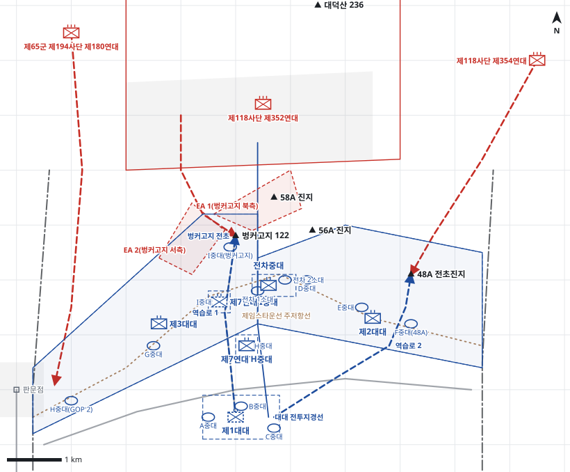

# kb2_020 · 벙커고지(122고지) 부근 전투

| 관점 | 임무 유형 | 구간 | 실제 결과 | 좌표 | 보정용 | 사람 검토 |
|---|---|---|---|---|---|---|
| 미 제1해병연대 | 지역방어 | t=0~76 (76h) | success | text | 아니오 | no |

**구간**: 8월 12일 새벽 122고지(벙커고지)를 점령한 뒤 미 제1해병연대가 벙커고지 전초와 주저항선을 방어한 구간이다. 8월 13일 01:00 공격부터 8월 16일 03:15 격퇴까지 포함한다.

**출처**: 국방부 군사편찬연구소, 『6·25전쟁 주요전투 2』(2017), '벙커고지(122고지) 부근 전투' (pdf 89쪽)

| 파일 | 내용 | 생성 모델에 |
|---|---|---|
| [`situation.json`](situation.json) | 상황 (익명화) | 줌 |
| [`coa.json`](coa.json) | pseudo-GT COA (익명화) | 예시로만 |
| [`scenario.json`](scenario.json) | 적 계획·환경 (시뮬레이터 전용) | 주지 않음 |
| [`history.json`](history.json) | 실제 경과 (평가 전용) | 주지 않음 |
| [`source.json`](source.json) | 출처·결과 라벨·자동 검사 | 주지 않음 |
| [`real_names/`](real_names) | 상황·COA 실명판 | 주지 않음 |

## 약도

## pseudo-GT COA (실명판)

**전투편성** 제3대대, 제7연대 H중대, 제2대대, 제1대대(연대 예비), 제7연대 I중대 / 지원: 제11해병연대 1개 대대(직접지원), 제1전차대대 1개 중대, 근접항공지원
**1. 상황**
  **가. 지형** 벙커고지는 중공군 후방을 관측하고 적 전초를 중립화하는 핵심 지형이다. 58A는 적 고지에서 감제되어 유지가 곤란하다. 적은 북쪽 전진 고지군에서 벙커고지 북·서측 경사로, 그리고 48A와 GOP 2 방향으로 접근한다.
  **나. 적** 적 제352연대는 벙커고지를 되찾으려고 야간에 포격 후 반복 공격해 올 것이다. 1개 대대는 북측과 서측에서 벙커고지로 공격해 오고, 1개 중대는 48A와 제2대대 주저항선을 동시에 공격해 올 것이다. 적 제180연대 일부는 사격제한구역을 이용해 GOP 2로 공격해 올 것이다.
  **다. 가정**
    **(1)** 제3대대 I중대가 D-1일 벙커고지 진지를 인수해 점령하고 있다.
    **(2)** 벙커고지 진지는 노무대가 구축 중인 급편진지다.
    **(3)** 판문점 사격제한구역에는 사격하지 않는다.
    **(4)** 중대 위치와 대대 전투지경선은 서술과 모순되지 않게 추정했다.
**2. 임무** 제1해병연대는 D일부터 판문점 동쪽 주저항선과 벙커고지 전초에서 방어하여 적의 전초 탈취를 저지하고 주저항선의 안전을 확보한다.
**3. 실시**
  **가. 최종상태** 벙커고지와 48A·GOP 2 전초를 유지하고 적 공격을 격퇴한다. 주저항선은 온전하다.
  **나. 작전개념** 제3대대가 벙커고지와 서부 주저항선을, 제2대대가 동부 주저항선과 48A를 방어한다. 벙커고지 정면 교전지역에 포병과 전차 화력을 집중해 적을 격퇴한다. 배속 I중대와 제1대대로 벙커고지 돌파에 역습한다.
    **(1) 기동** 제3대대 I중대가 벙커고지를 점령하고 D일 12:00 배속 H중대가 인수해 고수한다. 제2대대는 48A를 고수하고 58A·56A를 경계한다. I중대(제7연대)는 벙커고지 후방에서, 제1대대는 주저항선 후방에서 역습을 준비한다.
    **(2) 화력** 직접지원 포병은 EA 1·EA 2에 방어사격과 최후저지사격을 계획한다. 전차는 주저항선에서 벙커고지 정면에 직접사격한다. 주간 근접항공지원으로 적 전진 고지군을 공격한다.
  **다. 예하부대 과업**
    **(1) 제3대대** 서부 주저항선과 벙커고지에서 방어한다. GOP 2를 경계한다.
    **(2) 제7연대 H중대** 벙커고지 후방 집결지를 점령한다. D일 12:00부로 제3대대 I중대로부터 벙커고지 진지를 점령한다. 벙커고지를 고수한다.
    **(3) 제2대대** 동부 주저항선에서 방어한다. 48A 전초를 고수한다. 58A·56A 일대를 경계한다.
    **(4) 제1대대** 주저항선 후방 예비진지를 점령한다. 명에 의해 역습로 1로 벙커고지에 역습한다. 명에 의해 역습로 2로 48A에 역습한다.
    **(5) 제7연대 I중대** 벙커고지 후방 진지를 점령한다. 명에 의해 벙커고지 돌파구에 역습한다.
    **(6) 전차중대** 주저항선 화력지원진지를 점령한다. 벙커고지 정면 교전지역에 제3대대를 화력지원한다.
  **라. 협조지시**
    **(1) 시간계획** D일 00:00 진지 점령과 예비 준비 완료 / D일 12:00 H중대 벙커고지 점령 / D일 19:30 일몰 후 야간 방어사격계획 시행
    **(2) 통제수단** 대대 전투지경선, 제3대대 방어지역, 제2대대 방어지역, 벙커고지 전초, EA 1(벙커고지 북측), EA 2(벙커고지 서측), 연대 예비진지, H중대 집결지, I중대(제7연대) 진지, 전차 화력지원진지, 역습로 1, 역습로 2
