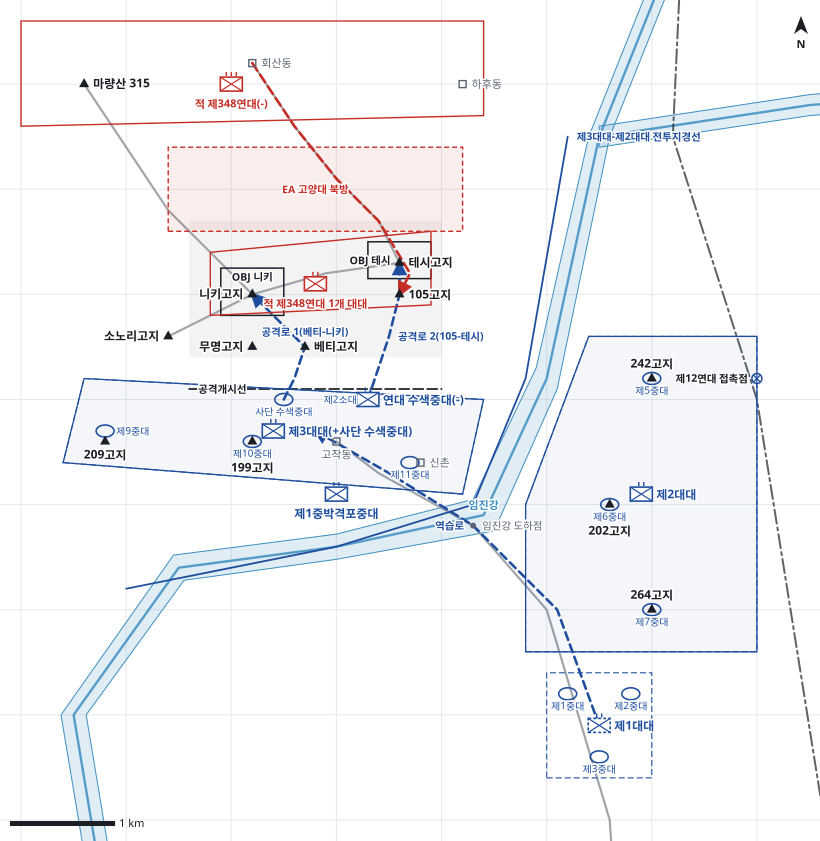

# kb2_022 · 고양대 부근 전투

| 관점 | 임무 유형 | 구간 | 실제 결과 | 좌표 | 보정용 | 사람 검토 |
|---|---|---|---|---|---|---|
| 제15연대 | 역습 | t=31~87 (56h) | partial | text | 아니오 | no |

**구간**: 중공군 제116사단 제348연대 1개 대대가 고양대의 니키·테시고지를 탈취한 뒤 제15연대가 역습을 거듭하다가 미 제1군단장 지시로 공격을 중지하고 현 진출선에 전진진지를 편성하기까지(10.6~10.9).

**출처**: 국방부 군사편찬연구소, 『6·25전쟁 주요전투 2』(2017), '고양대 부근 전투' (pdf 96쪽)

| 파일 | 내용 | 생성 모델에 |
|---|---|---|
| [`situation.json`](situation.json) | 상황 (익명화) | 줌 |
| [`coa.json`](coa.json) | pseudo-GT COA (익명화) | 예시로만 |
| [`scenario.json`](scenario.json) | 적 계획·환경 (시뮬레이터 전용) | 주지 않음 |
| [`history.json`](history.json) | 실제 경과 (평가 전용) | 주지 않음 |
| [`source.json`](source.json) | 출처·결과 라벨·자동 검사 | 주지 않음 |
| [`real_names/`](real_names) | 상황·COA 실명판 | 주지 않음 |

## 약도

## pseudo-GT COA (실명판)

**전투편성** 제3대대(+사단 수색중대), 연대 수색중대(-), 제2대대, 제1대대(연대 예비), 제1중박격포중대 / 지원: 제1사단 포병, 지원 전차부대, 근접항공지원
**1. 상황**
  **가. 지형** 니키고지와 테시고지는 주저항선을 감제하는 전진진지이며 베티고지와 105고지가 각각의 남쪽 발판이다. 적은 마량산과 회산동에서 능선을 따라 고양대로 증원할 수 있다. 임진강 도하점이 서안 제3대대의 유일한 후방 연결로다.
  **나. 적** 적 제348연대는 1개 대대로 니키고지와 테시고지에서 방어하다가 마량산-회산동의 증원 병력으로 105고지와 베티고지의 역습부대 배후로 역습해 올 것이다. 적 포병 제2사단은 제3대대 주진지와 임진강 도하점에 차단사격을 할 것이다.
  **다. 가정**
    **(1)** 동굴호에 연대 수색중대 고립 인원이 생존해 있다.
    **(2)** 대대 세부 보충: 제3대대는 제9·10·11중대로 209고지 북쪽 능선-199고지-신촌을, 제2대대는 임진강 동안 242-202-264고지를 점령하고 제1대대는 연대 예비로 둔다.
    **(3)** 임진강 도하점은 적 차단사격에도 주간에 사용할 수 있다.
**2. 임무** 제15연대는 D+1일 08:20 고양대에서 니키고지와 테시고지로 역습하여 적 제348연대 1개 대대를 격퇴하고 전진진지를 회복한다.
**3. 실시**
  **가. 최종상태** 니키고지와 테시고지를 탈취해 전진진지를 회복하고 임진강 양안 주저항선을 유지한다.
  **나. 작전개념** 사단 수색중대가 베티고지를 거쳐 니키고지를, 연대 수색중대(-)가 105고지를 거쳐 테시고지를 동시에 역습한다. 포병·박격포·항공은 고지 북사면과 적 증원로를 차단한다. 제1대대는 예비로 도하점 동안에서 제3대대 주진지 역습을 준비한다.
    **(1) 기동** 제3대대(+사단 수색중대)가 주공으로 니키고지를 탈취하고, 연대 수색중대(-)가 조공으로 테시고지를 탈취한다. 제3대대 주력과 제2대대는 주진지를 방어한다.
    **(2) 화력** 제1사단 포병과 근접항공지원은 니키·테시고지 북방과 마량산-회산동 증원로를 차단하고, 제1중박격포중대는 공격 중대를 근접 지원한다.
  **다. 예하부대 과업**
    **(1) 제3대대(+사단 수색중대)** 사단 수색중대로 베티고지를 거쳐 니키고지를 탈취한다. 니키고지를 확보한다. 제9·10·11중대로 주진지를 방어한다. 명에 의해 제10중대로 니키고지를 공격한다.
    **(2) 연대 수색중대(-)** 105고지를 탈취한다. 북쪽 능선을 따라 테시고지를 탈취한다. 테시고지를 확보한다.
    **(3) 제2대대** 임진강 동안 주저항선을 방어한다. 임진강 도하점을 경계한다.
    **(4) 제1대대** 예비진지를 점령한다. 명에 의해 도하점을 건너 제3대대 주진지로 역습한다.
    **(5) 제1중박격포중대** 니키고지 공격을 화력지원한다. 테시고지 공격을 화력지원한다.
  **라. 협조지시**
    **(1) 시간계획** D+1일 08:00 사단 수색중대 공격대기지점 점령 완료 / D+1일 08:20 H시 니키·테시고지 역습 개시 / D+1일 10:00 제1대대 예비진지 점령 완료
    **(2) 통제수단** OBJ 니키, OBJ 테시, 공격개시선, 제3대대-제2대대 전투지경선, 공격로 1(베티-니키), 공격로 2(105-테시), 역습로, 제3대대 주진지, EA 고양대 북방, 제2대대 진지, 연대 예비진지, 제12연대 접촉점
