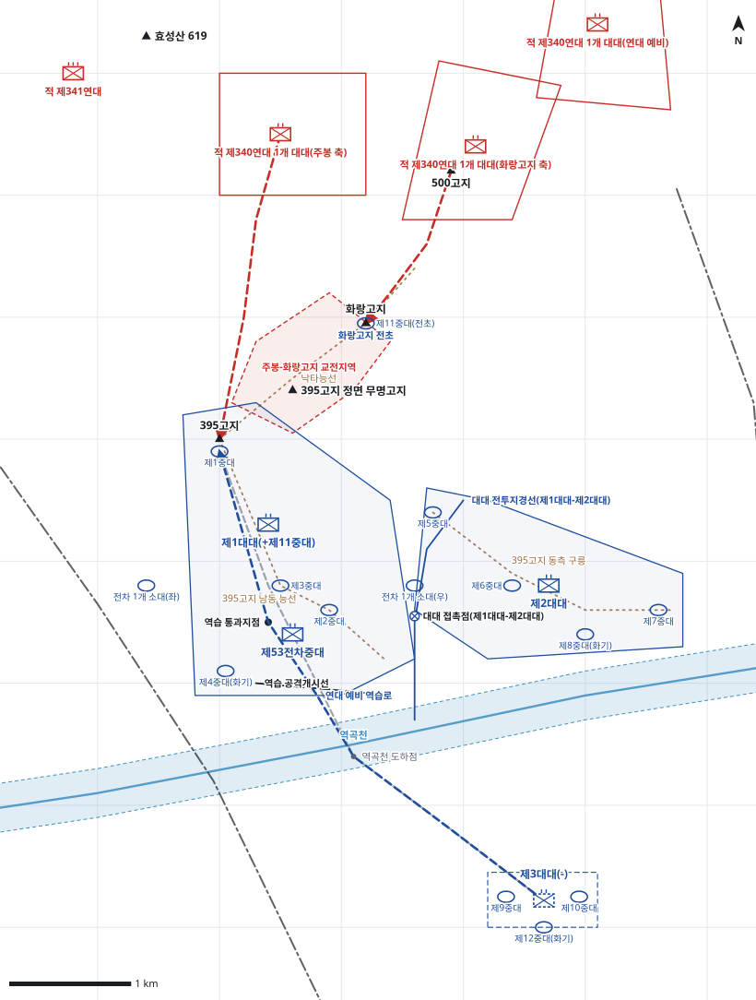

# kb2_023 · 백마고지 전투

| 관점 | 임무 유형 | 구간 | 실제 결과 | 좌표 | 보정용 | 사람 검토 |
|---|---|---|---|---|---|---|
| 제30연대 | 지역방어 | t=6~54 (48h) | partial | atlas+text | 예 | yes |

**구간**: 백마고지 전투의 첫 48시간이다. 적 공격준비사격 직전 제30연대의 초기 배치에서 시작해 D+2일 06:00에 끝난다.

**출처**: 국방부 군사편찬연구소, 『6·25전쟁 주요전투 2』(2017), '백마고지 전투' (pdf 100쪽)

| 파일 | 내용 | 생성 모델에 |
|---|---|---|
| [`situation.json`](situation.json) | 상황 (익명화) | 줌 |
| [`coa.json`](coa.json) | pseudo-GT COA (익명화) | 예시로만 |
| [`scenario.json`](scenario.json) | 적 계획·환경 (시뮬레이터 전용) | 주지 않음 |
| [`history.json`](history.json) | 실제 경과 (평가 전용) | 주지 않음 |
| [`source.json`](source.json) | 출처·결과 라벨·자동 검사 | 주지 않음 |
| [`real_names/`](real_names) | 상황·COA 실명판 | 주지 않음 |

## 약도

## pseudo-GT COA (실명판)

**전투편성** 제1대대(+제11중대), 제2대대, 제3대대(-) / 지원: 사단 포병, 제53전차중대, 근접항공지원
**1. 상황**
  **가. 지형** 395고지가 철원평야와 3번 도로를 감제한다. 주봉 북동쪽 화랑고지가 전초다.
  **나. 적** 적 제114사단 제340연대는 D일 야간 공격준비사격 후 500고지 일대에서 2개 대대로 공격해 올 것이다. 1개 대대는 화랑고지로, 1개 대대는 주봉으로 공격해 올 것이다.
  **다. 가정**
    **(1)** 적이 봉래호 수문을 폭파해도 도하점은 쓸 수 있다.
    **(2)** 대대 세부 보충: 중대 배치와 번호는 상황도 중대 진지 표시에 맞춰 서술과 모순되지 않게 보충했다.
    **(3)** 사단 포병과 근접항공지원은 주간에 395고지 정면에 집중된다.
**2. 임무** 제30연대는 395고지 일대에서 방어하여 적의 공격을 격퇴하고 395고지를 고수함으로써 사단 주저항선 좌단을 유지한다.
**3. 실시**
  **가. 최종상태** 395고지를 고수하고, 적 공격부대는 고지 북쪽에서 격퇴된다.
  **나. 작전개념** 2개 대대를 나란히 배치해 395고지를 고수하고, 화랑고지 전초로 적 접근을 조기에 경고한다. 제3대대(-)는 연대 예비로 둔다.
    **(1) 기동** 연대 예비는 명에 의해 제1대대 지역으로 역습한다.
    **(2) 화력** 우선 지원은 제1대대다. 화랑고지와 주봉 사이 교전지역에 화력을 집중한다.
  **다. 예하부대 과업**
    **(1) 제1대대(+제11중대)** 주봉 일대를 점령한다. 제11중대로 화랑고지 전초를 점령하여 경계한다. 395고지 주봉을 고수한다.
    **(2) 제2대대** 제1대대 동쪽 능선을 점령한다. 제1대대 동쪽 능선 일대를 방어한다.
    **(3) 제3대대(-)** 역곡천 남쪽 예비진지를 점령한다. 명에 의해 역습로를 따라 제1대대 지역으로 역습한다.
    **(4) 제53전차중대** 주봉과 화랑고지 사이 교전지역에 화력을 집중하여 제1대대를 화력지원한다.
  **라. 협조지시**
    **(1) 시간계획** 진지 점령은 D일 06:00까지 완료한다. / 연대 예비는 D일 06:00까지 역습 준비를 완료한다.
    **(2) 통제수단** 대대 전투지경선(제1대대-제2대대), 대대 접촉점(제1대대-제2대대), 주봉-화랑고지 교전지역, 화랑고지 전초, 연대 예비진지, 역습 공격개시선, 역습 통과지점, 연대 예비 역습로
