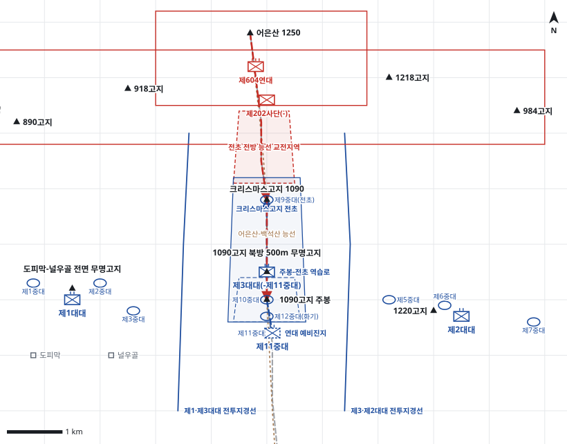

# kb2_024 · 1090고지 부근 전투

| 관점 | 임무 유형 | 구간 | 실제 결과 | 좌표 | 보정용 | 사람 검토 |
|---|---|---|---|---|---|---|
| 제7사단 제3연대 | 지역방어 | t=17~32 (15h) | partial | text | 아니오 | no |

**구간**: 구간 ①: 10월 6일 일몰 전 제3연대의 방어 배치부터 10월 7일 새벽 크리스마스고지(북쪽 1090고지) 전초진지 피탈과 연대장의 재탈환 보류 결심까지. 구간 ②(10월 13일~14일)는 조정된 경계진지에서 시작하는 별도 기록으로 다룬다.

**출처**: 국방부 군사편찬연구소, 『6·25전쟁 주요전투 2』(2017), '1090고지 부근 전투' (pdf 104쪽)

| 파일 | 내용 | 생성 모델에 |
|---|---|---|
| [`situation.json`](situation.json) | 상황 (익명화) | 줌 |
| [`coa.json`](coa.json) | pseudo-GT COA (익명화) | 예시로만 |
| [`scenario.json`](scenario.json) | 적 계획·환경 (시뮬레이터 전용) | 주지 않음 |
| [`history.json`](history.json) | 실제 경과 (평가 전용) | 주지 않음 |
| [`source.json`](source.json) | 출처·결과 라벨·자동 검사 | 주지 않음 |
| [`real_names/`](real_names) | 상황·COA 실명판 | 주지 않음 |

## 약도

## pseudo-GT COA (실명판)

**전투편성** 제1대대, 제2대대, 제3대대(-제11중대), 제11중대(연대 예비) / 지원: 제16포병대대(직접지원), 미 포병대대(일반지원)
**1. 상황**
  **가. 지형** 1090고지 주봉과 크리스마스고지는 어은산-백석산 능선 위에 있다. 일대를 감제하므로 양측 모두 반드시 확보해야 할 요충이다. 적의 주 접근로는 어은산에서 크리스마스고지로 내려오는 좁은 능선이다. 주봉에서 전초로 이어지는 능선은 협소하고 가팔라 역습이 느리다.
  **나. 적** 적 제604연대는 어은산에서 능선 접근로를 따라 크리스마스고지로 공격해 올 것이다. 전면공세가 아니라 1개 대대 이하로 야간에 전초 탈취를 노리는 제한공격일 것이다. 포격으로 전초를 제압한 뒤 돌입하고, 전초를 얻으면 1090고지 주봉으로 공격을 이어 올 것이다.
  **다. 가정**
    **(1)** 적은 전면공세가 아닌 국부 제한공격을 한다.
    **(2)** 제3대대 제11중대를 연대 예비로 지정하고 주봉 남쪽에 둔다.
    **(3)** 제3대대는 제9중대를 크리스마스고지 전초에, 제10중대를 주봉에, 제12중대(화기)를 주봉 후사면에 둔다.
    **(4)** 제1·제2대대는 각 3개 소총중대를 횡대로 배치한다.
**2. 임무** 제3연대는 D일부터 1090고지-1220고지-봉선골 선을 방어하여 크리스마스고지 전초와 1090고지 주봉을 확보함으로써 사단 주저항선 중앙의 감제고지를 유지한다.
**3. 실시**
  **가. 최종상태** 1090고지 주봉과 크리스마스고지 전초를 확보하고, 공격한 적을 전초 전방의 능선에서 격퇴한다.
  **나. 작전개념** 제3대대를 주력으로 하여 크리스마스고지 전초와 1090고지 주봉을 지킨다. 전초 전방 능선 접근로에 포병 화력을 집중해 적의 돌입을 꺾는다. 전초를 잃으면 전초 부대로 즉시 역습하고, 주봉이 위협받으면 연대 예비 제11중대로 역습한다.
    **(1) 기동** 제1대대는 좌측 무명고지, 제2대대는 우측 1220고지-봉선골, 제3대대는 중앙 1090고지를 방어한다. 제3대대는 제9중대로 크리스마스고지 전초를 지킨다. 제11중대는 주봉 남쪽에서 역습을 준비한다.
    **(2) 화력** 제16포병대대는 전초 전방 능선 교전지역에 최우선으로 사격하고, 전초가 돌파되면 전초 위로 사격을 전환한다. 미 포병대대는 어은산 일대의 적 집결지와 포진지를 제압한다.
  **다. 예하부대 과업**
    **(1) 제1대대** 도피막-널우골 전면 무명고지 일대를 방어한다.
    **(2) 제2대대** 1220고지-봉선골 일대를 방어한다.
    **(3) 제3대대(-제11중대)** 제10중대로 1090고지 주봉을 고수한다. 제9중대로 크리스마스고지 전초를 점령하고 능선 접근로를 경계한다. 명에 의해 전초가 돌파되면 제9중대로 크리스마스고지에 역습한다.
    **(4) 제11중대** 1090고지 주봉 남쪽 예비진지를 점령한다. 명에 의해 1090고지 주봉으로 역습한다. 명에 의해 제3대대의 역습이 실패하면 크리스마스고지로 역습한다.
  **라. 협조지시**
    **(1) 시간계획** D일 17:00 전 진지의 방어태세를 완비한다. / D일 18:00 일몰과 함께 전초 경계를 강화하고 교전지역 사격을 준비한다. / D일 19:00 연대 예비의 역습 준비를 마친다.
    **(2) 통제수단** 제1·제3대대 전투지경선, 제3·제2대대 전투지경선, 크리스마스고지 전초, 1090고지 주봉 전투진지, 전초 전방 능선 교전지역, 주봉-전초 역습로, 연대 예비진지
