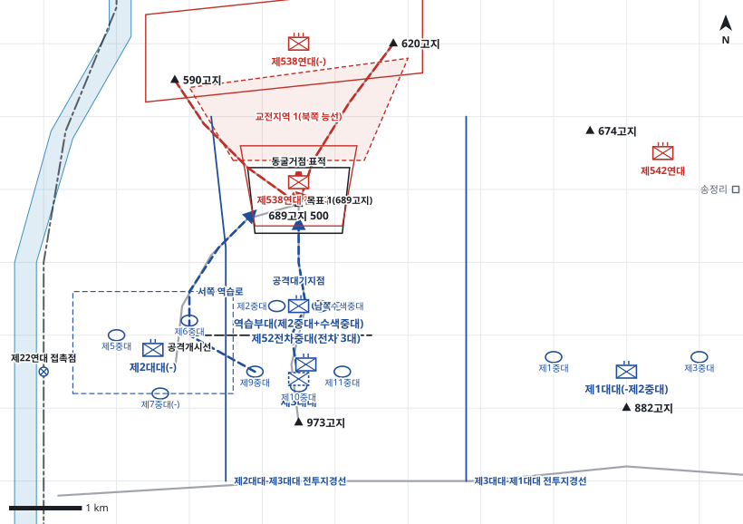

# kb2_026 · 텍사스고지(689고지) 전투

| 관점 | 임무 유형 | 구간 | 실제 결과 | 좌표 | 보정용 | 사람 검토 |
|---|---|---|---|---|---|---|
| 제18연대 | 역습 | t=5~70 (65h) | success | text | 예 | no |

**구간**: 구간 2: 689고지를 잃은 뒤 제18연대가 역습부대(제2중대+수색중대)로 1차 역습을 하고 제3대대가 이어서 2~5차 역습으로 고지를 확보해 제2대대 제5중대에 방어를 넘긴 국면

**출처**: 국방부 군사편찬연구소, 『6·25전쟁 주요전투 2』(2017), '텍사스고지(689고지) 전투' (pdf 111쪽)

| 파일 | 내용 | 생성 모델에 |
|---|---|---|
| [`situation.json`](situation.json) | 상황 (익명화) | 줌 |
| [`coa.json`](coa.json) | pseudo-GT COA (익명화) | 예시로만 |
| [`scenario.json`](scenario.json) | 적 계획·환경 (시뮬레이터 전용) | 주지 않음 |
| [`history.json`](history.json) | 실제 경과 (평가 전용) | 주지 않음 |
| [`source.json`](source.json) | 출처·결과 라벨·자동 검사 | 주지 않음 |
| [`real_names/`](real_names) | 상황·COA 실명판 | 주지 않음 |

## 약도

## pseudo-GT COA (실명판)

**전투편성** 역습부대(제2중대+수색중대), 제3대대, 제2대대(-), 제1대대(-제2중대), 제52전차중대(전차 3대) / 지원: 제11포병대대, 제3중박격포중대, 사단 일반지원 포병 2개 대대, 근접항공지원
**1. 상황**
  **가. 지형** 689고지는 973고지에 이르는 능선 접근로를 통제하는 핵심 지형이다. 남쪽 후사면은 급경사라 역습과 보급이 어렵고, 북쪽 능선은 완만해 적이 590고지와 620고지에서 쉽게 역습한다. 아군 접근로는 973고지 남쪽 능선과 서쪽 접근로다.
  **나. 적** 적 제538연대는 689고지를 1개 중대 내외로 방어하다가 아군이 고지에 오르면 포병 집중사격 아래 620고지와 590고지에서 2개 중대 이상으로 역습해 올 것이다. 역습이 막히면 1개 대대로 거듭 역습해 올 것이다.
  **다. 가정**
    **(1)** 대대 세부 보충: 대대 진지와 중대 위치는 서술에 없어 지형에 맞춰 보충한다.
    **(2)** 사단 일반지원 포병과 근접항공지원은 주간에 요청에 따라 쓸 수 있다.
    **(3)** 적은 고지 점령 직후 역습할 병력을 590고지와 620고지에 두고 있다.
**2. 임무** 제18연대는 D일 05:40 689고지에 역습하여 고지를 탈취하고 확보함으로써 973고지 능선 접근로의 전초진지를 회복한다.
**3. 실시**
  **가. 최종상태** 689고지를 아군 1개 중대가 점령하고 북쪽 능선의 적 역습을 화력으로 막는 상태다.
  **나. 작전개념** 역습부대가 공격준비사격에 이어 남쪽 능선으로 689고지를 탈취하고 확보한다. 제3대대는 973고지에서 역습을 준비하다가 역습부대가 고지를 지키지 못하면 서쪽과 남쪽 두 접근로로 역습한다. 고지 북쪽 능선에 화력을 집중해 적 역습을 끊는다.
    **(1) 기동** 역습부대는 남쪽 능선으로 접근해 수류탄전과 근접전으로 고지를 탈취한다. 제3대대는 서쪽과 남쪽에 중대를 나눠 병진 역습한다. 제2대대와 제1대대는 주저항선을 방어한다.
    **(2) 화력** 공격준비사격은 689고지와 동굴거점, 탈취 뒤에는 EA1과 620고지에 집중한다. 전차는 973고지 북사면에서 직접사격으로 고지를 지원한다.
  **다. 예하부대 과업**
    **(1) 역습부대(제2중대+수색중대)** D일 05:40 공격개시선을 넘어 남쪽 능선으로 689고지를 탈취한다. 689고지를 확보한다.
    **(2) 제3대대** 973고지 정면 주저항선을 방어한다. 명에 의해 서쪽과 남쪽 접근로로 689고지에 역습한다. 689고지를 확보한다.
    **(3) 제2대대(-)** 590고지에서 남쪽으로 오는 적을 저지한다. 명에 의해 제5중대로 689고지에서 제3대대를 후속인수한다.
    **(4) 제1대대(-제2중대)** 882고지 일대 주저항선을 방어한다.
    **(5) 제52전차중대(전차 3대)** 689고지를 직접사격으로 화력지원한다.
  **라. 협조지시**
    **(1) 시간계획** D일 04:30 역습부대 공격대기지점 점령 완료 / D일 05:00 공격준비사격 개시, 제3대대 역습 준비 완료 / D일 05:40 H시 공격개시선 통과
    **(2) 통제수단** 목표 1(689고지), 공격개시선, 공격대기지점, 남쪽 공격로, 서쪽 역습로, 교전지역 1(북쪽 능선), 동굴거점 표적, 제2대대 진지, 제2대대-제3대대 전투지경선, 제3대대-제1대대 전투지경선, 제22연대 접촉점
