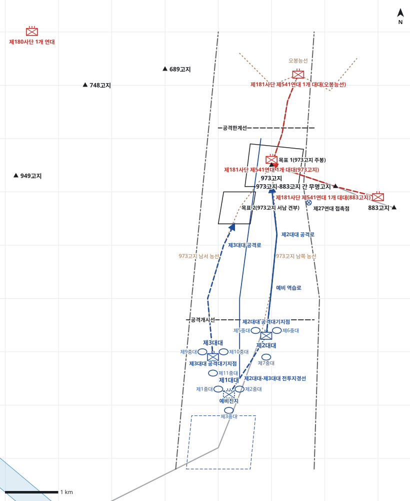

# kb2_030 · 미주리선(949고지-973고지-883고지) 방어전

| 관점 | 임무 유형 | 구간 | 실제 결과 | 좌표 | 보정용 | 사람 검토 |
|---|---|---|---|---|---|---|
| 제35연대 | 역습 | t=1~95 (94h) | failure | text | 아니오 | no |

**구간**: D-1일(6.10) 일몰 적 제60군 공세로 973고지·883고지 피탈 직후, 사단예비 제35연대가 973고지 역습 명령을 받은 D일 01:00부터 미주리선 와해(D+3일 23:00)까지 전투 전체

**출처**: 국방부 군사편찬연구소, 『6·25전쟁 주요전투 2』(2017), '미주리선(949고지-973고지-883고지) 방어전' (pdf 124쪽)

| 파일 | 내용 | 생성 모델에 |
|---|---|---|
| [`situation.json`](situation.json) | 상황 (익명화) | 줌 |
| [`coa.json`](coa.json) | pseudo-GT COA (익명화) | 예시로만 |
| [`scenario.json`](scenario.json) | 적 계획·환경 (시뮬레이터 전용) | 주지 않음 |
| [`history.json`](history.json) | 실제 경과 (평가 전용) | 주지 않음 |
| [`source.json`](source.json) | 출처·결과 라벨·자동 검사 | 주지 않음 |
| [`real_names/`](real_names) | 상황·COA 실명판 | 주지 않음 |

## 약도

## pseudo-GT COA (실명판)

**전투편성** 제2대대, 제3대대, 제1대대(예비) / 지원: 사단 포병단 1개 포병대대(직접지원), 중포중대, 전차중대 / 연대 수색중대는 제27연대에 배속
**1. 상황**
  **가. 지형** 973고지는 주저항선 중앙의 감제고지로, 확보하면 오봉능선과 883고지 측방을 관측·제압할 수 있다. 아군 접근로는 황병동에서 오르는 남쪽 능선과 남서 능선 2개이며 경사가 급하다. 적은 오봉능선과 883고지 연결 능선으로 973고지에 역습할 수 있다.
  **나. 적** 적 제541연대는 973고지와 883고지에서 급편방어하다가 아군이 973고지에 오르면 강력한 포격과 함께 오봉능선과 883고지 양측에서 역습해 올 것이다. 1개 대대는 973고지를 지키고, 1개 대대는 오봉능선에서, 1개 대대는 883고지에서 협공할 것이다. 역습은 일몰 이후에 집중될 것이다.
  **다. 가정**
    **(1)** 대대 세부 보충: 대대 공격대기지점, 공격로, 중대 배치는 서술에 없어 추정한다.
    **(2)** 적은 973고지를 점령한 지 수 시간밖에 되지 않아 진지를 보강하지 못했다.
    **(3)** 제27연대가 883고지를 동시에 역습하여 적 화력을 분산한다.
    **(4)** 연대 수색중대는 제27연대에 배속되어 가용하지 않다.
**2. 임무** 제35연대는 D일 08:00 황병동에서 공격하여 973고지를 탈취하여 사단 주저항선 중앙을 회복하고 883고지를 역습하는 제27연대의 좌측방을 보호한다.
**3. 실시**
  **가. 최종상태** 연대는 973고지 주봉과 서남 견부를 확보하고 오봉능선과 883고지 방향 적 역습에 대비한 진지를 편성한다.
  **나. 작전개념** 연대는 2개 대대를 병진하여 남쪽과 남서 능선으로 973고지를 공격한다. 주력 제2대대가 남쪽 능선으로 주봉을 탈취하고 제3대대는 서남 견부를 탈취해 주봉 공격을 화력지원한다. 제1대대는 예비로 적의 협공에 대비해 역습을 준비한다.
    **(1) 기동** 제2대대는 남쪽 능선으로 주봉을 탈취하고 즉시 확보한다. 제3대대는 남서 능선으로 서남 견부를 탈취한 뒤 주봉 공격을 화력지원하고 오봉능선 방향을 방어한다. 제1대대는 예비진지에서 973고지로 역습을 준비한다.
    **(2) 화력** H-30분부터 973고지 주봉과 오봉능선에 공격준비사격을 한다. 목표 탈취 후에는 오봉능선과 무명고지 방향에 방어사격을 계획한다. 우선권은 제2대대에 준다.
  **다. 예하부대 과업**
    **(1) 제2대대** 남쪽 능선을 따라 공격하여 973고지 주봉을 탈취한다. 973고지 주봉에 진지를 편성하여 확보한다.
    **(2) 제3대대** 남서 능선을 따라 공격하여 973고지 서남 견부를 탈취한다. 973고지 주봉을 공격하는 제2대대를 화력지원한다. 서남 견부에서 오봉능선 방향을 방어한다.
    **(3) 제1대대** 명에 의해 남쪽 능선으로 973고지 주봉에 역습한다. 973고지 주봉을 확보한다.
  **라. 협조지시**
    **(1) 시간계획** D일 01:00 역습 명령 하달 / D일 04:30 제27연대 883고지 역습 개시 / D일 06:00 공격대기지점과 예비진지 점령 완료 / D일 07:30 공격준비사격 개시 / D일 08:00 H시, 공격개시선 통과, 예비 준비 완료
    **(2) 통제수단** 황병동 집결지, 제2대대 공격대기지점, 제3대대 공격대기지점, 예비진지, 공격개시선, 제2대대-제3대대 전투지경선, 목표 1(973고지 주봉), 목표 2(973고지 서남 견부), 제2대대 공격로, 제3대대 공격로, 예비 역습로, 제27연대 접촉점, 공격한계선
