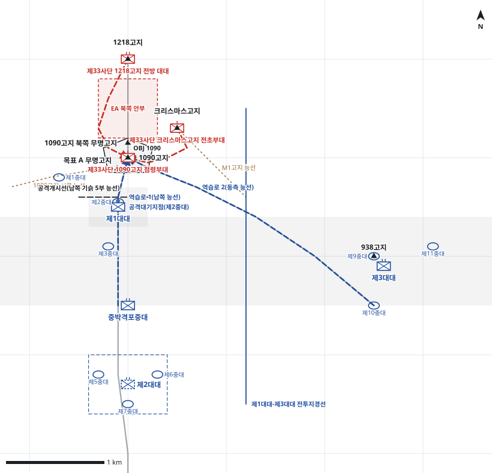

# kb2_032 · 1090고지 전투

| 관점 | 임무 유형 | 구간 | 실제 결과 | 좌표 | 보정용 | 사람 검토 |
|---|---|---|---|---|---|---|
| 제62연대 | 역습 | t=26~107 (81h) | success | text | 아니오 | no |

**구간**: 1090고지 전투 전체(1953.6.14 21:30 중공군 공격부터 6.18 10:50 1090고지 최종 탈환까지). 명령 시점은 1090고지 정상이 야간 3차례 공격으로 피탈된 직후 연대가 첫 역습을 결심한 D+1일(6.15) 새벽.

**출처**: 국방부 군사편찬연구소, 『6·25전쟁 주요전투 2』(2017), '1090고지 전투' (pdf 132쪽)

| 파일 | 내용 | 생성 모델에 |
|---|---|---|
| [`situation.json`](situation.json) | 상황 (익명화) | 줌 |
| [`coa.json`](coa.json) | pseudo-GT COA (익명화) | 예시로만 |
| [`scenario.json`](scenario.json) | 적 계획·환경 (시뮬레이터 전용) | 주지 않음 |
| [`history.json`](history.json) | 실제 경과 (평가 전용) | 주지 않음 |
| [`source.json`](source.json) | 출처·결과 라벨·자동 검사 | 주지 않음 |
| [`real_names/`](real_names) | 상황·COA 실명판 | 주지 않음 |

## 약도

## pseudo-GT COA (실명판)

**전투편성** 제1대대, 제3대대, 제2대대(연대 예비), 중박격포중대 / 지원: 사단 포병 1개 대대(직접지원), 사단 포병 일반지원
**1. 상황**
  **가. 지형** 1090고지는 연대 정면을 감제하는 전초이며 1218고지 능선과 크리스마스고지·M1고지 능선이 북·동에서 연결되어 적의 증원이 쉽다. 목표 A 무명고지는 1090고지를 서남쪽에서 감제한다. 아군 접근로는 남쪽 능선과 938고지에서 오는 동측 능선이다.
  **나. 적** 적 제33사단은 1090고지 정상을 2개 중대 내외로 방어하면서 1218고지에서 후속 병력을 보낼 것이다. 아군이 1090고지를 탈취하면 야간에 공격준비사격 후 1개 대대로 역습해 올 것이다. 1개 부대는 1218고지 능선으로, 1개 부대는 크리스마스고지에서 M1고지 능선으로 협공해 올 것이다.
  **다. 가정**
    **(1)** 대대 세부 보충: 제2대대는 연대 예비로 후방에 있고 제3대대 중대(제9·10·11중대) 배치와 중박격포중대는 서술과 모순되지 않게 보충했다.
    **(2)** 제2중대는 야간 3차례 방어로 전투력이 약 70%로 줄었다.
    **(3)** 사단 포병 1개 대대가 직접지원하며 진내사격 요청에 응할 수 있다.
    **(4)** 적은 아군 포병 관측을 피해 주로 야간에 대규모 역습을 한다.
**2. 임무** 제62연대는 D+1일 05:00 1090고지를 역습으로 탈취하여 연대 전초를 회복하고 적 제33사단의 주저항선 공격 발판을 제거한다.
**3. 실시**
  **가. 최종상태** 제1대대가 1090고지와 북쪽 무명고지를 확보하고 진지를 편성하며, 주저항선은 온전하다.
  **나. 작전개념** 제1대대가 여명 H시에 남쪽 능선으로 1090고지를 역습해 탈취하고 북쪽 무명고지까지 확보한다. 제3대대는 938고지를 방어하며 동측 능선 역습을 준비하고, 제2대대는 예비로 주저항선을 보장한다. 포병과 박격포는 1218고지 능선과 크리스마스고지에서 오는 적 증원을 차단한다.
    **(1) 기동** 제2중대가 남쪽 기슭에서 정면 역습하고 제1중대는 서쪽 능선을 고수하며 제3중대는 대대 예비로 후속한다. 1차 역습이 실패하면 제3중대, 이어 제3대대가 동측 능선으로 역습한다.
    **(2) 화력** H-30분부터 1090고지에 공격준비사격, 돌입 시 1218고지 능선과 크리스마스고지로 사격을 연신해 증원을 차단한다. 탈취 후 북쪽 안부에 방어사격을 계획하고 진내사격은 중대 요청 시 실시한다.
  **다. 예하부대 과업**
    **(1) 제1대대** H시에 제2중대로 남쪽 능선을 따라 1090고지로 역습한다. 이어서 1090고지와 북쪽 무명고지를 확보한다. 제1중대로 1090고지 서쪽 능선 진지를 고수한다. 명에 의해 제3중대로 1090고지로 역습한다.
    **(2) 제3대대** 938고지 일대를 방어한다. 명에 의해 동측 능선을 따라 1090고지로 역습한다.
    **(3) 제2대대** D+1일 06:00까지 연대 예비진지를 점령한다. 명에 의해 제1대대 주저항선 지역으로 역습한다.
    **(4) 중박격포중대** 제1대대의 1090고지 역습을 화력지원한다. 이어서 1090고지 북쪽 안부를 화력공격한다.
  **라. 협조지시**
    **(1) 시간계획** D+1일 04:30 제2중대 공격대기지점 점령 완료, 공격준비사격 개시 / D+1일 05:00 H시, 1090고지 역습 개시 / D+1일 06:00 연대 예비 준비 완료
    **(2) 통제수단** OBJ 1090, 공격개시선(남쪽 기슭 5부 능선), 역습로 1(남쪽 능선), 역습로 2(동측 능선), 제1대대-제3대대 전투지경선, 공격대기지점(제2중대), 연대 예비진지, EA 북쪽 안부
