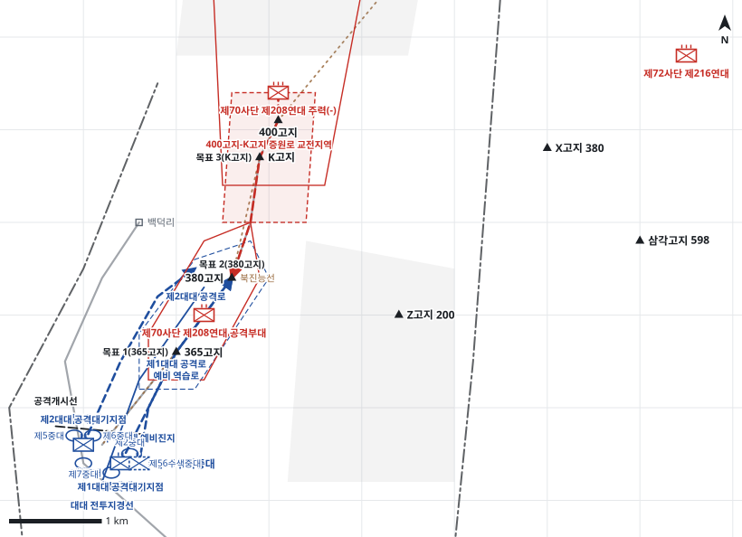

# kb2_033 · 북진능선 전투

| 관점 | 임무 유형 | 구간 | 실제 결과 | 좌표 | 보정용 | 사람 검토 |
|---|---|---|---|---|---|---|
| 제28연대 | 역습 | t=1~32 (31h) | success | text | 예 | no |

**구간**: D일 01:00 제28연대 역습 명령부터 D일 07:30 주저항선 회복, D+1일 새벽 중공군 재공격 격퇴, D+1일 약 08:00 K고지 탈환까지

**출처**: 국방부 군사편찬연구소, 『6·25전쟁 주요전투 2』(2017), '북진능선 전투' (pdf 136쪽)

| 파일 | 내용 | 생성 모델에 |
|---|---|---|
| [`situation.json`](situation.json) | 상황 (익명화) | 줌 |
| [`coa.json`](coa.json) | pseudo-GT COA (익명화) | 예시로만 |
| [`scenario.json`](scenario.json) | 적 계획·환경 (시뮬레이터 전용) | 주지 않음 |
| [`history.json`](history.json) | 실제 경과 (평가 전용) | 주지 않음 |
| [`source.json`](source.json) | 출처·결과 라벨·자동 검사 | 주지 않음 |
| [`real_names/`](real_names) | 상황·COA 실명판 | 주지 않음 |

## 약도

## pseudo-GT COA (실명판)

**전투편성** 제1대대(-), 제2대대, 제56수색중대 / 지원: 사단 포병, 근접항공지원(미 공군)
**1. 상황**
  **가. 지형** 380고지는 북진능선 주저항선의 중심으로 동쪽 개활지와 K고지 접근로를 감제한다. 365고지는 380고지로 가는 능선의 발판이다. 아군 접근로는 북진능선 남단에서 능선을 따라 365고지를 거쳐 380고지로 가는 능선로와 서사면 측면 접근로이고, 적 증원로는 400고지에서 K고지를 거쳐 380고지로 내려오는 능선이다.
  **나. 적** 적 제208연대는 1개 대대(+)로 365고지와 380고지에서 방어하다가 400고지와 K고지의 주력 1개 대대로 380고지에 역습해 올 것이다. 역습은 아군이 목표를 탈취하고 재편하기 전 박격포와 야포 지원 아래 능선을 따라 올 것이다.
  **다. 가정**
    **(1)** 대대 세부 보충: 제1대대는 2개 중대를 능선에 종대로, 제2대대는 2개 중대를 서사면에 병렬로 운용하고 각 1개 중대를 대대 예비로 둔다.
    **(2)** 제28연대 제3대대는 사단 예비로 잔류하고 제1중대는 제30연대 제3대대 배속을 유지한다.
    **(3)** 여명 이후 근접항공지원을 받을 수 있다.
**2. 임무** 제28연대는 D일 03:00 북진능선에서 365고지와 380고지로 역습하여 적 제208연대 공격부대를 격퇴하고 사단 좌측 주저항선을 회복한다.
**3. 실시**
  **가. 최종상태** 365고지와 380고지를 탈환해 주저항선을 회복하고 제2대대가 주저항선을 점령하여 적 재역습에 대비한다.
  **나. 작전개념** 제1대대(-)를 주공으로 능선을 따라 365고지를 탈취한 뒤 380고지를 탈취한다. 제2대대는 북진능선 남단에서 서사면으로 380고지 측면에 접근해 화력으로 제1대대를 지원하고 이어서 주저항선을 점령한다. 제56수색중대는 365고지 남쪽에서 역습을 준비한다.
    **(1) 기동** 주공 제1대대(-)는 능선로로 OBJ1, OBJ2를 차례로 탈취하고, 조공 제2대대는 서사면 접근로로 380고지 서측면에 화력지원진지를 점령해 제1대대를 지원한다.
    **(2) 화력** 사단 포병은 H시 전 OBJ1, OBJ2에 준비사격 후 400고지 증원로(EA1)를 차단사격한다. 여명 후 근접항공지원은 380고지와 EA1에 지향한다.
  **다. 예하부대 과업**
    **(1) 제1대대(-)** H시 능선로를 따라 365고지를 탈취한다. 이어서 380고지를 탈취한다. 이어서 365고지를 확보한다.
    **(2) 제2대대** 서사면으로 380고지 서측면에 접근해 제1대대(-)를 화력지원한다. 이어서 380고지 일대 주저항선을 점령한다. 명에 의해 K고지를 탈취한다.
    **(3) 제56수색중대** 365고지 남쪽 예비진지를 점령한다. 명에 의해 380고지로 역습한다.
  **라. 협조지시**
    **(1) 시간계획** 공격대기지점 점령 완료 D일 02:30 / H시 D일 03:00 공격 개시 / 예비 준비 완료 D일 03:00
    **(2) 통제수단** 제1대대 공격대기지점, 제2대대 공격대기지점, 수색중대 예비진지, 공격개시선, 목표 1(365고지), 목표 2(380고지), 목표 3(K고지), 북진능선 주저항선, 400고지-K고지 증원로 교전지역, 대대 전투지경선, 제1대대 공격로, 제2대대 공격로, 예비 역습로
