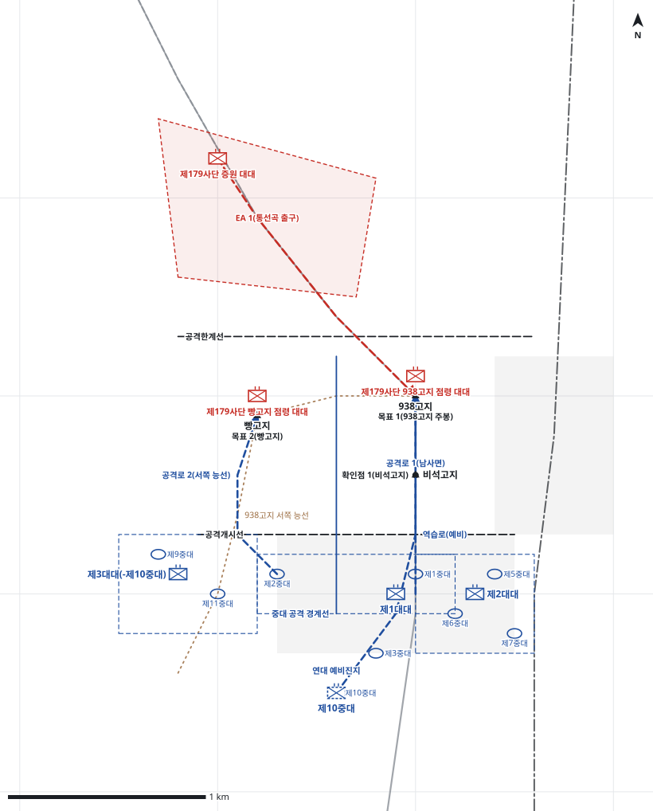

# kb2_034 · 선우고지 전투

| 관점 | 임무 유형 | 구간 | 실제 결과 | 좌표 | 보정용 | 사람 검토 |
|---|---|---|---|---|---|---|
| 국군 제7사단 제8연대 | 역습 | t=-0.33~105.0 (105.33h) | failure | text | 예 | no |

**구간**: 선우고지(938고지) 전투 전체. 명령 시점은 938고지와 빵고지를 상실한 직후 연대장이 제1대대에 6월 27일 02:30 역습을 명령한 연대의 첫 결심이다.

**출처**: 국방부 군사편찬연구소, 『6·25전쟁 주요전투 2』(2017), '선우고지 전투' (pdf 140쪽)

| 파일 | 내용 | 생성 모델에 |
|---|---|---|
| [`situation.json`](situation.json) | 상황 (익명화) | 줌 |
| [`coa.json`](coa.json) | pseudo-GT COA (익명화) | 예시로만 |
| [`scenario.json`](scenario.json) | 적 계획·환경 (시뮬레이터 전용) | 주지 않음 |
| [`history.json`](history.json) | 실제 경과 (평가 전용) | 주지 않음 |
| [`source.json`](source.json) | 출처·결과 라벨·자동 검사 | 주지 않음 |
| [`real_names/`](real_names) | 상황·COA 실명판 | 주지 않음 |

## 약도

## pseudo-GT COA (실명판)

**전투편성** 제1대대, 제2대대, 제3대대(-제10중대), 연대 예비: 제10중대 / 지원: 사단 포병 1개 대대(직접지원), 연대 중박격포중대
**1. 상황**
  **가. 지형** 938고지는 연대 정면을 감제하는 핵심 지형이고, 남사면 비석고지와 서쪽 빵고지가 고지로 오르는 두 능선을 통제한다. 아군 접근로는 남사면 능선도로와 서쪽 능선이며, 적 증원로는 통선곡이다.
  **나. 적** 적 제179사단은 938고지와 빵고지에서 2개 대대로 급편방어하다가 통선곡으로 1개 대대를 증원해 역습해 올 것이다. 1개 대대는 주봉과 비석고지에서, 1개 대대는 빵고지에서 방어하고, 증원 대대는 여명 전에 주봉으로 역습해 올 것이다.
  **다. 가정**
    **(1)** 적은 938고지를 점령한 지 수 시간밖에 되지 않아 진지를 강화하지 못했다.
    **(2)** 제2대대와 제3대대는 전투력이 저하되었으나 진지 방어와 화력지원은 할 수 있다.
    **(3)** 대대 세부 보충: 중대 배치, 제1대대 제3중대의 대대 예비 지정, 제10중대의 연대 예비 지정은 서술에 없어 보충했다.
**2. 임무** 제8연대는 D일 02:30 제1대대로 938고지와 빵고지에 역습하여 적이 증원으로 방어를 강화하기 전에 938고지를 탈취함으로써 사단 주저항선을 회복한다.
**3. 실시**
  **가. 최종상태** 제1대대가 938고지 주봉과 빵고지를 확보하고 제2·3대대가 양 측방 진지를 방어한다. 통선곡의 적 증원은 화력으로 차단된다.
  **나. 작전개념** 제1대대가 공격준비사격에 이어 2개 중대로 주봉과 빵고지를 동시에 역습한다. 제2·3대대는 남쪽 기슭과 서쪽 능선 진지에서 화력으로 역습을 지원하고, 제10중대는 연대 예비로 주봉 역습을 준비한다.
    **(1) 기동** 제1대대 제1중대는 남사면 능선도로를 따라 비석고지를 거쳐 주봉을, 제2중대는 서쪽 능선을 따라 빵고지를 공격한다. 제3중대는 대대 예비로 후속한다.
    **(2) 화력** 사단 포병은 D일 02:15부터 주봉과 빵고지에 공격준비사격을 하고 H시에 통선곡으로 연신해 증원을 차단한다. 중박격포는 비석고지를 제압한다.
  **다. 예하부대 과업**
    **(1) 제1대대** D일 02:30 제1중대로 남사면 능선도로를 따라 공격하여 938고지 주봉을 탈취한다. D일 02:30 제2중대로 서쪽 능선을 따라 공격하여 빵고지를 탈취한다. 주봉과 빵고지를 확보한다.
    **(2) 제2대대** 938고지 남쪽 기슭 진지를 방어한다. 비석고지와 주봉에 화력을 집중하여 제1대대를 화력지원한다.
    **(3) 제3대대(-제10중대)** 서쪽 능선 남단 진지를 방어한다. 빵고지에 화력을 집중하여 제1대대를 화력지원한다.
    **(4) 제10중대** 명에 의해 남사면 능선도로로 938고지 주봉에 역습한다.
  **라. 협조지시**
    **(1) 시간계획** 제1대대 공격대기지점 점령 완료 / 공격준비사격 개시 / H시 역습 개시, 연대 예비 준비 완료 / 여명 전 목표 확보와 재편성 완료
    **(2) 통제수단** 목표 1(938고지 주봉), 목표 2(빵고지), 확인점 1(비석고지), 공격개시선, 공격대기지점, 공격로 1(남사면), 공격로 2(서쪽 능선), 역습로(예비), EA 1(통선곡 출구), 제2대대 진지, 제3대대 진지, 연대 예비진지, 중대 공격 경계선, 공격한계선
