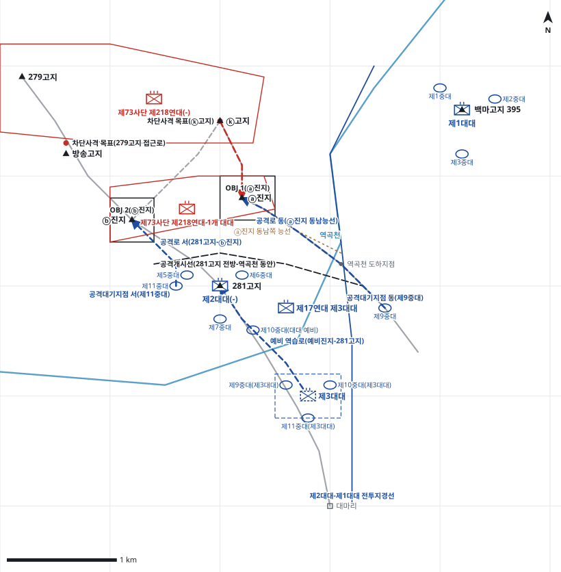

# kb2_037 · 화살머리고지(281고지) 전투

| 관점 | 임무 유형 | 구간 | 실제 결과 | 좌표 | 보정용 | 사람 검토 |
|---|---|---|---|---|---|---|
| 국군 제2사단 제32연대 | 역습 | t=30~102 (72h) | success | text | 예 | no |

**구간**: 화살머리고지(281고지) 전투 제2차전. 중공군이 ⓐ·ⓑ진지를 점령한 직후, 사단이 제17연대 3대대를 제32연대에 배속해 두 진지 탈환을 명한 때부터 7월 11일 양 연대 동시 공격까지다.

**출처**: 국방부 군사편찬연구소, 『6·25전쟁 주요전투 2』(2017), '화살머리고지(281고지) 전투' (pdf 152쪽)

| 파일 | 내용 | 생성 모델에 |
|---|---|---|
| [`situation.json`](situation.json) | 상황 (익명화) | 줌 |
| [`coa.json`](coa.json) | pseudo-GT COA (익명화) | 예시로만 |
| [`scenario.json`](scenario.json) | 적 계획·환경 (시뮬레이터 전용) | 주지 않음 |
| [`history.json`](history.json) | 실제 경과 (평가 전용) | 주지 않음 |
| [`source.json`](source.json) | 출처·결과 라벨·자동 검사 | 주지 않음 |
| [`real_names/`](real_names) | 상황·COA 실명판 | 주지 않음 |

## 약도

## pseudo-GT COA (실명판)

**전투편성** 제17연대 제3대대(배속), 제2대대(-), 제1대대, 제3대대(연대 예비) / 지원: 사단 포병 직접지원 대대, 사단·군단 일반지원 포병, 미 제5공군 근접항공지원
**1. 상황**
  **가. 지형** ⓐ진지는 281고지와 ⓚ고지 사이에 있는 핵심 지형으로, 이곳을 쥔 쪽이 281고지 전방을 통제한다. ⓑ진지는 281고지 서북쪽 측방을 덮는다. 아군은 역곡천을 건너 ⓐ진지 동남쪽 능선으로 오르는 길과 281고지에서 ⓑ진지로 이어지는 능선으로 접근하고, 적은 ⓚ고지와 279고지에서 소로를 따라 증원한다.
  **나. 적** 적 제218연대는 1개 대대로 ⓐ·ⓑ진지를 서둘러 방어하다가 ⓚ고지와 279고지의 예비로 야간에 역습해 올 것이다. 주 역습은 ⓚ고지에서 ⓐ진지로, 조공은 279고지에서 ⓑ진지로 올 것이다. 적 제208연대는 384고지 일대에서 증원을 준비할 것이다.
  **다. 가정**
    **(1)** 대대 세부 보충: 제1대대는 백마고지, 제2대대는 281고지를 맡고 제3대대는 연대 예비로 둔다. 제17연대 제3대대는 제9중대로 ⓐ진지, 제11중대로 ⓑ진지를 공격하고 제10중대를 대대 예비로 둔다.
    **(2)** 적 포병은 하루 7,000~8,000발 수준의 사격을 계속한다.
    **(3)** 사단 포병과 미 제5공군 근접항공지원을 연대 역습에 우선 할당받는다.
**2. 임무** 제32연대는 D+1일 10:00 배속된 제17연대 제3대대로 ⓐ진지와 ⓑ진지를 탈취하여 281고지 전초선을 회복하고 백마고지 측방 위협을 제거한다.
**3. 실시**
  **가. 최종상태** 아군이 ⓐ·ⓑ진지를 점령하고 ⓚ고지에서 오는 적 역습을 격퇴한다. 281고지와 백마고지를 계속 장악한다.
  **나. 작전개념** 제17연대 제3대대가 동쪽과 서쪽에서 ⓐ·ⓑ진지를 동시에 공격해 적을 분산시키며, ⓐ진지 공격이 주공이다. 제2대대는 281고지에서 화력으로 공격을 지원하고 포병은 ⓚ고지와 279고지의 증원로를 차단한다. 제3대대는 281고지 남쪽에서 역습과 후속인수를 준비한다.
    **(1) 기동** 제9중대는 역곡천 동안 공격대기지점에서 도하해 ⓐ진지 동남쪽 능선을 따라 ⓐ진지를 탈취한다. 제11중대는 281고지 서사면에서 능선을 따라 ⓑ진지를 탈취한다. 두 진지를 탈취하면 곧바로 ⓚ고지 쪽으로 진지를 편성해 적 역습을 격퇴한다.
    **(2) 화력** H-30분부터 ⓐ·ⓑ진지에 공격준비사격을 한다. 공격 중에는 ⓚ고지, 279고지, 384고지의 증원로에 차단사격과 대포병사격을 한다. 탈취 뒤에는 ⓚ고지 전방에 방호사격을 계획한다. 주간에는 근접항공지원으로 384고지 화력거점을 제압한다.
  **다. 예하부대 과업**
    **(1) 제17연대 제3대대** 제9중대로 역곡천을 건너 ⓐ진지 동남쪽 능선을 따라 ⓐ진지를 탈취한다. 제11중대로 281고지 서사면에서 능선을 따라 ⓑ진지를 탈취한다. ⓐ·ⓑ진지를 점령해 ⓚ고지에서 오는 적 역습을 격퇴한다.
    **(2) 제2대대(-)** 281고지를 고수한다. 281고지에서 중화기로 제17연대 제3대대의 ⓐ·ⓑ진지 공격을 화력지원한다.
    **(3) 제1대대** 백마고지를 고수한다. 백마고지에서 관측과 화력으로 ⓚ고지의 적 증원을 견제한다.
    **(4) 제3대대** 281고지 남쪽 연대 예비진지를 점령한다. 명에 의해 281고지로 역습한다. 명에 의해 제17연대 제3대대의 ⓐ진지 공격을 후속인수한다.
  **라. 협조지시**
    **(1) 시간계획** D+1일 08:00 연대 예비 준비 완료 / D+1일 09:00 제17연대 제3대대 공격대기지점 점령 완료 / D+1일 09:30 공격준비사격 개시 / D+1일 10:00 H시, ⓐ·ⓑ진지 동시 공격 개시
    **(2) 통제수단** OBJ 1(ⓐ진지), OBJ 2(ⓑ진지), 공격개시선(281고지 전방-역곡천 동안), 공격대기지점 동(제9중대), 공격대기지점 서(제11중대), 공격로 동(ⓐ진지 동남능선), 공격로 서(281고지-ⓑ진지), 연대 예비진지, 차단사격 목표(ⓚ고지), 차단사격 목표(279고지 접근로), 예비 역습로(예비진지-281고지), 제2대대-제1대대 전투지경선
