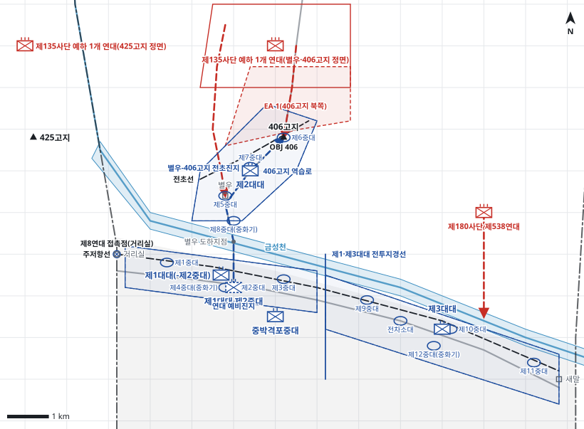

# kb2_040 · 425고지 및 406고지 전투

| 관점 | 임무 유형 | 구간 | 실제 결과 | 좌표 | 보정용 | 사람 검토 |
|---|---|---|---|---|---|---|
| 제3연대 | 지역방어 | t=4~69 (65h) | partial | text | 예 | no |

**구간**: 제3연대가 사단 우측 전선을 인수한 D일 04:00부터 제5연대에 방어 임무를 넘긴 D+3일 21:00까지의 별우-406고지 전초진지 방어와 역습.

**출처**: 국방부 군사편찬연구소, 『6·25전쟁 주요전투 2』(2017), '425고지 및 406고지 전투' (pdf 169쪽)

| 파일 | 내용 | 생성 모델에 |
|---|---|---|
| [`situation.json`](situation.json) | 상황 (익명화) | 줌 |
| [`coa.json`](coa.json) | pseudo-GT COA (익명화) | 예시로만 |
| [`scenario.json`](scenario.json) | 적 계획·환경 (시뮬레이터 전용) | 주지 않음 |
| [`history.json`](history.json) | 실제 경과 (평가 전용) | 주지 않음 |
| [`source.json`](source.json) | 출처·결과 라벨·자동 검사 | 주지 않음 |
| [`real_names/`](real_names) | 상황·COA 실명판 | 주지 않음 |

## 약도

## pseudo-GT COA (실명판)

**전투편성** 제1대대(-제2중대), 제2대대, 제3대대, 제1대대 제2중대(연대 예비), 중박격포중대 / 지원: 제11포병단, 사단 전차소대
**1. 상황**
  **가. 지형** 406고지는 별우와 도하지점을 감제하는 전초의 핵심이다. 이곳을 잃으면 별우의 전초는 후방이 노출된다. 적의 주 접근로는 406고지 북쪽 능선과 별우 북쪽 고지군에서 내려오는 경로다.
  **나. 적** 적 제135사단 1개 연대는 공격준비사격 뒤 야간에 2개 대대로 금성천 북안 전초를 공격해 올 것이다. 1개 대대는 406고지 북쪽 능선으로, 1개 대대는 별우 북쪽으로 공격해 올 것이다. 처음에는 소규모로 전초의 강도를 시험하고, 406고지가 흔들리면 예비 연대를 투입해 별우 지역을 확보할 것이다. 적 제538연대는 제3대대를 고착할 것이다.
  **다. 가정**
    **(1)** 대대 세부 보충: 제2대대는 제5중대를 별우, 제6중대를 406고지, 제7중대를 그 사이에 두고, 제1·제3대대는 각 3개 중대를 횡대로 배치한다.
    **(2)** 금성천은 별우 도하지점에서 보병이 건널 수 있다.
    **(3)** 제11포병단과 인접 중대의 직사화기로 406고지 전방에 화력을 집중할 수 있다.
    **(4)** 사단 전차소대 1개가 연대 우측 도로에서 직접지원한다.
**2. 임무** 제3연대는 D일 04:00부로 새말-거리실 간 주저항선을 방어하고 별우-406고지 간 전초진지를 확보하여 적의 금성천 북안 별우 지역 확보를 저지한다.
**3. 실시**
  **가. 최종상태** 주저항선과 별우-406고지 전초를 유지하고, 적의 공격 부대는 전초 전방에서 격퇴된다.
  **나. 작전개념** 제1·제3대대로 금성천 남안 주저항선을 방어하고, 제2대대로 금성천 북안 별우-406고지 전초진지를 편성해 적의 공격을 전방에서 격퇴한다. 화력은 406고지 전방 교전지역에 집중한다. 제1대대 제2중대를 예비로 두어 406고지 피탈에 즉시 역습한다.
    **(1) 기동** 제2대대는 D일 주간에 별우-406고지 간 전초진지를 점령하고 적정을 탐색한다. 제1대대(-)는 좌측, 제3대대는 우측 주저항선을 방어하며 전초를 화력으로 지원한다. 예비는 도하지점 남쪽에서 406고지 역습을 준비한다.
    **(2) 화력** 제11포병단과 중박격포중대는 406고지 북쪽 교전지역과 별우 북쪽 접근로에 화력을 집중한다. 적 공격준비사격이 시작되면 적 집결 예상 지역에 대응사격한다. 역습 때는 406고지 정상에 화력을 집중한다.
  **다. 예하부대 과업**
    **(1) 제2대대** 별우-406고지 간 전초진지를 점령한다. 406고지 북쪽 교전지역에 대한 적정탐색으로 연대 정면을 경계한다. 명에 의해 별우 도하지점을 거쳐 주저항선으로 철수한다.
    **(2) 제1대대(-제2중대)** 거리실-대대 전투지경선 간 주저항선을 방어한다. 명에 의해 대대 화기로 제2대대의 406고지 전투를 화력지원한다. 명에 의해 406고지를 확보한다.
    **(3) 제3대대** 대대 전투지경선-새말 간 주저항선을 방어한다. 명에 의해 좌측 중대 직사화기로 제2대대의 406고지 전투를 화력지원한다.
    **(4) 제1대대 제2중대** 별우 도하지점 남쪽 예비진지를 점령한다. 명에 의해 제2대대장 지휘 아래 406고지로 역습한다.
    **(5) 중박격포중대** 406고지 북쪽 교전지역에 제2대대를 화력지원한다.
  **라. 협조지시**
    **(1) 시간계획** D일 04:00 진지 인수와 작전지휘권 인수를 완료한다. / D일 18:00까지 별우-406고지 전초진지 점령을 완료한다. / D일 20:00까지 예비의 역습 준비를 완료한다.
    **(2) 통제수단** 제1·제3대대 전투지경선, 전초선, 주저항선, OBJ 406, 406고지 역습로, EA 1(406고지 북쪽), 연대 예비진지, 제8연대 접촉점(거리실), 제1대대 진지, 제3대대 진지, 별우-406고지 전초진지
