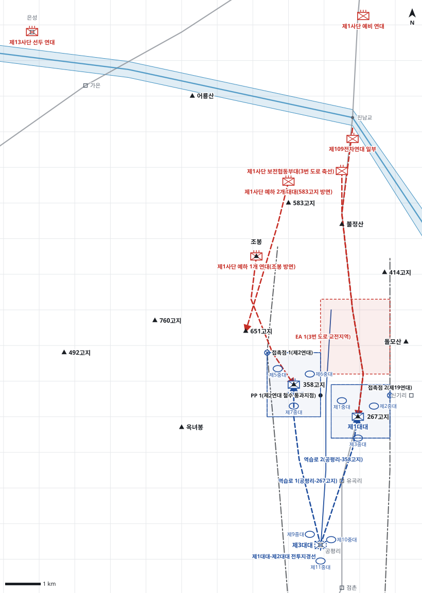

# kb2_043 · 유곡리 전투

| 관점 | 임무 유형 | 구간 | 실제 결과 | 좌표 | 보정용 | 사람 검토 |
|---|---|---|---|---|---|---|
| 제7연대 | 지역방어 | t=10~70 (60h) | partial | text | 아니오 | no |

**구간**: 유곡리 전투 ① 구간: 제6사단 단독 방어. 조봉 상실 뒤 제7연대가 함창에서 점촌 북방으로 들어가 358고지·267고지를 점령하고 3번 도로 축선을 저지한 때부터 유곡리 상실(7월 25일 밤)까지.

**출처**: 국방부 군사편찬연구소, 『6·25전쟁 주요전투 2』(2017), '유곡리 전투' (pdf 180쪽)

| 파일 | 내용 | 생성 모델에 |
|---|---|---|
| [`situation.json`](situation.json) | 상황 (익명화) | 줌 |
| [`coa.json`](coa.json) | pseudo-GT COA (익명화) | 예시로만 |
| [`scenario.json`](scenario.json) | 적 계획·환경 (시뮬레이터 전용) | 주지 않음 |
| [`history.json`](history.json) | 실제 경과 (평가 전용) | 주지 않음 |
| [`source.json`](source.json) | 출처·결과 라벨·자동 검사 | 주지 않음 |
| [`real_names/`](real_names) | 상황·COA 실명판 | 주지 않음 |

## 약도

## pseudo-GT COA (실명판)

**전투편성** 제1대대, 제2대대, 제3대대(예비) / 지원: 제16포병대대(사단 일반지원)
**1. 상황**
  **가. 지형** 267고지는 유곡리 북쪽에서 3번 도로를 직접 통제하는 핵심 지형이고, 358고지는 조봉-651고지 능선에서 내려오는 적과 제2연대 철수로를 내려다본다. 접근로는 진남교에서 3번 도로를 따라 내려오는 기계화 접근로와 조봉에서 651고지·358고지로 이어지는 능선 접근로 둘이다.
  **나. 적** 북한군 제1사단은 전차를 앞세운 보전협동부대로 진남교에서 3번 도로를 따라 267고지와 유곡리로 공격해 올 것이다. 1개 연대는 조봉에서 651고지·358고지 방면으로 제2연대를 추격해 올 것이고, 583고지 방면 2개 대대가 이를 뒤따를 것이다.
  **다. 가정**
    **(1)** 대대 세부 보충: 중대 배치, 교전지역, 역습로는 서술에 없어 지형에 맞게 보충했다.
    **(2)** 제2연대는 D일 오후 358고지와 267고지 사이를 지나 유곡리로 철수를 마친다.
    **(3)** 적 제13사단은 구간 초기 연대 정면에 도달하지 않는다.
    **(4)** 사단 포병은 3번 도로 축선에 화력을 우선 지원한다.
**2. 임무** 제7연대는 D일 14:00까지 358고지-267고지 일대를 점령하고 3번 도로 축선에서 북한군 제1사단의 남하를 저지하여 제2연대의 철수를 엄호하고 유곡리를 확보한다.
**3. 실시**
  **가. 최종상태** 연대가 358고지-267고지 선을 유지하고 제2연대가 유곡리로 철수를 마친다. 적 보전협동부대는 267고지 북쪽에서 저지되고 3번 도로는 아군 통제 아래 있다.
  **나. 작전개념** 연대는 2개 대대를 앞에, 1개 대대를 예비로 두고 3번 도로 축선을 막는다. 제1대대가 267고지에서 도로를 저지하는 주력이고, 제2대대는 358고지에서 제2연대의 철수를 엄호한다. 제3대대는 공평리에서 267고지와 358고지로 역습을 준비한다.
    **(1) 기동** 제1대대는 267고지를 점령해 3번 도로 양측에서 적 전차와 보병을 저지한다. 제2대대는 358고지를 점령해 조봉 방면에서 내려오는 적을 막고 제2연대를 통과시킨다. 제3대대는 공평리에 예비진지를 점령하고 267고지가 위협받으면 역습한다.
    **(2) 화력** 사단 제16포병대대 화력은 3번 도로상 교전지역에 우선 지원하고, 제2연대 철수 간 조봉 남쪽 능선의 추격 부대에 차단사격을 한다.
  **다. 예하부대 과업**
    **(1) 제1대대** 267고지를 점령한다. 3번 도로 교전지역에서 적 보전협동부대와 전차의 남하를 저지한다.
    **(2) 제2대대** 358고지를 점령한다. 조봉 방면 적을 막아 제2연대의 철수를 엄호한다.
    **(3) 제3대대** 공평리 일대 예비진지를 점령한다. 명에 의해 267고지로 역습한다. 명에 의해 358고지로 역습한다.
  **라. 협조지시**
    **(1) 시간계획** D일 10:00 명령 하달, 함창에서 출발한다. / D일 13:00 제3대대 공평리 예비진지 점령을 마친다. / D일 14:00 제1대대·제2대대 진지 점령을 마친다. / D일 18:00까지 제2연대의 통과지점 통과를 엄호한다.
    **(2) 통제수단** 제1대대-제2대대 전투지경선, EA 1(3번 도로 교전지역), 역습로 1(공평리-267고지), 역습로 2(공평리-358고지), 접촉점 1(제2연대), 접촉점 2(제19연대), BP 1(267고지), BP 2(358고지), PP 1(제2연대 철수 통과지점)
